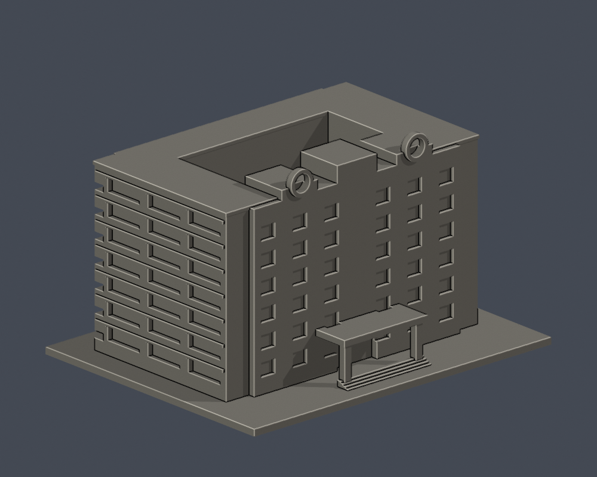
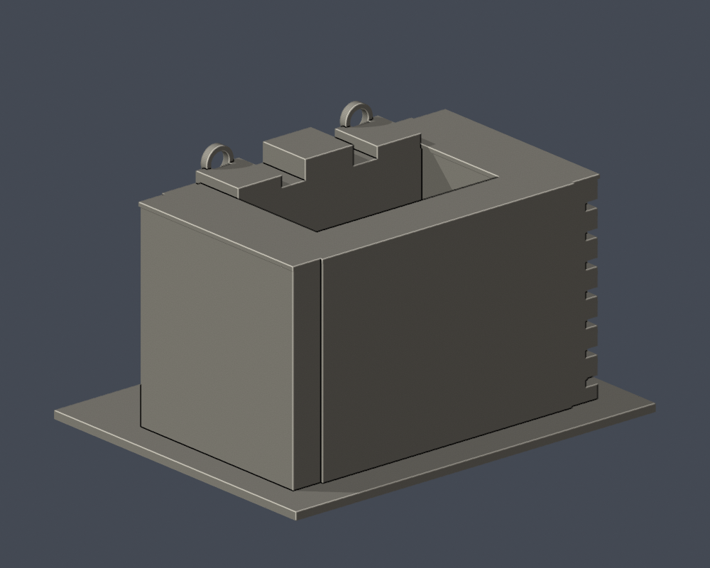

# 景文科技大學電資館（E）

## 模型預覽

| 模型預覽 | 模型預覽 | 模型預覽 |
| :---: | :---: | :---: |
| 正面  | 背面（證據不足處簡化）  |  |

公開外觀照片推估的建築微縮研究，非測繪級BIM，也不代表2026即時外觀。

## 外觀依據
- 七層側翼水平深陽台與入口挑簷
- 屋頂階梯狀構件及雙圓孔，側面狹窄窗帶
- 中庭依校圖表現為露天空間

官方電資館03為斜側實拍，已直接檢視側翼陽台及前方雨庇。屋頂圓形裝飾可辨，全正面排列輔以官方示意插畫，並非完整正面實拍。中庭形式源自校區示意圖，實際深度、後側、庭內牆與精確翼寬未知，均簡化。

## 比例及限制
- 含底板尺寸：150.00 × 119.00 × 89.60 mm。每件独立縮放，最長150 mm，並非統一比例校園拼圖。
- 未取得實測尺寸；整體深度、背側、被遮擋細節為估計或明示簡化，未見的背面不任意複製正面窗格。
- 門窗數量、曲率和間距是視覺近似。省略文字、旗幟、空調、植栽和細欄杆；細柱及窗框為列印加厚。
- 官方273頁所附PNG是示意插畫，不能當照片。本模型另有 sources.json 所列實拍，來源照片不隨包公開。

## 檔案及重建
安裝 requirements.txt，執行 Python build_model.py 產生 model.stl。以 Blender -b -t 2 -P render_preview.py 由實際STL生成 scene.blend 與預覽；scene.blend 保留一個可編輯完整網格。再執行 validate_model.py、check_layers.py、check_thin_features.py。Python生成程式保留所有形體參數。

## 檢查
- 原STL法向、封閉邊與頂點流形、正體積、一個連通外表面、無分離內腔殼、重建SHA及Blend/STL幾何一致：通過。
- 0.2 mm間距、非共面微偏移截面，共448層全部閉合。
- 0.8 mm XY形態開運算篩檢（1 mm間距抽樣），2層超過1%面積損失，最高2.28%。此值包含尖角、凸緣，非完整壁厚或切片器噴嘴路徑分析。
- 屋簷、雨庇、柱廊及開口頂緣可能需要支撐；依材料與方向在切片器中複查。未完成實體試印、完整切片或支撐可移除性驗證。
