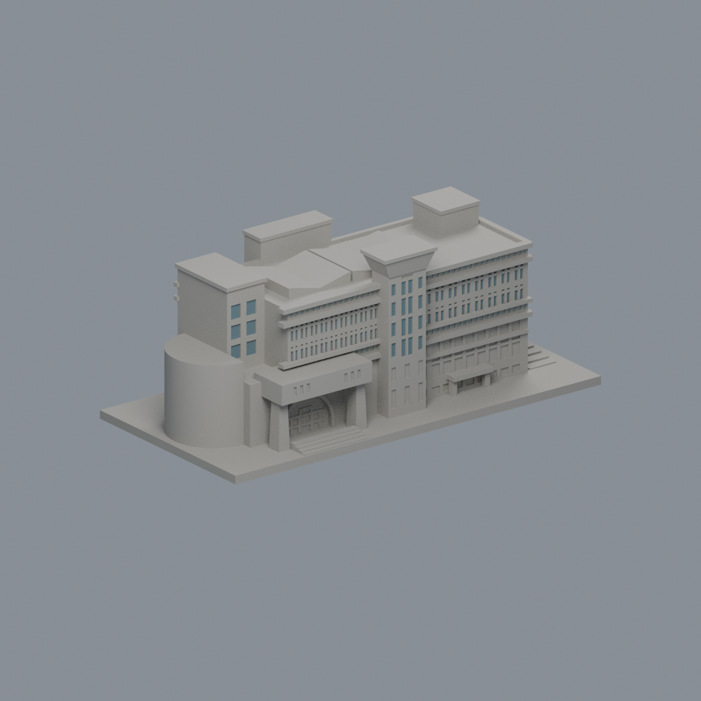
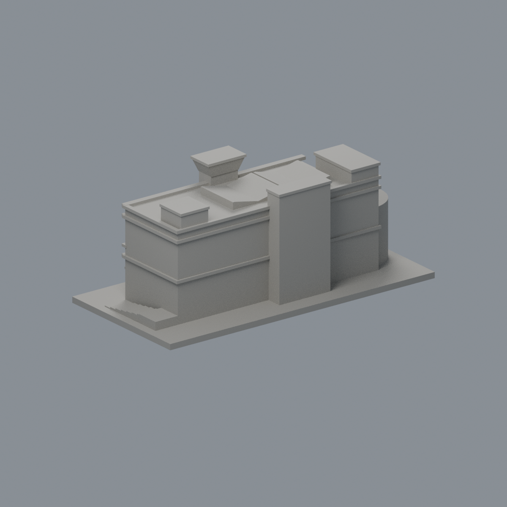

# 朝陽科技大學

本期僅一件波錠紀念圖書館外觀近似模型，非全校完成。既有v2模型已公開；本次新增有限原面彩色外觀層，原v1／v2歷史QA與限制照留。

| 波錠紀念圖書館：正面 | 同件模型：背面 |
|---|---|
|  |  |

[模型、來源及完整驗證](霧峰校本部/buildings/cyut-poding-library/README.md)。背側細節與屋突高度仍有證據界限；兩門廊柱56跨層角損樣本有具體尺寸/根接評估，不宣稱零警告或全域最小壁厚。 · [有限原面彩色外觀](霧峰校本部/buildings/cyut-poding-library/appearance/README.md)
