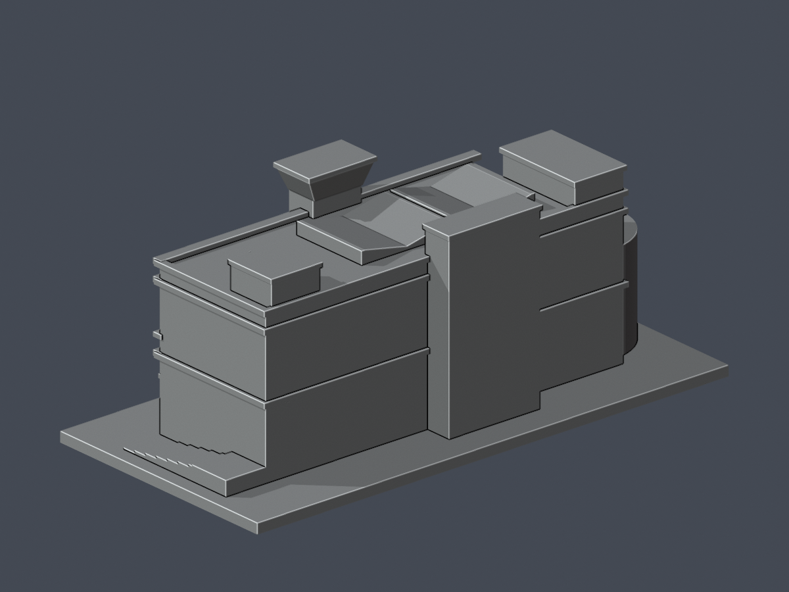

# 波錠紀念圖書館｜來源限定外觀近似模型 v2

朝陽科技大學・霧峰校本部。這是一件依官方樓層圖、不同年代外觀照片與航照交叉建構的可列印尺度外觀近似，**不是全館測繪、同年現況或全校完成**。背側窗序仍缺全貌，保留已知退台體量，不複製正面窗陣。

| 正面 | 背面 |
|---|---|
|  |  |

[俯視](previews/top.png) · [正立面](previews/elevation.png) · [背立面](previews/rear-elevation.png) · [南端側面](previews/west.png) · [北端側面](previews/east.png) · [STL](model.stl) · [可編輯Blender網格](scene.blend) · [參數來源](build_model.py)

## v2 修訂與局部角損警示

本件取代HOLD的v1（v1保持不變）。v1塔冠通風格錯置於外張冠內，留有0.373–0.660mm封閉前皮；v2將通風淺刻完整移至冠下直塔面，略縮最上排玻璃，冠本體厚實。原8個問題截面重新按實際三角面法向射線檢查，沒有該前皮。

另有**2根門廊方柱、56個跨層樣本**的opening角損超過1%，不是56根柱。最差損失3.495800054%，保留96.504199946%；全在矩形四角0.41mm鄰域內，實際X/Y寬至少約1.987951mm，向下連底座、向上連10.120482mm門廊頂。這是特定角損經尺寸與根接核對後接受，**不是零警告，也不放寬塔冠薄皮或其他構件門檻**。

詳[逐構件損失與位置](feature-loss-locations.json)、[v2柱角及根接重驗](column-corner-review.json)、[冠面法向與柱根](cap-column-root-check.json)、[v1兩柱獨立核對紀錄](v1-column-corners-independent.json)。最後一份只作既有兩柱證據，綁定v1 SHA；v2另以自含腳本對新STL重新執行，未冒稱舊紀錄直接證明新STL。

## 保存與簡化

- 保留南端半圓體、北端1F外接樓梯低台、上層南東退角及較高後塊、入口深檐與巨柱、拱門玻璃淺刻、中央貫通塔、兩座不同形狀/進深的後屋突、兩片閉合折形玻璃頂。
- 正面灰牆主面為兩排帶氣窗/中梃的窗，退角後塊為三排。紅牆為短／高／短三排；上、下長窗帶採連續淺凹＋密集背牆融合竪框，並與簷留實體間距。
- 屋頂玻璃以閉合實體折面呈現，沒有掏成露天天井。尖脊為列印篩檢留平頂；不重現玻璃透明、欄杆、空調設備及過細窗扇。
- 1F圖可辨北端外接樓梯，但外部平台標高不詳，因此只作低台寬踏步近似，不拉成上層塔。

## 比例、尺寸與列印

單位毫米；含底座最大尺寸 **150 × 74.096 × 60.014 mm**。底座朝下。主體長邊依航照可見上層約62.3m作尺度參考；量體高度約31m是照片比值推估，合理界限28–35m，並非校方標高。全樓足跡、屋頂投影與照片透視不得混作一個量測多邊形。

源碼座標不是交付毫米：XY乘150/166，Z另乘1.12。長窗帶竪框1.0源座標＝約0.904mm；凹刻深約0.226mm。玻璃折頂1.2源座標平頂＝約1.084mm。原STL射線量得上窗帶上下實體約0.911／0.810mm，中窗帶上下約0.860／0.860mm；詳驗證JSON而非僅信參數。

入口大簷、拱邊、塔冠及水平挑簷可能需支撐。細淺刻效果取決於噴嘴、層高、材料及方向。0.2mm數位截面與0.8mm形態篩檢**不是Cura/Prusa工具路徑、全方向最小壁厚或實體試印保證**。

## 證據與限制

[來源清單](sources.json) 僅列公開網址與用途，不附第三方原照片/PDF。2025防災照片、2016註記環景、2019年以前刊出照片、NLSC帶2024字樣航照並非同年實測；NLSC字樣不等於已證實攝影日。

校方公眾樓層用途有7F；2025調查列地上8F。一手論文記2022年使用八樓平台，兩種樓層口徑可並存，不能做成8片等高完整樓板。三屋突平面配對：B2中央前塔、B1北西小塊、B3西側長塊（B3對應中可信）；各自高度獨立估值，不宣稱真實高度排序已測得。後方局部照片只支持紅磚窗牆，不能建立整個高層背面窗序。

## 重建與驗證

Python依[requirements.txt](requirements.txt)；Blender 4.3.2。先執行build_model.py，再以Blender執行render_preview.py，最後執行run_all_checks.py。不使用repair吞掉不合法輸入。

- [原STL拓樸／獨立重建／Blend及PNG驗證](validation.json)
- [0.2mm逐層每原Polygon erosion/opening](layer-component-check.json)
- [canonical v3薄特徵](thin-feature-check.json)
- [逐層輪廓](layer-opening-check.json)
- [原STL細框根接與實體間距射線](open-space-check.json)
- [總驗證](qa-summary.json) · [渲染來源](render-manifest.json) · [逐檔SHA](SHA256SUMS)

原v2已發布；本次新增有限原面彩色外觀層。歷史凍結候選／審核記錄照留，數位全檢通過不代表外觀無不確定性。

## 原面有限彩色外觀層

[彩色3MF、可編輯Blend與五視角](appearance/README.md)：僅438個原上部／正面窗背三角面（316灰藍窗、122淺長窗帶），709.94116457 mm²；其餘6816面中性。紅灰牆、低窗、拱背、雙折屋頂與背面不染。原7254面／3621頂點與STL bytes不變，不是全棟實景精準復原。照片EXIF原攝自述2015無offset，IPTC +0000獨立保留，2019為後製。歷史兩柱56角損樣本、最大3.495800054%損失的有限接受及v1／v2報告界限全部保留，沒有新增列印保證。
