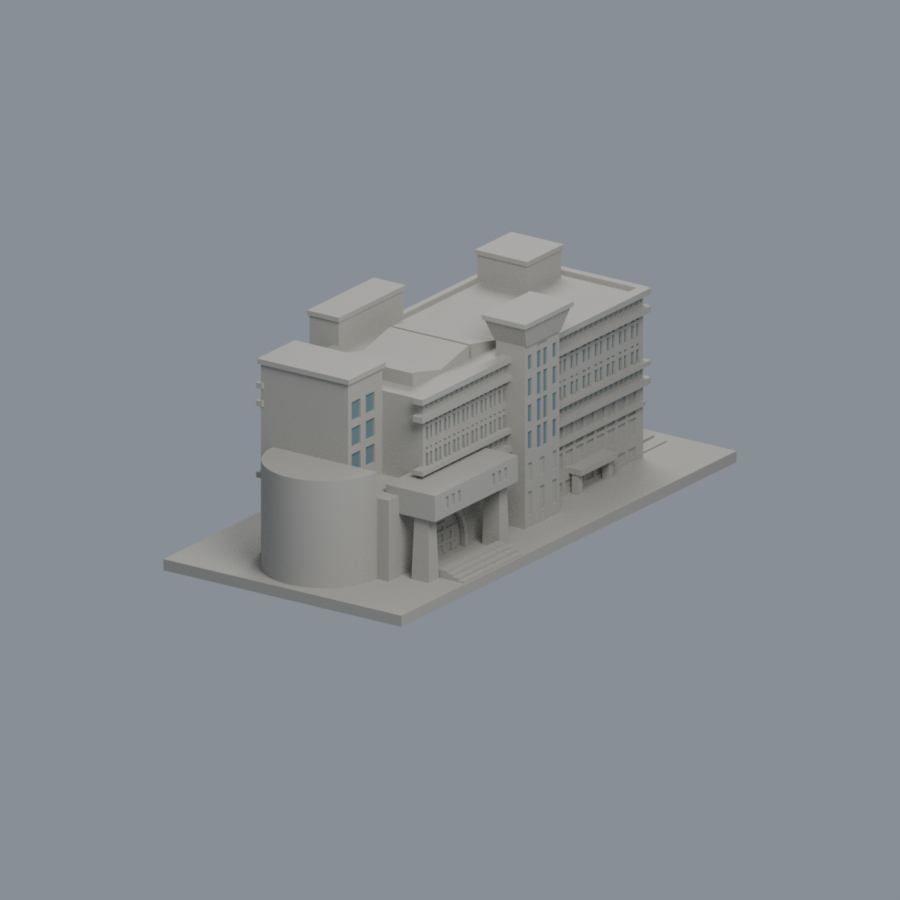
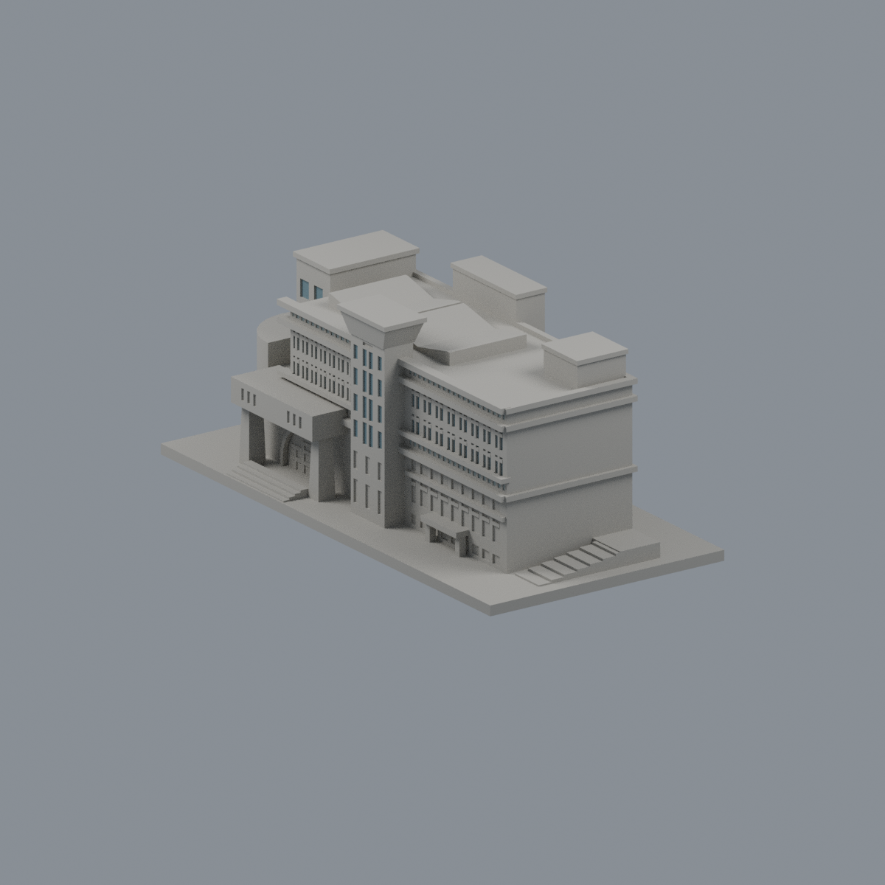
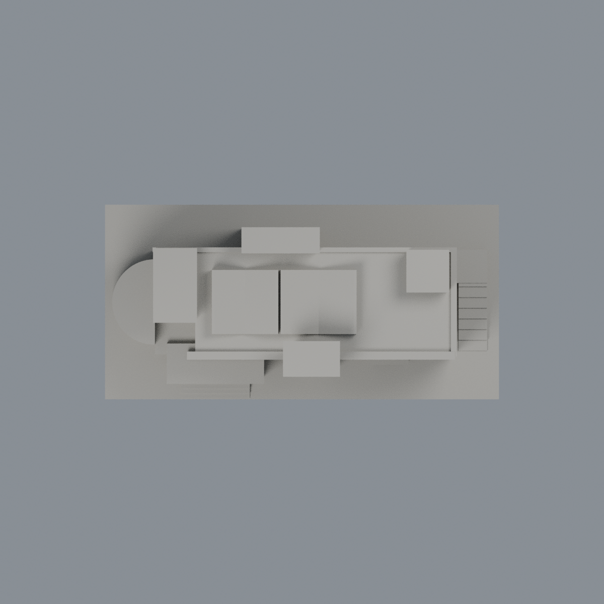

# 朝陽科技大學波錠紀念圖書館：原面有限彩色外觀層

本件是既有近似模型的有限外觀改善，不是全棟實景精準復原或新增建築。只將53組有限窗背範圍的438個完整原三角面分成316個低彩度灰藍窗代理面及122個較淺長窗帶代理面，合計709.9411645724322 mm²；其餘6816面保持中性。材質是不透明展示代理，未量測實景RGB、透明度或反射。

- [彩色3MF](cyut-poding-library-appearance.3mf)：單網格、每面原頂點可編輯、三個可獨立改色材質。
- [Blender原生可編輯檔](scene.blend)：保存全部原三角面；材質及頂點實際修改／保存／重開驗證。
- [正面](previews/front.png)・[左側](previews/left.png)・[右側](previews/right.png)・[背面](previews/rear.png)・[俯視](previews/top.png)
- [重建原始碼ZIP](rebuild-source.zip)；Python numpy、lib3mf 2.5.0，Blender 4.3.2。解壓後依序執行 source/build_appearance.py、verify_exchange.py，再以 Blender --background --python 執行 render_appearance.py、verify_scene.py。

| 模型預覽 | 模型預覽 | 模型預覽 |
| :---: | :---: | :---: |
| 正面  | 左側  | 右側  |
| 背面  | 俯視  |  |

## 範圍與未知
只涵蓋主立面上兩排窗、上／中長窗帶、塔上部實窗背及左後退高塊六窗。不擴染紅灰大牆、下方27窗組、低塔窗、拱背、門廊槽、百葉、雙折屋頂、框／橫檔／分格、背面、側牆、階梯和底座；沒有新增幾何、切面或以三角形硬湊材料邊界。原簡化窗分割節奏保持，不等於逐片實景窗格測繪。

## 幾何與歷史QA
原STL bytes完全不變，7254三角面／3621頂點，150×74.09638214×60.01445770 mm，保留原面順序與有向頂點。原37件完整另存於私有完整備份，包含歷史程式、QA、原預覽及原生檔，不以新報告取代。

原QA passed=true只表示文載特定例外有限接受，不是零警告。原兩根門廊柱有56個跨層角損樣本（不是56根柱）；原單元最大損失3.495800054001316%，保留96.504199946%，限於0.41 mm矩形角區，實際X/Y寬約至少1.987951 mm，柱根連底與頂棚10.120482 mm。全域300層／711原多邊形、0.2 mm層距、0.071 mm偏移、0.8 mm opening參考；全層最大損失0.09625698655%、零層超過1%，不能沖銷個別柱的3.4958%。歷史v1薄冠皮0.373–0.660 mm曾被拒；v2將通風口移到冠下並保留厚冠，檢核8個問題截面。v1雙柱報告只屬歷史，不能直接當v2證明；v2 cap-column及column-corner原報告完整保留。本次沒有重跑製造測試，不新增切片、全方向最小厚度、自交窮盡或實印保證。

原約31 m高度（28–35 m界限）、未知背窗序列、混合來源年代與幾何近似仍存在；本次不解決這些問題。

## 來源與日期
見 [來源說明](SOURCES.md) 及 [權利界限](LICENSE-NOTICE.md)。圖像僅私下觀察，不含照片貼圖或可辨識像素；不可由有限配色推論2026現況。
