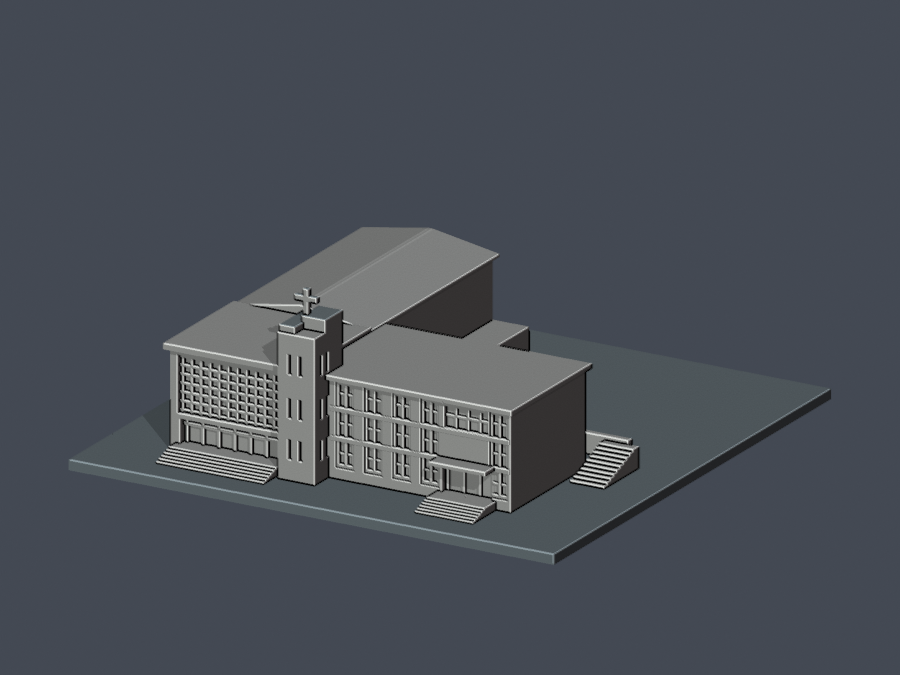
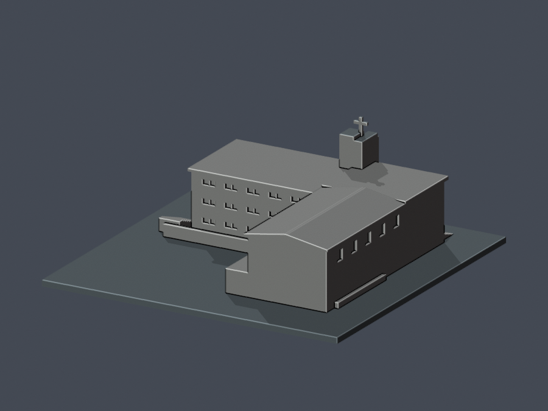
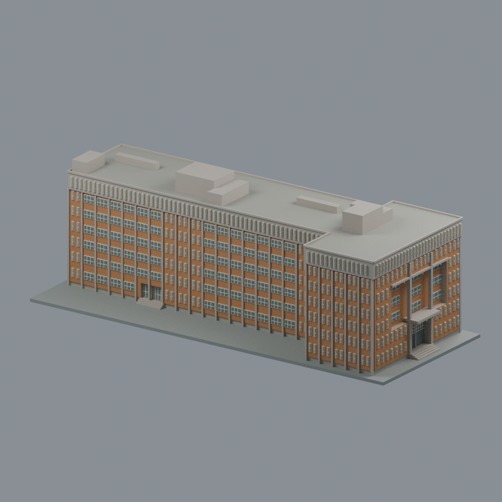

# 東吳大學

現行主圖鑑共 **3 套**：安素堂暨愛徒樓連體模型、白色大拱校門、城中鑄秋大樓；不是全校／全校區完成，均須詳閱各件範圍與列印限制。

[安素堂暨愛徒樓，一組連體](外雙溪校區/buildings/scu-chapel-aitu/README.md)

| 建築模型 | 建築模型 | 建築模型 |
| :---: | :---: | :---: |
| 正面 actual STL  背面 actual STL  |  **[東吳大學外雙溪白色大拱校門｜公開照片外觀近似](外雙溪校區/buildings/scu-waishuanghsi-main-gate/README.md)** |  **[鑄秋大樓（第二大樓）](城中校區/buildings/scu-chuqiu-hall/README.md)** |

**安素堂暨愛徒樓既有範圍：**150mm原創有界近似。堂前灰平頂／後紅淺雙坡與低附翼分開；愛徒三層、4窄跨→寬入口跨→外端雙窗依來源，末端被裁與背窗總數未知。高度非測量，2013坡牆不等2024復原，僅低擋牆及通道抽象。36高損樣本全為十架，原面局部1.5mm與根證據齊，待獨立及特定例外接受；未試印、局部射線非全域壁厚、不可任意縮小，支撐另判。來源、重現及完整SHA見建物頁。

## 城中校區新增模型

鑄秋大樓（第二大樓）完整七層T形主要外觀近似：四個不同立面、東端3–5F真退凹與6F外包窄窗帶、西端不對稱磚灣與底門、三組不同屋頂梯間／機房及兩低長水箱；不含鄰棟鐘樓。依博物館竣工圖與作者完成照交叉核對：1979為圖面設計日期，1981竣工為作者說明，2025-01-14照片日期為作者自述；三者不混用，非2026現況測繪。256.605×102×86.55mm，6材質可編輯Blend／3MF與不含材質的STL及5張真mesh預覽；93,326三角單閉殼、433有效切層、51空實點與11局部截面、strict材質及Blend真頂點存讀、乾淨九檔bytes一致。細窗框與簷／入口懸挑仍須切片及支撐評估，未實印；非全校完成。模型供公開展示及下載；來源與使用範圍詳見模型LICENSE.txt，未指定全包通用CC，也不轉授第三方權利；原始圖紙／照片不隨包公開。

[城中校區圖鑑](城中校區/README.md) · [來源與版本](城中校區/buildings/scu-chuqiu-hall/SOURCES.md) · [QA與列印限制](城中校區/buildings/scu-chuqiu-hall/QA.md) · [授權及使用範圍](城中校區/buildings/scu-chuqiu-hall/LICENSE.txt)。原外雙溪兩套幾何、來源與QA均未修改。
