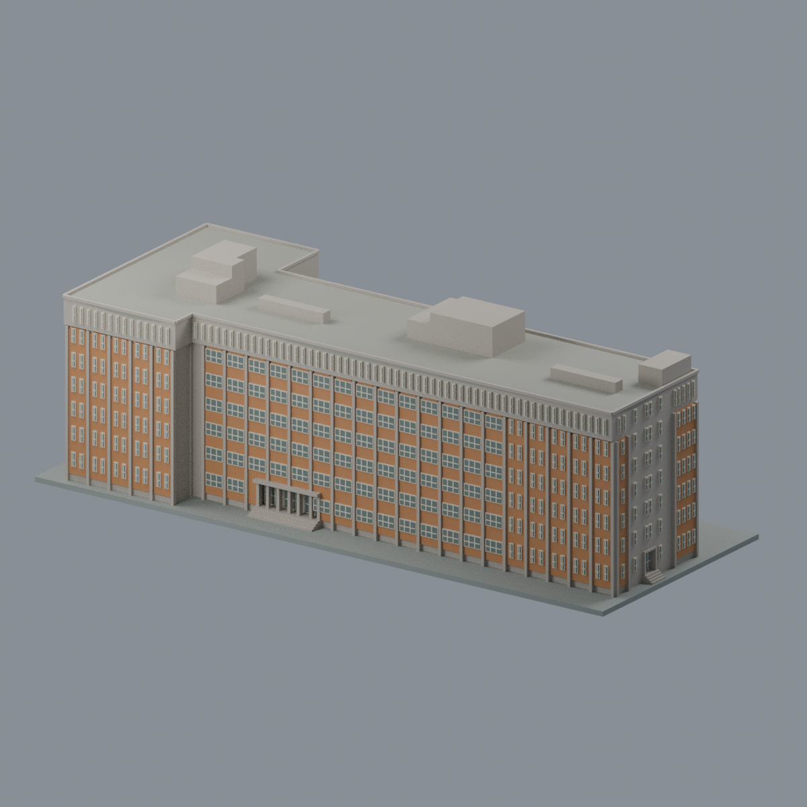
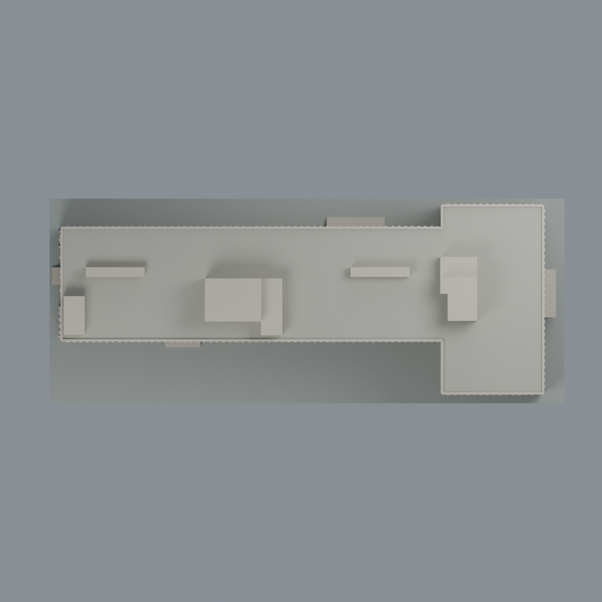

# 東吳大學・城中校區鑄秋大樓（第二大樓）

[城中校區圖鑑](../../README.md) · [東吳大學圖鑑](../../../README.md) · [全部模型](../../../../README.md)

**來源與使用範圍見包內 `LICENSE.txt`；來源素材的授權不自動等同本模型的通用授權，本包未另指定全包通用CC授權。**

彩色完整建築外觀近似模型：七層 T 形主體、四面不同窗列、平屋頂、三組不同梯間／機房屋突、兩座低長水箱，以及直接附屬入口雨庇、柱與階梯。**不含旁邊第六大樓鐘塔，也不是外雙溪校區建築。**

## 版本及證據邊界
國立臺灣博物館所藏王大閎／大洪建築師事務所「東吳大學城區部行政資料處理中心新建工程」六張竣工圖，供 B1–7F、RF、兩剖面及四立面；照片以 Taiwan Drama Location 作者記載 2025-01-14 拍攝、2025-02-19 發表的東短端與南長面交叉檢查。北、西及屋頂依檔案版，**不是 2026 現況測繪，也沒有航拍或四向現況照片**。圖面 68.4.30 為1979設計日期，1981竣工為作者文章記載，並非本模型另證工程日期。

## 檔案
- `scene.blend`：可編輯真網格、逐面材質、燈光與五視角渲染設定。
- `model.3mf`：毫米單位、六種逐三角面材料。
- `model.stl`：同表面單色交換網格；STL 本身不保存顏色。
- `mesh.json` / `palette.json`：精確交換頂點、三角面與材質對照。
- `previews/`：五張從實際交換網格渲染的圖片，不是生成概念圖。
- `build_model.py` / `render_model.py` / `rebuild.py`：生成與乾淨目錄重建。
- `qa/`、`QA.md`、`SOURCES.md`、`SHA256SUMS`：獨立檢測、限制、來源與校驗。

## 尺寸與簡化
設計米數按每米3毫米縮放，近似1:333.3。長向標示尺寸鏈 6363.5 cm 與東翼1590 cm，主幹深1760 cm、端翼深3030 cm；不按掃描像素DPI推算紙上比例。7F小幅外包，不誤作大退台；圖面屋上三角線是避雷保護線，不作斜屋頂。屋頂機房依各自圖形，非三個鏡像盒；水箱保留低長體量。細窗框印刷加粗，顏色是混凝土／赭磚／低飽和窗的近似展示色，非精確修復採樣。

封閉室內採外觀實心化，沒有臆造室內房間；B1不升成第八層，僅表達地面上基座。底座是展示用，不是測繪地形。省略細避雷針、小型冷卻設備、機電管線、校徽文字、樹木及鄰建。

**不可僅據閉合網格就直接列印。** 雨庇、入口門楣及局部突出需切片支撐判斷，最細窗格低於常見FDM單線寬；應依設備加大或調整。沒有實體列印、材料強度、現況尺寸或免支撐保證。實際檢測狀態見 QA.md。

## 本地重建
Python 3.12，numpy、trimesh、manifold3d、shapely、scipy、rtree、lib3mf；Blender 4.3.2。先執行 `python build_model.py`，再 `blender -b -t 4 --python-exit-code 1 --python render_model.py`。`python rebuild.py --output /new/empty/path` 比對四核心交換檔及五PNG實際bytes；`run_all_checks.py` 執行技術檢測。補充東入口近視可由 `blender -b -t 4 --python-exit-code 1 --python render_detail.py` 生成，保持同一mesh，不切除或隱藏物件。來源照片及原圖不隨包分發。

## 驗證歷史與本次使用範圍
原始v12技術獨審保持原SHA；其當時私人候選包的 `LICENSE_PENDING` 及待核文書只屬歷史，不是本次使用範圍仍待核的宣稱。八份舊文書原bytes保存在 `qa/history/private-v12/`，由 `qa/historical-binding-map.json` 逐項對照；不以舊文書hash冒稱綁定現在的來源與使用範圍說明。

## 實際模型預覽與下載

| 正面 | 背面 | 頂視 |
| :---: | :---: | :---: |
|  |  |  |

[可編輯 Blend](scene.blend) · [彩色 3MF](model.3mf) · [單色 STL](model.stl) · [來源與使用範圍](LICENSE.txt)

本次依使用者澄清移除模型額外的「非商業研究」標示，保留實際來源、作者及來源自身的授權資訊，不另授第三方權利。先前文書與審核維持原bytes作歷史，並非現行模型用途標示；上一候選文書保存在 `qa/history/pre-user-clarification/`，由 `qa/publication-revision-map.json` 精確對照。現行文字以本README、SOURCES及LICENSE為準。
