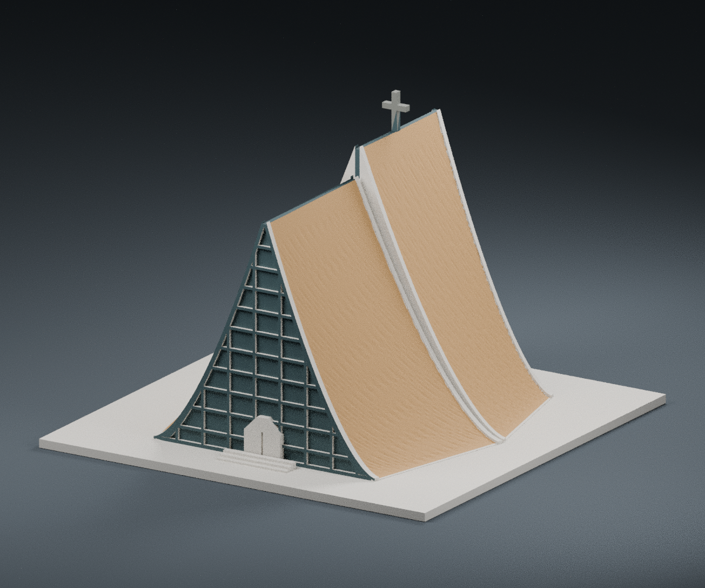
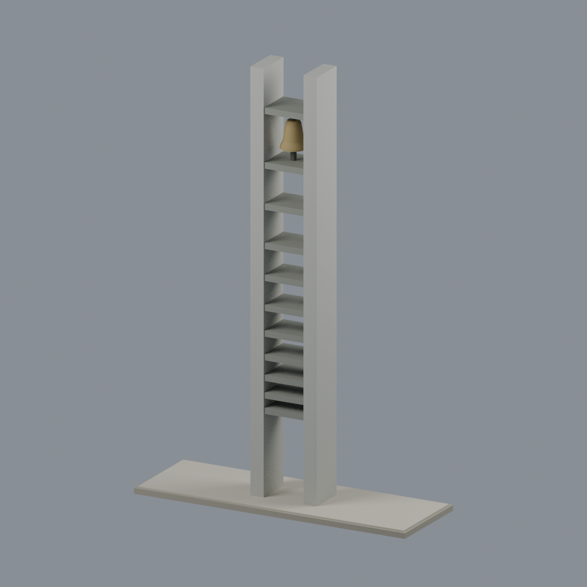

# 東海大學｜校園建築外觀模型

現行校級主圖鑑共 **5 套**：本校新增目錄 **4 套**，另含地標分類既有路思義教堂 **1 套**；教堂不重複計入新增目錄或全庫件數。模型套件不等於整棟建築，亦非全校完成。

既有原藝術中心歷史外觀研究模型：不是現況測繪，也不代表全校建物已完成。尺寸、殼頂形式與部分細節的史料推定限制詳見模型說明。

| 建物 | 建物 | 建物 |
| :---: | :---: | :---: |
|  **[原藝術中心（1962–1964 年史料外觀研究版本）](校本部/buildings/thu-original-arts-center-1964/README.md)** 依歷史圖面與照片建立的原藝術中心外觀研究近似；非現況測繪，推定尺寸與殼頂細節逐件揭露 |  |  |

| 建築模型 | 建築模型 | 建築模型 |
| :---: | :---: | :---: |
|  **[東海大學綠之心・曲面遮陽翼片立面片段](校本部/buildings/thu-green-heart-curved-fin-facade-segment/README.md)** |  **[東海大學 畢律斯鐘樓](校本部/buildings/thu-priest-bell-tower/README.md)** |  **[路思義教堂｜150 mm FDM 外觀模型](../臺灣地標/luce-chapel/README.md)** |

| 建築模型 | 建築模型 | 建築模型 |
| :---: | :---: | :---: |
|  **[東海大學 文理大道校友鐘樓](校本部/buildings/thu-alumni-bell-tower/README.md)** |  |  |

本件已通過[指定版本獨立限定條件數位覆核](inventory/qa/thu-original-arts-center-1964-v1.1-review.md)。保留 98 個柱頭過渡截面超過 1% 面積損失的嚴格失敗，以及原始精確邊界判定；只對具體根部與數值包絡作限定覆核，不代表全部檢查無失敗或全域壁厚證明。數位檢查不等於實際切片或實體試印，仍須依設備、材料與列印方向檢查支撐。

[路思義教堂既有地標模型](../臺灣地標/luce-chapel/)另存於地標分類，未重複計入本次新增包。

[校本部模型目錄](校本部/README.md)
