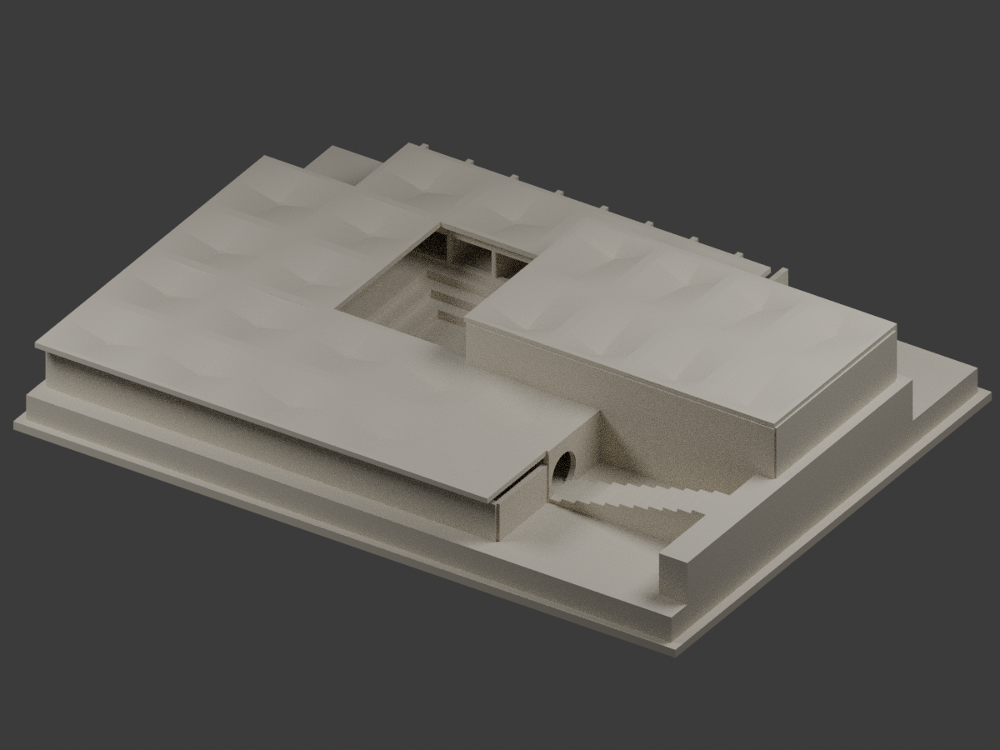
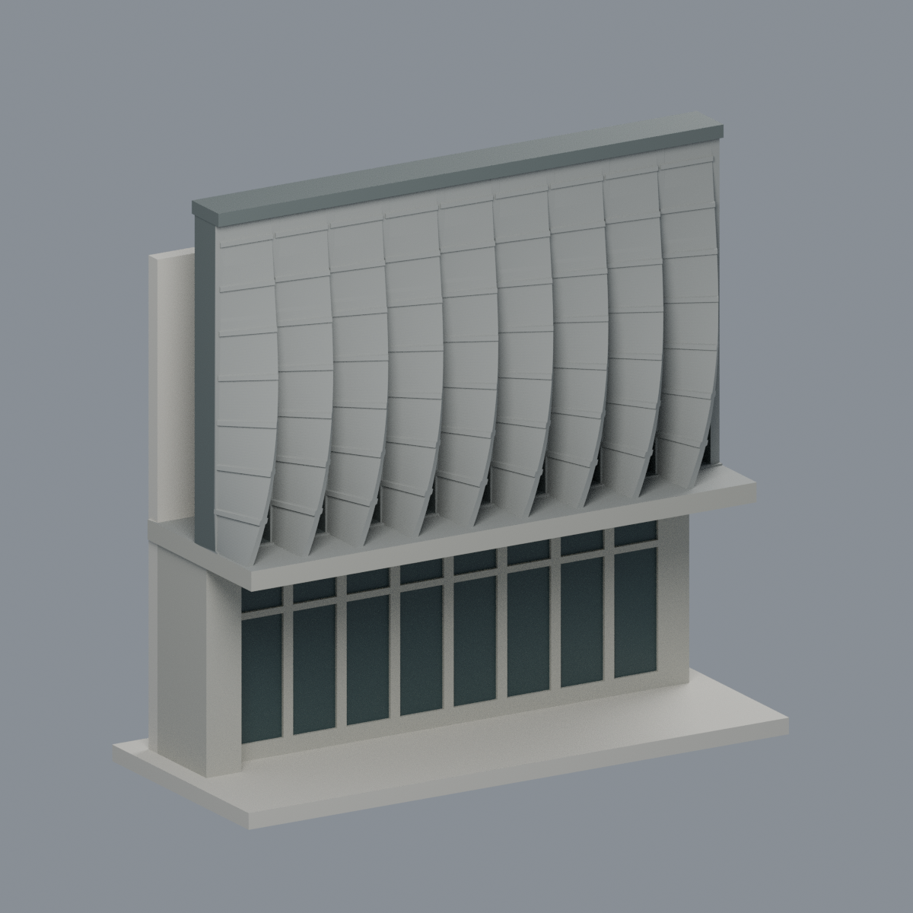
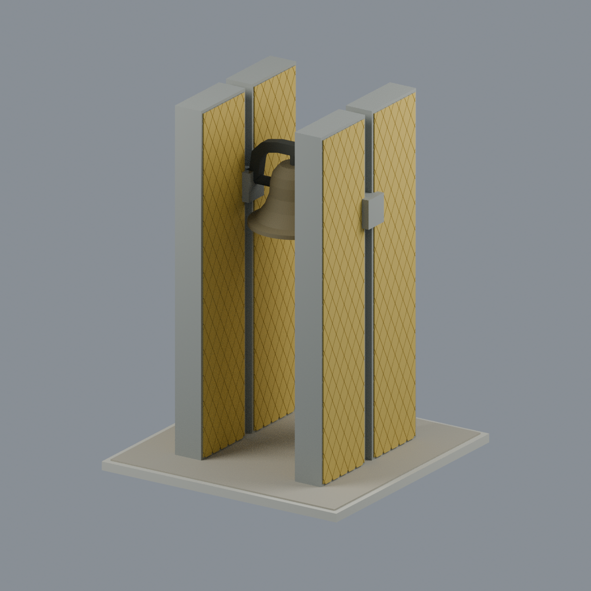

# 東海大學｜校本部

本校區新增目錄 **3 套**；既有路思義教堂另由學校主圖鑑連結地標分類，不重複計入此數。套件不等於整棟建築，亦非全校完成。

既有原藝術中心歷史外觀研究模型：不是現況測繪，也不代表全校建物已完成。尺寸、殼頂形式與部分細節的史料推定限制詳見模型說明。

| 建物 | 建物 | 建物 |
| :---: | :---: | :---: |
|  **[原藝術中心（1962–1964 年史料外觀研究版本）](buildings/thu-original-arts-center-1964/README.md)** 依歷史圖面與照片建立的原藝術中心外觀研究近似；非現況測繪，推定尺寸與殼頂細節逐件揭露 |  |  |

| 建築模型 | 建築模型 | 建築模型 |
| :---: | :---: | :---: |
|  **[東海大學綠之心・曲面遮陽翼片立面片段](buildings/thu-green-heart-curved-fin-facade-segment/README.md)** |  **[東海大學 畢律斯鐘樓](buildings/thu-priest-bell-tower/README.md)** |  |

[指定版本限定條件獨立覆核](../inventory/qa/thu-original-arts-center-1964-v1.1-review.md)；保留 98 個柱頭過渡截面超限等原始診斷，未正式切片或實體試印。

[回學校圖鑑](../README.md)
