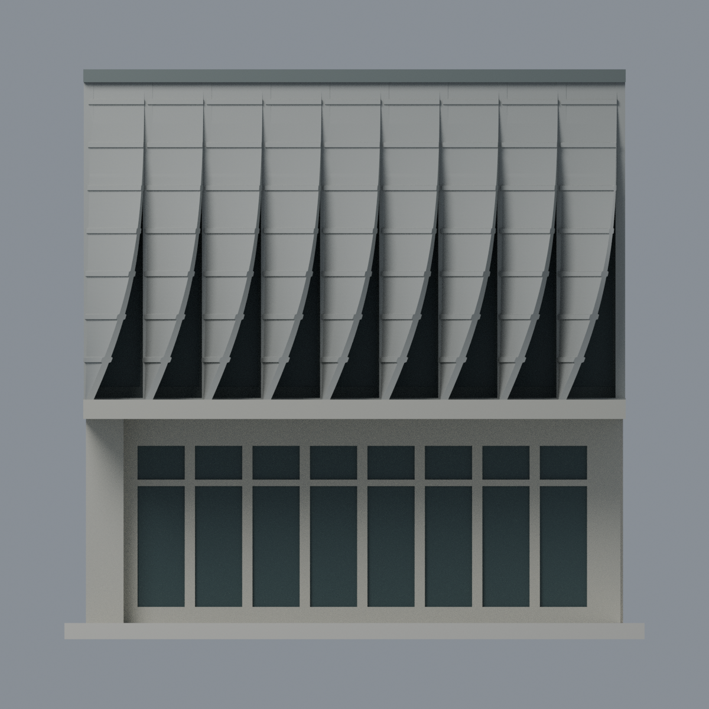

# 東海大學綠之心・曲面遮陽翼片立面片段

## 模型預覽

| 模型預覽 | 模型預覽 | 模型預覽 |
| :---: | :---: | :---: |
|  |  |  |

東海大學・校本部。依 **2016 年 10 月建築師雜誌所刊建築師提供照片**建立的九跨局部立面模型，表現上層向外翻出的曲面翼片、水平肋、懸挑板底與下層退縮入口。校方 2017 年活動頁確認「綠之心－乳品小棧」名稱。**不是完整建築、測繪復原或 2026 現況模型；與舊藝術中心及路思義教堂不同。**

## 檔案
- [model.3mf](model.3mf)：五種可分別改色的顯示材質；不是印表機分料設定。
- [scene.blend](scene.blend)：交付三角網格、材質、五視角及燈光，可編修。
- [model.stl](model.stl)：無色單一連通封閉表面。
- [build_model.py](build_model.py)、[palette.json](palette.json)：參數與材質。
- [SOURCES.md](SOURCES.md)、[QA.md](QA.md)、[qa/source-registration.json](qa/source-registration.json)：來源對照、九跨邊界與驗證。

## 截取範圍與相對比例
含展示底座 **108 × 46 × 106.1 顯示 mm**，無已知實際比例尺。a1 日景圖（975 × 691 px）長翼片面左端起算，第 8 至第 16 跨，共九跨；上沿十條邊界約為 x=323、349、375、399、423、445、467、487、507、526。這是明示選取的中央片段，**不是整面只有九片**。完整像素座標及誤差載於登記檔。

模型片距 11、曲面高 60，比例約 1:5.45；將透視照片近似等跨。翼片上緣近立面、下緣向外轉出，採連續曲面擬合，不是把平直板塗暗來假裝間隙。翼片前方與片間保留實際空氣，後方玻璃另有退縮；窗玻璃以實際淺凹槽底面表示。

## 刻意簡化與未知
- **後方淺色平板、側邊平截與底座是中性展示截斷，不是原建築後立面或屋頂。** 未推測全棟平面、背立面、雙翼連接、斜屋頂或室內。
- 真實曲率、構件厚度、門窗格數及精確尺寸未知；曲面方程只是照片外觀擬合。下層門窗分格、七道加強橫肋為簡化視覺節奏，並非施工圖計數。
- 翼片原有細微穿孔因微縮省略，改為厚 1.3 mm 的實體薄片，橫肋增厚至 2.05 mm、根柱寬 1.8 mm，均屬製作加厚。不得用此模型推論透光、通風或真實結構性能。
- 材料採日景灰金屬、淡混凝土與深色玻璃；夜景黃色只用於看曲面，沒有當作材料顏色。未製作路燈、植栽、坡道與整體場地。
- 五張圖由交付網格渲染；光滑法線改善顯示，未添加隱藏幾何或照片貼圖。原始照片不隨包重散布。

## 製作與重建
幾何／切片檢查不等於可免支撐列印。懸挑板底、曲片、肋條及上緣須由切片軟體另評估支撐、方向或拆件；未生成 FFF 路徑，未實印。

Python 安裝 requirements.txt，執行 `python build_model.py`、`python qa_model.py --out .`、`python check_features.py`、`python verify_exchange.py`；若 lib3mf 與建模套件在不同環境，可設 `BUILD_PYTHON` 指向建模 Python。Blender 執行 `blender -b -P render_model.py` 與 `blender -b -P verify_scene.py`。lib3mf 需原生庫。
