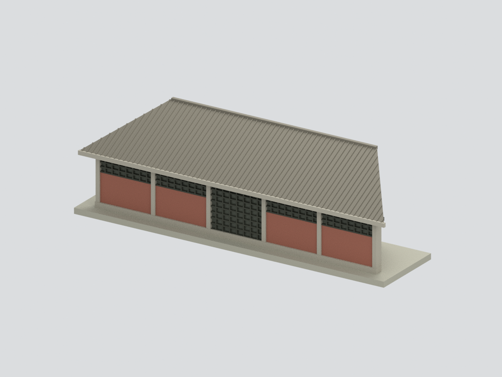
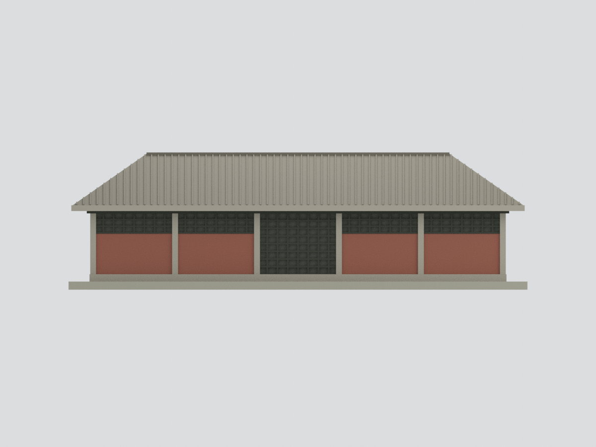
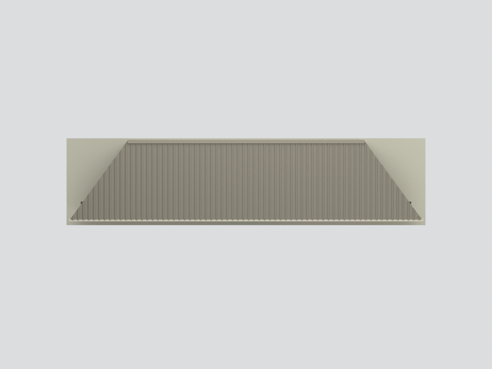

# 東海大學銘賢堂｜廣場側長立面與前屋坡截段

依臺中市文化資產處公開圖照建立的五跨長立面研究模型，**不是完整銘賢堂**。包含中央格柵門、兩側各二跨紅磚高窗、六道灰色結構直線、簷口、向較短屋脊收窄的前屋坡與簡化台基。來源照片拍攝日期未標示，不聲稱為2026年現況。

## 實際網格預覽
| 主視角 | 正立面 | 俯視 |
|---|---|---|
|  |  |  |

[人工背截面](previews/rear.png) · [左端](previews/left_end.png) · [格柵局部](previews/entry_detail.png)

## 模型與來源界線
- 實尺寸未知；名義單位經5.5 mm縮放，僅為照片比例近似，不能換算實物尺度。
- 五跨、中央長門、兩側高窗、屋脊短於簷線可在官方正面照片辨認；各跨作近等寬，是透視歸一化假設而非測量。
- 屋脊/簷線寬比採約0.67的照片判讀近似，坡度與深度未經測繪。
- 窗格數、瓦列數/截面均粗化，非逐件複製。66條細瓦肋只表達屋坡方向，不代表真實瓦數；不加入不可讀銘文。
- **後面灰色平面是人工截面支承，不是真實後立面。只做前坡，不做另一坡、完整山牆、室內或全棟屋頂。** 端部切界不是原建築洞口。
- 不把館刊歷史照片的圓窗山牆混入此版本；不移植不同年代門窗配置。
- 台基厚度、截面與最細網格經小尺寸實體化，屬製作調整。未試印、未切片，瓦肋及高窗細節需依設備評估。
- 參考照片僅供私下比對，不含於公開包。

## 數位實體

138.60 × 33.55 × 41.47 mm；4272 個三角面，單一封閉連通網格。所有整體視圖完整留白，局部圖只看中門。

## 檔案
[STL](model.stl) · [彩色3MF](model.3mf) · [Blender](scene.blend) · [來源與限制](SOURCES.md) · [重建](REBUILD.md) · [數位QA](QA.md)

Blender可見物件與STL/3MF相同網格；隱藏集合保存製作前部件（含重疊），不是另一套可直接列印實體。
