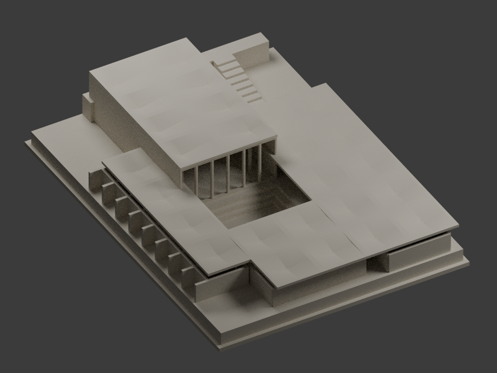
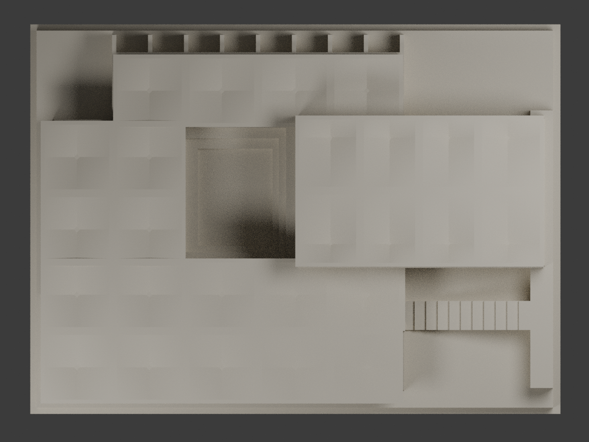

# 東海大學原藝術中心（1962–1964 年史料外觀研究版本）

## 模型預覽

| 模型預覽 | 模型預覽 | 模型預覽 |
| :---: | :---: | :---: |
| 入口側：會堂、外階梯與月洞門<br> | 庭院側：下沉庭院與練習室外伸隔牆<br> |  |

依1962年圖面、剖面重刊及1964年照片獨立建立的四翼圍合建築外觀研究模型。保留較高的會堂、低矮三翼、下沉庭院與三級階梯、外部入口階梯及一座月洞門。這不是現況修復版、測量模型或結構工程資料。

## 實際模型視圖

以下是交付STL網格的實際渲染，不是概念示意；入口與庭院兩側並列。史料照片不包含在公開套件內。


[俯視圖](output/preview-plan.png) · [列印STL](output/model.stl) · [Blender場景](output/model.blend)

| 模型預覽 | 模型預覽 | 模型預覽 |
| :---: | :---: | :---: |
| 俯視圖<br> |  |  |

## 模型與列印

- 完整組合含底座：148.480 × 109.040 × 28.728 mm，最大邊小於150 mm。
- STL採毫米；單一連通、封閉實體外殼。Blender檔含實際STL網格、材質、燈光與相機。
- 屋頂為每傘四片雙曲拋物面式雙線性曲面，不是四個平面三角形。會堂8傘的低點位於圖示偏心柱頭，沒有將柱距直接向兩端延伸。
- 26傘為工作重建數量：會堂8傘有明確文字依據，教室4、練習室4、畫廊及門廳10依圖面柱位推定，照片無法獨立辨明所有低屋頂。
- 為小比例列印，加厚牆體1.20 mm、方柱1.45 mm（柱角圓弧半徑0.42 mm）、屋頂垂直厚度1.15 mm；屋頂高邊另有1.10 mm寬的平頂帶。原始殼厚未知，這些是製作調整。柱頭頂端約高於曲面低點0.20 mm，也是本模型的製作幾何。練習室與會堂之間另有局部屋頂下方連接補強；窗框採圓角矩形並與端牆完整接合。
- 參數以名義約1:271比例換算，但平面總尺度約有±10%不確定性。不可用於測量。
- 底座朝下放置。挑檐、月洞門及大片屋頂下方可能需要支撐；尚未實際試印。數位檢查不保證任何列印機、材料或支撐設定必定成功。

## 數位驗證範圍與保留的失敗診斷

本包已完成獨立技術複核，限定條件下的幾何、根部與重現檢查通過。嚴格形態檢查仍保留 98 個逐例驗證的失敗 Polygon；未進行實體試印。詳見[獨立複核摘要](../../../inventory/qa/thu-original-arts-center-1964-v1.1-review.md)（模型倉庫內連結）與 `AUDIT-STATUS.json`。作者限定報告原有旗標保持不變，獨立結論另行記錄。所有證據綁定同一 STL：

`0ff3e1a65202e528f2328a9372a058a0d1c79639c7ace4aa93fcd55e5ef4cea2`

- **原始網格：** 85,464 面、42,630 個完全相同座標的索引頂點；單一封閉連通外殼，正體積 145,097.128 mm³。沒有零面積、重複面、錯向邊、非二鄰接邊、非流形頂點鏈或原始儲存法向錯誤。驗證時不修補網格。
- **切片：** 兩組未四捨五入的 0.2 mm 網格，共 288 層、4,287 個原始正面積 Polygon；輪廓全部有效，每個 Polygon 的 0.4 mm 內縮及再外擴均保留一個成分，沒有分裂或消失。
- **嚴格開啟運算仍為 false：** 98 個柱頭過渡區 Polygon 超過 1% 面積損失門檻，最高 4.956%。qa.py 會如實退出 1。全部原始、內縮、開啟及損失幾何保留，不以整層平均掩蓋，也沒有全屋頂或全轉角豁免。
- **原始法向厚度：** 每個原始面採 10 個指定重心座標，共 854,640 條射線；最短第一實體區間 0.948584 mm，沒有短區間、未分類交點、空氣判定或共面重疊失敗。最短 30 條另有 150 點全網格實體／空氣檢查。這是有限密集採樣，不是所有點的全域最小厚度定理。
- **實際根部與例外區域：** 26 個柱殼接點、130 條連續材料路徑的最小證明直徑 0.918652 mm，另由原始三角面長雙精度距離計算覆核。98 個切片圓盤在實際高度上完整連入此實體；全部 2,006 個損失片逐一保留並證明其來源、完整徑向覆蓋與根部連接。
- **數值診斷不被抹除：** 395 個精確邊界重疊及 1,326 個精確 covers 判定仍為 false。1,254 個布林再交集微小突出片全部保存，對個別原始線段的完整距離界限含保護量最高 1.00513×10⁻⁹ mm；僅這些已測片使用明示的 10⁻⁸ mm 數值包絡，並不改變原始輪廓、薄部件門檻或嚴格失敗旗標。98 個損失區 WKB 均與原始 Polygon 減開啟結果逐位元組相同。
- **重現：** 獨立建構的 STL 位元組完全相同；獨立渲染的三張影像像素完全相同；兩份 Blender 場景的有向三角面均與 STL 相同。PNG 的中繼資料與 Blend 檔序列化位元組不作相同承諾。

限定證據與每項拒絕控制見 [作者驗證摘要](output/qa-author-qualified.json)、[根部方法](root_README.md) 及 [密集射線方法](dense_README.md)。嚴格失敗與作者限定結果是不同欄位，不可混稱「所有檢查皆無失敗」。尚未實際試印。

## 史料解讀及不確定性

1. 屋頂外緣沒有完整屋頂CAD。會堂x360–600、y102–248為原圖像素框架下的推定；剖面對齊支持較寬的屋頂覆蓋舞台及後方控制室。低翼對稱屋頂外緣也屬推定。
2. 練習室後方圖示分隔牆延伸至y24，薄封閉線約y42。本模型將其解讀為屋頂以外的外伸隔牆；照片不能確認挑檐是否覆蓋全部外伸部分。
3. 月洞門僅有一座。圖23連續三景及圖22、26的反向照片為同一入口。中心及直徑根據入口牆與階梯對齊作外觀解讀，並非實測尺寸。
4. 平面及剖面標尺各自換算，不共用像素尺度；屋頂高度約有±0.2–0.4 m以上的不確定性，場地標高的不確定性更高。
5. 玻璃以開口、窗框及低牆表達；窗框數量、室內隔間簡化、階梯分級、庭院局部尺寸與場地邊界均為小比例外觀解讀。未建樹木、家具、精細磚紋及後增建築。
6. 圖面右側為地理西側，下側為北側。不可把圖面上方當作北方。

## 重建與檔案配置

已測環境：Python 3.12.14、requirements.txt 固定版本、Blender 4.3.2、GCC 14.2／C++17 與 OpenMP，Linux x86-64。先複製到可寫入目錄，再執行：

```sh
python -m venv .venv
.venv/bin/pip install -r requirements.txt
.venv/bin/python reproduce.py --blender blender
```

完整流程會重建 STL、重新執行全部幾何及拒絕控制、渲染兩次並比較。嚴格切片與舊精確邊界重疊診斷的退出 1 被保留；只有逐例連接證據、其餘幾何與重現檢查全數通過時，另列的作者限定結果才會通過。`check_qualified_evidence.py` 的缺漏例外與失敗根部負向控制也必須拒絕。

僅需列印檔時執行 `python build.py`；僅查嚴格原始網格與切片時執行 `python qa.py`。建構使用雙精度曲面、布林運算及匯出前 0.0002 mm 交線簡化；驗證不修復網格。程式不需要私人參考照片。

公開包保留 STL、Blend、三張實際渲染、全部驗證程式、STL 綁定摘要、全部實際失敗／例外幾何及完整根部連接證據。大量全通過射線事件、NPZ 及全通過切片快取另行完整保存；其雜湊與大小列於 `CACHE-MANIFEST.json`，可從公開 STL 重算。直接執行限定證據彙整器前須先重算或恢復這些快取；缺少快取不會被悄悄當作通過。早期失敗試作也在私人稽核封存中保留，沒有冒充本版結果。

## 公開來源

- 臺北市立美術館原文與圖18–26：https://map.tfam.museum/content/JO0046_03
- 1962年原平面圖：https://map.tfam.museum/storage/photos/shares/JO/JO046/JO0046_3/JO0046_3_18.webp
- 原建築師時期屋頂圖：https://map.tfam.museum/storage/photos/shares/JO/JO046/JO0046_3/JO0046_3_21.webp
- 臺中市文化資產處：https://www.tchac.taichung.gov.tw/building?pid=173&uid=33
- 1964年畢業紀念冊照片：https://www.tchac.taichung.gov.tw/uploads/tchac/images/large/d22e5bc7-7aa6-4956-8b17-a661ec24f230.jpg
- 平面及剖面學術重刊：https://k.sina.com.cn/article_1960275693_74d76eed0340016fg.html

參考照片及掃描僅供研究，未包含於本模型套件。第三方影像著作權不因模型發布而移轉。
