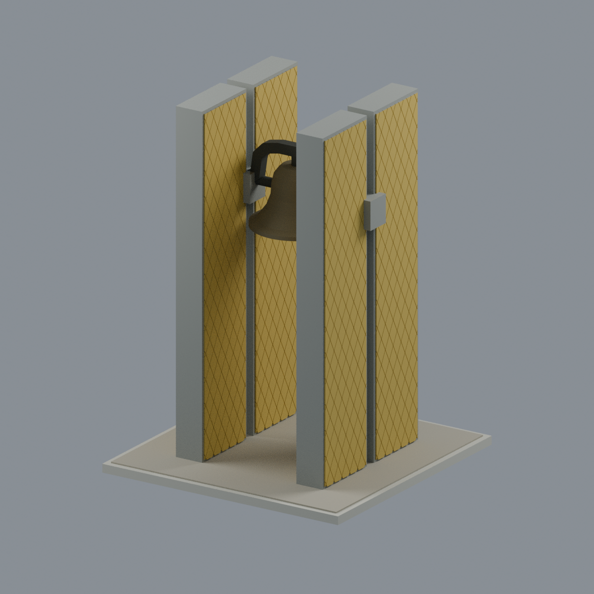
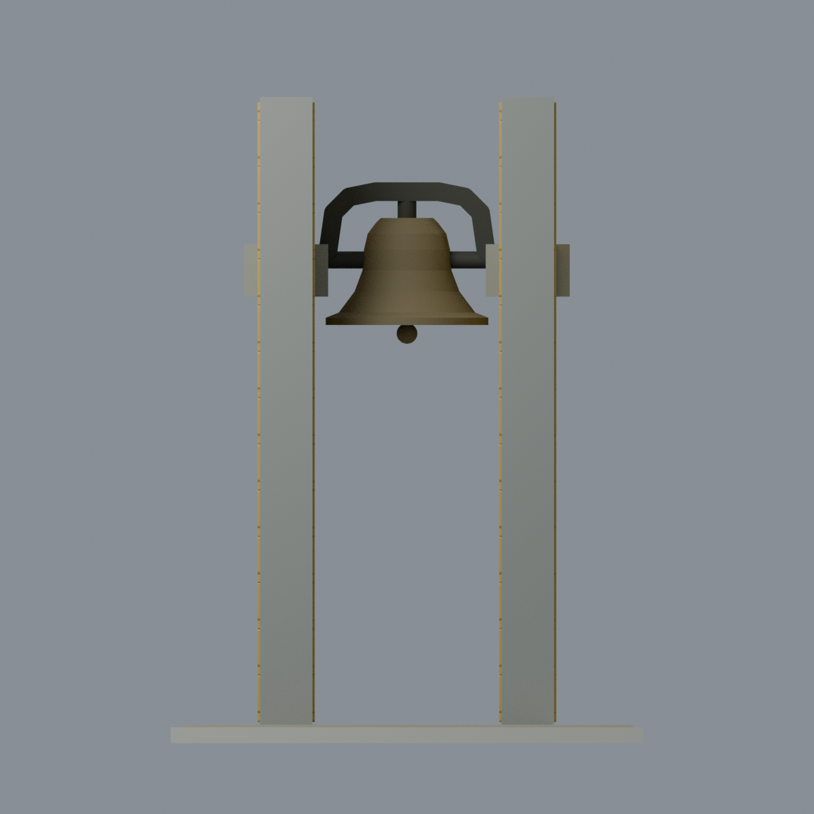
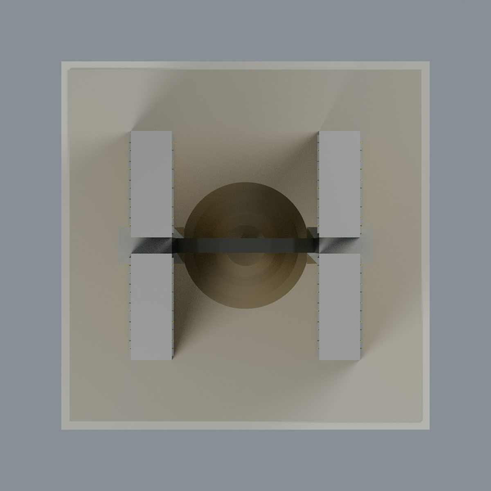
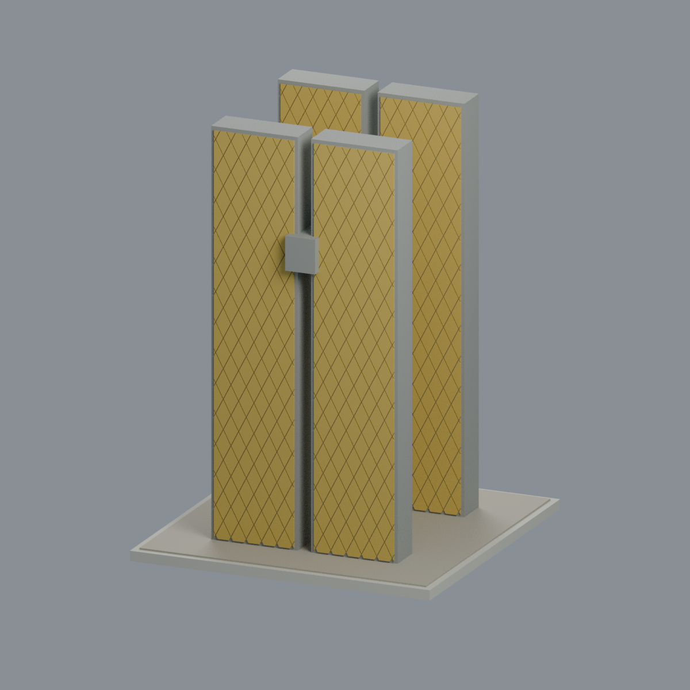

# 東海大學 畢律斯鐘樓


**新增幾何｜依官方公開照片近似，不是現場測繪，也不宣稱2026現況。** 本模型是路思義教堂旁的畢律斯鐘樓，不是校友鐘樓，不包含教堂或後方辦公室。

兩排相對厚牆，每排兩片共四片；保留兩側垂直細縫與中央通道。黃色菱格面、灰色窄端與邊框、鐘與鐘舌、固定簡化 U 形鐘架、軸及混凝土軸承座。鐘口保留淺凹口，非可擺動發聲的薄壁鑄鐘。

## 下載
- [可編輯 Blender 場景](scene.blend)：與 STL 同一三角網格，六種逐面可編輯顯示材質。
- [彩色 3MF](model.3mf)：顯示顏色，不是噴頭／AMS 指派。
- [STL](model.stl)：單一連通水密網格，格式本身無顏色。
- [生成器](build_model.py)、[來源](SOURCES.md)、[檢查報告](QA.md)。

設計尺寸 **90×90×123 mm**；牆高120、厚10、每片深26、側縫4、主通道寬36、鐘口徑31 mm。這些是照片比例與展示／加厚尺寸，**不是建築實測尺寸或精確比例尺**。菱格數、接縫、鐘架細節和底座均簡化；不猜補銘文。

## 來源與界限
建模者親看文化部3張與東海總務處官方連結相簿6張，共9張完整照片。照片拍攝年代未知；檔名與上傳目錄日期不能當作拍攝證明。2022校方新聞記載曾整修，故不宣稱外觀至今未變。沒有實測尺寸、精確磁磚數或完整機械測繪；對稱規則與隱蔽接合為建模近似。省略樹木、盆栽、警告牌、辦公室、教堂、長步道；展示鋪地不是現場完整邊界。原始來源照片不隨檔再分發。

## 列印警告
水密不等於可直接列印。鐘口、鐘舌、軸架、支承座底部懸挑需要切片器支撐／方向評估；菱格浮雕及曲面尖端可能小於0.8 mm。全域與局部侵蝕測試失敗會原樣列在 QA，不能由大底座掩蓋。**沒有實體試印，不認證免支撐、最小法向厚度、強度或切片器相容性。**

## 五個實際交付網格視角





## 重建與驗證
Python依賴見requirements.txt；驗證另需lib3mf官方SDK、Blender4.3.2。
```sh
python build_model.py
python qa_model.py
PYTHONDONTWRITEBYTECODE=1 python check_features.py
BUILD_PYTHON=/path/to/model/python /path/to/lib3mf/python verify_exchange.py
blender -b --python-exit-code 1 --python render_model.py
blender -b --python-exit-code 1 --python verify_scene.py
blender -b --python-exit-code 1 --python verify_render.py
python verify_package.py
```
獨立重建比對 STL、3MF、mesh、palette 與全部五張 PNG；若改動模型，必須重新驗證，不能沿用舊 QA 當作新結果。
