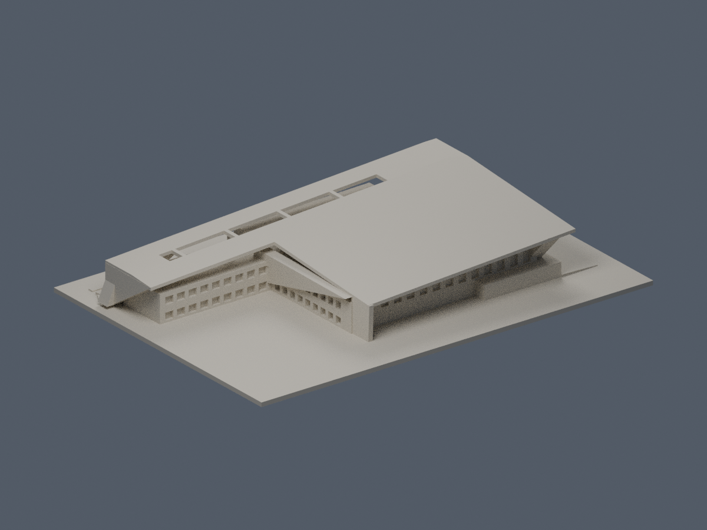

# 樹人醫護管理專科學校

## 2016 多功能活動中心

兩層大跨活動中心的來源限定外觀近似，保留折板／穿廊／外梯。局部標高與地形為推估，未實體試印；本件不代表全校已完成。數位審核紀錄見隨附報告；是否正式發布以統一發布清單為準。

| 正向 actual STL | 反向 actual STL |
|---|---|
|  |  |

[模型與來源限制](路竹校本部/buildings/szmc-multifunction-activity-center/README.md) · [數位QA](路竹校本部/buildings/szmc-multifunction-activity-center/QA.md)
