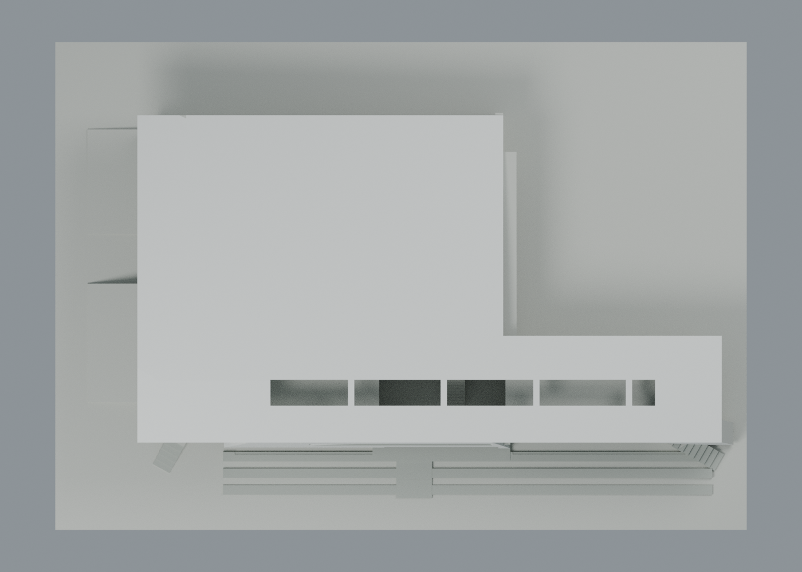
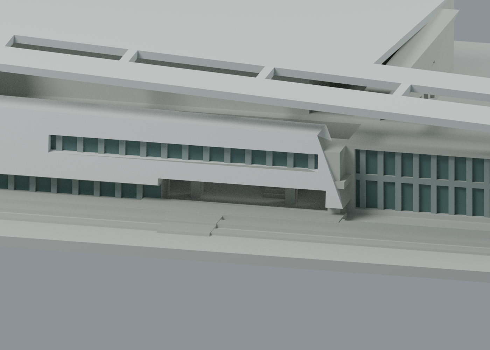

# 樹人醫專多功能活動中心：六材質外觀交換版

保留既有 2016 建物模型的全部 3172 三角面，依 2017 年公開空拍可見部位補上近似色。**六個可編輯材質身份，不限制四色；未見背面保留中性灰，並非已確認其實際色。**

| 可見街側／草坪側外觀 | 背面幾何，顏色未確認區保留中性 |
|---|---|
|  |  |

| 頂視 | 穿廊與既有玻璃凹面局部 |
|---|---|
|  |  |

## 下載與編輯
- [通用表面色 3MF](szmc-appearance.3mf)：1 個原網格、1562 頂點、3172 三角面；原 STL float32 座標與面序逐面相同。毫米單位，與原模型相同座標原點。
- [可編輯 Blender 外觀 scene](scene.blend)、[六材質調色表](palette.json)、[逐面材質與角色](face-materials.json)。
- [原單色 STL](../model.stl) 不變，SHA256 a763cee5febe34c80b4bbe36d19dca5fb1b2d9fd65d956aa310a06e5a993e902。

這是表面材質交換，**沒有把色區改造成封閉分色體、沒有噴頭映射、沒有機器設定或 G-code**。不同軟體可能只顯示色而不直接轉成多材料工具；未驗證 GUI 匯入。六個身份包含未確認中性面，不等於實物只有六色。玻璃用不透明灰綠表面表現，不聲稱光學透射或測得建材色。

## 來源與界線
[公開空拍頁](https://www.flickr.com/photos/115050927%40N06/36572949213)，攝影帳號 takuyatsai，既存頁面記錄標示 2017-09-10；日期未另行核實，不作 2026 現況證明。[圖片連結](https://live.staticflickr.com/4359/36572949213_da7e688a9e_b.jpg) 僅作參考，原照片不隨包散布。建築身份由既有官方校園資料及原模型來源對照；原幾何的 MAYU 平面／多向照片來源見[原 sources.json](../sources.json)。

- 白折板頂／街側折面、灰白屋板側邊、灰綠玻璃及灰色框／平台，均為可見顏色的近似選值；反射、天候、陰影與塗料無法從單張照片完全拆分。
- 深穿廊由既有凹入幾何與照明形成陰影，**沒有把陰影當黑色塗料**。本次沒有新翼、窗孔、屋頂設備或背面細部。
- 反向圖是原幾何的另一視角；未見背面不補假色區。未做測色、同日現場調查或精確材料辨識。
- 仍適用[原模型尺寸及簡化](../README.md)與[原製造 QA](../QA.md)的全部限制，包含 46 個跨層薄損樣本、兩個斜屋角及柱角特定例外。沒有以配色推翻或重跑歷史製造證據。
- 未做新的 FFF 切片、支撐分析或實體試印，屋簷／穿廊／外梯仍有待驗風險，不保證無支撐列印。

## 必要檢查與重建
[交換驗證](qa/exchange-validation.json)、[scene 驗證](qa/scene-validation.json)、[來源與外觀覆核](qa/source-appearance-review.json)、[預覽資訊](qa/render-manifest.json)。lib3mf 2.5.0 嚴格載入零警告；實際單一材質改色往返保留其餘材質與指派，SDK 預設六位小數寫出最大座標量化 0.0000076294 mm、零退化面。這份測試改色檔不交付，交付 3MF 本身與原 STL 座標完全相同。

標準 Python 執行 source/build_appearance.py 可由原 STL 與 palette.json 重建 3MF／面材質清單；Blender 4.3.2 執行 source/render_appearance.py 可生成四圖及 scene，再執行 source/verify_scene.py。source/verify_exchange.py 使用已安裝 numpy/lib3mf。原圖不需嵌入重建，沒有新增軟體或字型資產。
