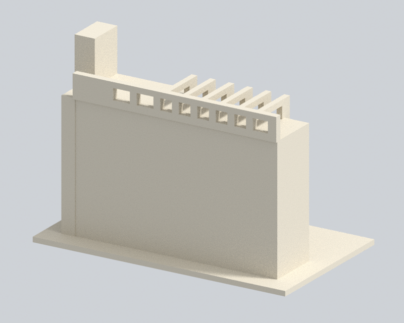
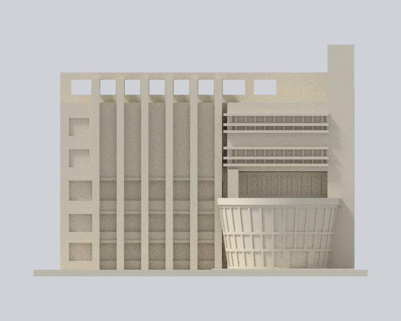
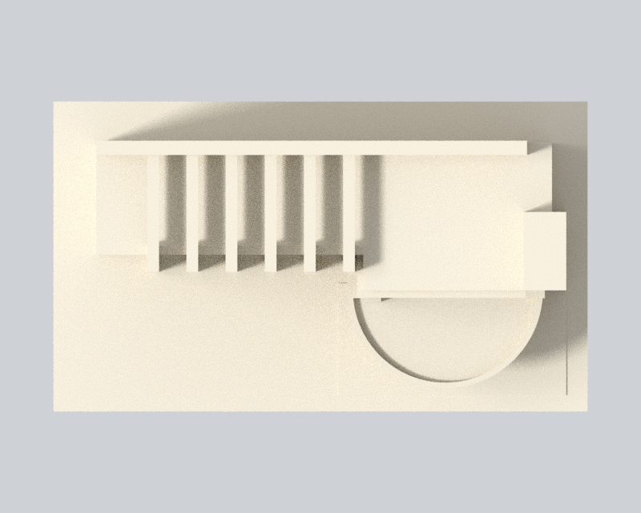

# 樹德科技大學｜行政大樓弧形入口及前庭行政翼（局部）

## 模型預覽

| 模型預覽 | 模型預覽 | 模型預覽 |
| :---: | :---: | :---: |
| 實際 STL 斜前<br> | 實際 STL 背面（簡化終止面）<br> |  |

> 復原修訂 v3：原 STL 與建模程式已從原始內容恢復，獨立重建 SHA 完全一致。缺失的渲染程式、Blend 與四張預覽重新製作；數值檢查程式與 C++ 輔助程式保持恢復的原位元內容並重新執行。新的彙整閘門與文件另作版本記錄，v3 獨立覆核與發布決策另行記錄。恢復、重產與新寫檔案的區別見 [recovery-provenance.json](recovery-provenance.json)。

這是校本部南校區行政大樓的前庭翼段近似模型，**不是完整行政大樓、相接禮堂或全校模型**。依實拍與校方空照自行建立幾何，沒有擷取第三方 3D 網格。


## 範圍與辨識特徵

保留上寬下窄的凸弧玻璃入口、其上的深凹陽台與左側方柱、兩組成對細窗與寬實牆分隔、六片大型混凝土翼片、翼片後方主要玻璃帶、屋頂開放格架及高塔側面玻璃。另有[正立面](previews/elevation.png)、[上視圖](previews/top.png)及[背面圖](previews/rear.png)，全部由交付 STL 渲染。

| 模型預覽 | 模型預覽 | 模型預覽 |
| :---: | :---: | :---: |
| 正立面<br> | 上視圖<br> |  |

背面是明示簡化的封閉終止面，不代表已查明的完整背立面。前翼進深、屋頂格架後端與曲率缺乏尺寸圖；比例由斜視照片估擬，沒有精確測繪比例。整棟資料表列 5F+B2，不等於七排等高窗。模型不重建地下樓層、完整 L 翼、相接多功能禮堂或未核得的側後細節。

## 檔案與列印

- 單位：毫米；含底座尺寸 150 × 87 × 104 mm，底座厚 3 mm
- [model.stl](model.stl)：原始交付單一連通實體
- [scene.blend](scene.blend)：匯入同一 STL 的可編修網格；重建參數在 [build_model.py](build_model.py)
- 底座朝下。屋頂橫樑、深凹陽台上板及遮陽片需要在實際切片中檢查橋接與支撐
- 0.2 mm 分層與 0.8 mm 參考寬度是數位幾何篩檢，未執行實際印表機工具路徑或實體試印，不保證免支撐或必然可印
- 平底座代替現地草坡；玻璃用淺凹表現，翼片根部、欄緣端部與門框適度加粗。細字、細金屬欄杆及空調未重製

## 驗證結果與必要限制

原始二進位 STL 的法向、繞序、每邊兩面、頂點 link 單環、正體積及單一連通表面均通過；520 個 0.2 mm 原始截面均閉合且有效。每個原 Polygon 經 0.8 mm opening 均不消失或分裂，最大個別面積損失約 0.864%。沒有用修補或四捨五入截點掩蓋失敗。

**原始法向短段診斷仍有 1,977 個小於 0.8 mm 的樣本，最短約 0.01331 mm。不能說所有方向厚度均達 0.8 mm。** 這些樣本限定在鼓形入口的淺玻璃／門片凹紋，逐點保留原短段及後續空氣，再驗證固定朝向實際母體的連續根部；最短根部約 24.943 mm。另有 3 個固定方向奇偶旗標，經全部 57,340 條法向線的原三角形邊界篩檢及 250 個側向控制，辨識為沿真實表面的邊界情況。詳細限定與原始失敗狀態保留於 [QA.md](QA.md) 及 [validation.json](validation.json)，需連同獨立覆核閱讀，作者證據不能代替發布決策。

## 重建與檢查

使用 Python 3.12、[requirements.txt](requirements.txt) 固定套件，另需 Blender 4.3.2 與支援 C++17/OpenMP 的 g++。

```sh
python -m venv .venv
.venv/bin/pip install -r requirements.txt
.venv/bin/python build_model.py
MALLOC_ARENA_MAX=2 LP_NUM_THREADS=1 OMP_NUM_THREADS=1 blender -b --factory-startup -t 1 --python-exit-code 1 -P render_preview.py
.venv/bin/python run_checks.py
```

run_checks.py 對個別原始法向診斷的預期退出碼為 1，並保留其 false 結果；其餘檢查及最後的限定證據閘門必須退出 0。任何未分類短段、根部失敗、邊界證據不足、無效截面或 SHA 不合，仍會失敗。

## 來源

核心來源為[校方／教育部期末報告](https://ws-proj.moe.edu.tw/001/Upload/568/relfile/13271/17377/accab4cb-8092-4855-9d38-65f37b5a9f0f.pdf)印刷頁 12 空照，以及 [104 行政大樓近景](https://guide.104.com.tw/backend/media/origin/school/703.jpg)。報告 PDF metadata 建立日為 2025-04-02；兩張照片的實際攝影日期均未提供，不能稱為 2026 現況測繪。完整來源、支持特徵與缺口見 [sources.json](sources.json)。第三方照片與 PDF 不包含在模型包內。
