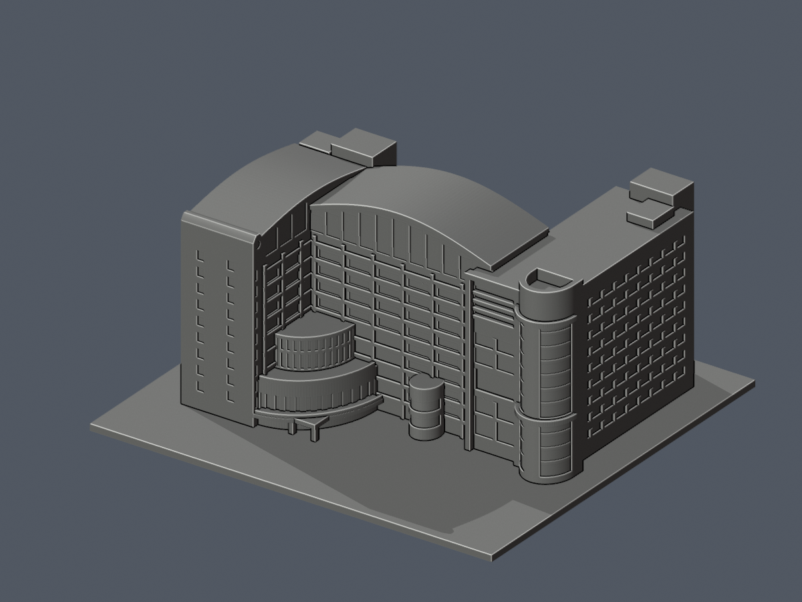
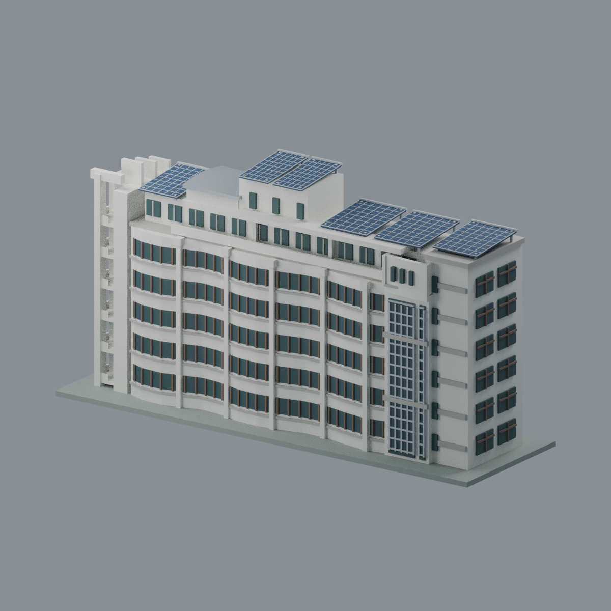

# 校本部｜階段模型（3套）

收錄圖書科技大樓、綜合行政大樓03A/B/C與幼兒保育館三套不同建物的外觀近似，非全校完成。圖科保留2017外觀主版本／2024資料核形；行政依公開影像相對估計，拍攝年份未逐一核實，不稱2026現況。

| 建築模型 | 建築模型 | 建築模型 |
| :---: | :---: | :---: |
|  **[圖書科技大樓](buildings/csu-library-technology/README.md)** |  **[綜合行政大樓03A/B/C](buildings/csu-administration-03/README.md)** |  **[幼兒保育館｜2024含PV版](buildings/csu-childcare-building/README.md)** |

[圖科模型與QA](buildings/csu-library-technology/)；[行政模型、兩分件與發布說明](buildings/csu-administration-03/PUBLICATION.md)。行政03A/B/C是同棟三區，主體與截頂屋蓋分印仍只算一套；排除04及鄰樓。

行政固定幾何與文書經獨立條件GO，嚴格製造false保留。普通窗凹約0.4mm、門凹約0.65mm，門頂實際懸垂路徑16.6mm；auto45確有外部支撐，非免支撐保證。尚未實體試印、清除支撐／brim、驗證尖屋緣、翹曲或平面膠合；generic G-code須依真機重切。第三方原照／來源PDF未隨包散布。

幼兒保育館的來源版本與列印限制

幼兒保育館（幼保大樓，館號22）2024-08-27含PV版完整獨立主棟外觀近似：六層＋局部屋突、前波折後平直、不同端塔與真孔階梯、寬窄玻璃核／白弧帽、退縮六樓、中央高白盒／低淺弧頂、六組分層PV及兩層高透空入口／退凹門廊。270×84×144mm展示尺度，8材質Blend/3MF/STL＋5實mesh圖，33528三角單殼、720全局層與局部空實檢查、lib3mf真材質及Blend幾何材質存讀、乾淨九檔重建一致、獨審PASS。尺寸/窗格/PV細數為照片近似，附著PV格線0.35mm且有懸挑；需切片支撐評估、未實印。2009五層舊頂不混入2024版，不稱2026現況或測繪，非全校完成。

[來源與版本](buildings/csu-childcare-building/SOURCES.md) · [驗證與限制](buildings/csu-childcare-building/QA.md)。前兩套既有幾何、製造條件及QA不變。

