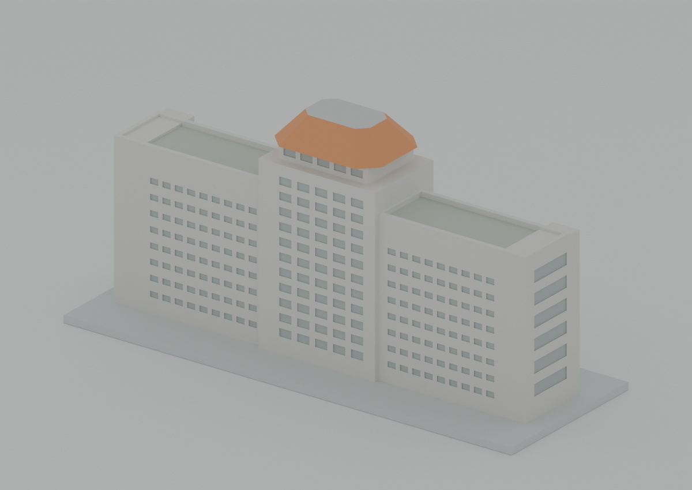

# 正修科技大學｜綜合行政大樓 03A/B/C

**正式交付版：固定幾何及文書修正已獨立增量 GO；保留製造條件與嚴格 false。** 03A/B/C 為同棟三區，本件只算一套，含主體與截頂屋蓋兩個列印分件。外觀依實看公開影像作相對估計，非測繪、BIM、工程圖或 2026 現況紀錄。[發布範圍與核對](PUBLICATION.md)。

**場景metadata修正：** 初版 `6e68368` 的v1／v2壓縮BLEND各留有一個私人存檔對話框目錄，原text／PNG檢查漏掉這層。現用場景只遮蔽 `FileSelectParams.dir[1282]` 為相對目錄 `//`；解碼後其餘資料及場景語義不變，STL、G-code、參數與預覽原檔不變。詳見[修正前後核對與新hash](qa/scene-path-redaction-1/README.md)。舊build／render／QA與Library v2回條均是其固定時點的歷史證據，舊scene hash及原排除私人路徑宣告不作現版完整二進位檢查證明。

| 組裝正面 | 組裝背面 |
|---|---|
|  |  |

保留中央較高量體、左右長翼、翼端垂直柱梯輪廓、平屋頂退台、橙色多坡**截平**屋蓋及前方山牆門廊。背面低樓層遭遮擋處只在已見主外框內作實心估計，不加未知附翼；低矮 04 體育室、其他教學樓、校門、操場、停車場與連廊延伸均不屬本件。

- [主體 STL](models/v2/parts/body.stl)：200 × 72 × 85 mm，底座朝下。
- [屋蓋 STL](models/v2/parts/roof.stl)：48 × 36 × 11 mm，較寬平底朝下；頂面保留 29 × 18 mm 的截平外框。
- [組裝 STL](models/v2/assembly.stl)：200 × 72 × 96 mm，**只供總覽與外觀核對**。請列印上述兩分件；整體列印會重新引入屋簷懸空。
- [可編輯場景](models/v2/scene.blend)、[各面及分件預覽](previews/v2/)、[參數](parameters.json)、[來源與判讀](sources.md)、[QA 與製造限制](QA.md)。

## 列印與組裝

主體、屋蓋均以各自 STL 的 z=0 平面置床。兩分件分開切片；場景預設為組裝姿態，不能直接把其位置當分件列印位置。主體中央實心頂台的頂面在 z=85 mm；屋蓋 48 mm 方向沿 X、36 mm 沿 Y，人工置中至 (0,0,85)，先乾組確認方向與平面，再以適合材料的膠固定並維持固化位置。此處沒有插銷、卡扣、膠厚／強度、公差或防呆定位驗證。四邊名義外伸 4 mm **不是 ±4 mm 允許偏移**；截角使無旋轉且頂台保持全覆蓋的純幾何條件為 `|Δx|+|Δy|≤1 mm`，也不是製造公差。必要時用臨時對中記號或治具。獨立檢查接觸面積 1120 mm²、正體積干涉 0，不能據此推論膠合強度。

門廊採實心淺凹、階梯縮短；普通窗凹名義深約 0.4 mm，**入口門凹另約 0.65 mm**（固定 raw STL 實測 0.650001526 mm）。門背同線仍有約 46.55 mm 連續實體；這不是 0.65 mm 薄牆，但門頂成形／支撐仍有製造影響。實際門頂 Overhang perimeter 從模型 (-8.3,-28.975,20.2) 至 (8.3,-28.975,20.2)，長 **16.6 mm**，不能以凹深替代路徑長或橋跨評估。翼端開放柱梯填實；綠化、細欄杆、機電、招牌及室內省略。退台護牆設計厚 2 mm；這些是列印化簡，不能解讀為實際建築的封閉牆、無窗或實心門廊。分印屋蓋採實心平底；未識別出完全封閉困支撐，並不保證外部支撐都容易拆除。

本件未實體試印、未驗證支撐／brim 清除、尖屋緣成形、翹曲、附著、膠合強度或裝配手感。主體 auto45 實際產生 20,930 段支撐＋61,223 段介面＝**82,153 段**，合計 7,273.39394 mm 支撐耗絲；段數不是支撐塊數。門凹區有 305 段支撐／介面、45 個沉積 strata；最高支撐頂 z19.8 對門頂下表面 z20，為名義 0.2 mm gap。這是實際承托配置，並非成形、黏連或清除成功的證明。移除時不得以 2 mm 護牆／銳屋緣作撬點；若工具無法進入或必須使薄邊承力，先調整該區支撐／製程。200 mm 長底座再加 brim 須核實真正可用床面。普通窗凹約 0.4 mm 的可見程度受噴嘴、層高、縮放與塗裝影響；本次判讀以供應 100% 尺寸為準，縮小或轉向須重新評估。所附 generic G-code **NOT-MACHINE-READY，必須按真機重切**；0.4 mm／0.2 mm／100% rectilinear 為 QA 設定，並非實物填充建議。

## 重建

使用 Python 3.13 與 [requirements.txt](requirements.txt)；在此資料夾執行：

```text
python -B source/build_model.py --output-dir models/rebuild
python -B source/render_preview.py
```

生成器讀取 parameters.json，不需要照片、網路、私人路徑或原作者檔案。`parameter_semantics` 列出實際控制欄位；門凹深、`relief.*`、`manufacturing.*` 等另為聲明值，幾何仍由源碼中的固定座標生成，修改聲明不會改尺寸。本輪僅修正聲明，生成器與 STL 均不改。原 v2 build/render manifest 與舊 QA 是 76681 固定快照，其參數 SHA 對應[原參數快照](qa/documentation-revision-1/parameters-at-76681.json)；[增量勘誤與新校驗](qa/documentation-revision-1/README.md)另外綁定現用參數，不能把舊 manifest 當作新參數的執行紀錄。渲染器載入固定 v2 STL；重新生成到其他資料夾後，請先比較輸出。STL 單位 mm，沒有地理座標或統一校園比例。窗列與端部六條淺槽是符號化外觀，不代表實際樓層、窗數或開放梯間構造。場景材質僅便於辨識，STL 不帶顏色。

[獨立覆核：條件 GO 與完整限制](qa/independent-76681/INDEPENDENT-CSU-REVIEW.zh-TW.md)；[54c4 最終增量確認](qa/final-incremental-54c4/FINAL-INCREMENTAL-REVIEW.zh-TW.md)解除先前文書必修，沒有要求改幾何、再切片或重渲染。這不是實體試印、支撐清除或膠合驗證通過。

16張原預覽另清除私人 `File` metadata；圖像 IDAT／像素完全相同，原 render manifest 不改。[前後檔案映射](qa/documentation-revision-1/png-metadata-redaction.json)提供原／新 SHA，不能把歷史 PNG SHA 當作現用檔案指紋。獨立覆核的公開副本也有逐檔路徑遮蔽映射，沒有改數字、座標或旗標。

第三方原照、官方原圖／PDF、憑證及私人路徑不隨本套件散布。來源連結與本機實看檔案雜湊載於來源紀錄，以便讀者自行核對；這不授予第三方影像或建築設計的權利。
