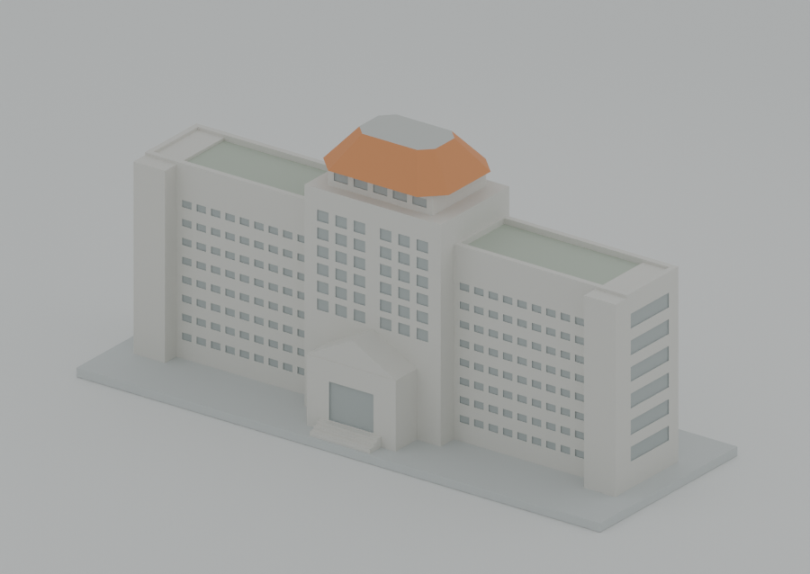

# 正修科技大學綜合行政大樓03A/B/C：獨立覆核

覆核時點：2026-10-18 UTC；作者工作目錄為 `2026-10-19/task-2`。固定提交 **`76681c5dcedc88d684946780e795d7914a88c075`**。原候選全程唯讀；重建、程式、圖像及報告只寫入本次 `task-7/csu-76681/`，未修改、推送、發布或變更任何憑證。

**結論：條件 GO，可交付為有製造條件的低細節外觀代表模型。一套03A/B/C，兩個列印分件。未發現須改固定STL的來源／主量體、真自交、分件干涉、封閉困支撐或獨立薄壁阻擋。必須補正入口凹門深度的文件／參數聲明，並保留門頂16.6 mm懸垂路徑與實際外部支撐條件。** 這不是免支撐、真機G-code可直接用、容易去支撐或膠合強度通過的承諾。

## 固定交付與必修項

| v2檔案 | SHA-256 | 用途 |
|---|---|---|
| `models/v2/parts/body.stl` | `e388dff1247334ec5e79530e45a1b7e5e85d1a630aff0a9d6d53720f1362ee6c` | 列印主體，200×72×85 mm |
| `models/v2/parts/roof.stl` | `7d1c8840ee11649ec4c57984ff1a0cc2c2a3916f37fc21888e7ead0f631fed04` | 列印屋蓋，48×36×11 mm，平底向下 |
| `models/v2/assembly.stl` | `6d3a8796831cd83bd7e012664dd8f094b6e700998031e71db38567fc1ecff416` | 組裝展示，200×72×96 mm，非推薦列印檔 |

**必修為文件／參數說明，不要求改幾何：** `parameters.json` 的 `entrance.door_recess_depth=0.45`、`manufacturing.maximum_shallow_facade_recess=0.45` 未控制現有生成器門凹，和實際值不符。獨立raw-STL線量測得到門上方前面Y=−29.200000763、凹門背面Y=−28.549999237，實際深 **0.650001526 mm**。請將門凹另列約0.65 mm、普通窗凹約0.4 mm，說明哪些參數是聲明值／哪些實際控制生成器；不要把全部凹面泛稱最深0.45 mm。本報告已給出勘誤，正式交付說明應同步補註。若選擇改生成器以讓參數控制尺寸，屬另一個幾何變更，應另立SHA及受影響檢查；本輪不要求這條路線。

門凹背後同線有約46.55 mm連續材料，**深度不符不是0.65 mm薄牆**。但它確有門頂成形／支撐影響，不能把此勘誤描述為完全無製造意義，見下文。

原auto45 `slice-summary.json` 的 `limits` 與原audit尚有「no-support／支撐禁用」繼承字句，原錯誤、修正audit及勘誤已分檔保留。製造交接須引用修正audit與實際支撐數，不可單獨引用舊句作免支撐結論；不要求覆寫歷史失敗證據。除上述說明補正外，沒有本輪識別出的必修網格／接合造型。

## 可讀性、版本與Library回條

候選、參數、原始碼、v1/v2、所有QA及實際G-code均可讀。唯讀Git物件核對 **337個套件追蹤檔案逐位元組與固定提交相同**。已讀根／學校／校區／模型與QA README；Git樹及檔案搜尋未見適用 `AGENTS.md`、`SKILL.md` 或 `.agents/skills`，Codex祖先 `.agents` 為空，未假稱讀過不存在的建模skill。

已讀 `delivery.json` 及作者 `library-backup/library-verification.json`，其固定提交、Library `libfile_2c2d4cd4e1988191b0451cc967251490` v0、37,898,165 bytes、ZIP SHA `79065a030374b464dd8ab8e2d5e631dec3d8ecc110dc938661b1e6ca248b2c51` 相符。回條記錄342項大小／SHA／CRC及337模型Git blob核對成功。**官方下載與整包核對由作者完成；本輪只讀回條，未自行重下載或宣稱再驗下載ZIP。** 身分、原始快照及回條見[identity-and-author-receipt.json](identity-and-author-receipt.json)。

## 來源像素、身分與主量體

來源子覆核實看官方校園圖、2023配置表完整頁、四張指定照片原像素，以及v2九張預覽；六份本機來源的bytes/SHA均與 `sources.json` 相同，URL亦與任務提供者相符。官方[校園地圖頁](https://oia.csu.edu.tw/p/405-1075-16071,c224.php?Lang=zh-tw)本次可讀；[2023普通教室配置表](https://b007.csu.edu.tw/var/file/7/1007/attach/95/pta_3116_9686958_56575.pdf)的本機固定來源實看為一頁、`20230801-V2`，它是用途／樓層配置，不能以表格欄寬量建築比例。遠端PDF重取timeout，部分照片重取亦失敗；本輪沒有聲稱取得遠端新bytes或證明遠端此刻SHA與本機相同。

官方03及配置表03A／B／C支持一套綜合行政大樓，04體育低體、15圖書科技大樓、其他低樓、停車屋頂、校門等各自排除。四張照片支持中央高體、兩長翼、端部柱梯外框、翼頂退台、橙色**截平多坡屋蓋**與正中山牆門廊；候選不是完整尖金字塔，也沒有在背面添加未受約束的大型附翼。[Flickr原相簿](https://www.flickr.com/photos/archiwu945/albums/72157622878976691/)與指定P1–P4對應保留於來源記錄。

窗列／端面六槽為符號化、開放柱梯與門廊填實、階梯縮短、小側斜蓋／綠化／設備／欄杆省略，均有揭露。背側低層遮擋處只在已見主外框內估計，沒有據此杜撰後附樓。左右對稱、深度、層高及全部毫米數是相對估計；四照拍攝日期未全核，不能稱2026現況、測繪、BIM或逐層精確復原。這些有界近似可接受，無需為所有隱蔽面量測而重做整棟。詳見[來源報告](agent-source/SOURCE-IDENTITY-SCOPE-REVIEW.zh-TW.md)及[逐檔來源核對](agent-source/source-evidence-verification.json)。

## 重建、全量碰撞、場景與分件接合

在新的reviewer目錄只複製固定生成器與參數重建，body、roof、assembly **三STL均逐位元組相同**，未在候選內執行會寫回的生成器。見[獨立重建](independent-rebuild.json)。

| 獨立檢查 | 主體 | 屋蓋 |
|---|---:|---:|
| 原始面／完全相同座標頂點／邊 | 6696／3350／10044 | 28／16／42 |
| 單一連通封閉表面；邊二面反向；頂點link單環 | 通過 | 通過 |
| 精確零面積／重複面 | 0／0 | 0／0 |
| 精確有理正體積換算mm³ | 439552.4138911435 | 11066 |
| 不同演算法exact AABB全掃面對 | 73993 | 208 |
| 非法自交／接觸 | **0** | **0** |

直接讀原始float32座標，不修補／焊接。獨立Y掃描＋有理邊／平面與共面邊／邊算法未調用候選checker；16控制全頂點排列／面交換共1152判定符合。精確算術及交叉實作仍不是形式化驗證，且不代表全域壁厚或製造通過。

接合直接檢查兩個分件，不用assembly union掩蓋衝突：body全部Z≤85、roof上移85後全部Z≥85，故**正體積干涉0**。Z85精確三角形裁切求得實際接觸 **1120 mm²**，完整覆蓋中央40×28 mm頂台；屋蓋底面1630 mm²，其餘510 mm²為外伸。沒有只靠一條邊／小點承托的問題。

屋蓋48 mm方向沿X、36 mm沿Y，人工置中至(0,0,85)，試放後膠合；無XY／轉角定位、插銷、卡扣、膠厚或強度驗證。四邊4 mm名義外伸**不是±4 mm裝配允許量**：截角使無旋轉且頂台全覆蓋的純幾何條件為 `|Δx|+|Δy|≤1 mm`，不是製造公差。先乾組確認平面與方向、必要時用臨時對中記號／治具，固化時保持位置；不需要擅加未知接合機構。詳見[幾何／接合報告](agent-geometry/INDEPENDENT-CSU-GEOMETRY-REVIEW.zh-TW.md)、[完整exact證據](agent-geometry/independent-csu-geometry.json)。

獨立實際載入 `scene.blend`：兩個print mesh的**精確局部三角形multiset**與body／roof STL相同，無modifier或縮放／旋轉，roof位移Z85；另有明確排除的studio ground，沒有照片、linked library或外部依賴。八視角加總覽九PNG與manifest逐一hash相符，renderer source也相符。另從固定場景渲染一張新front並實看，沒有重做九圖。見[場景核對](independent-scene-check.json)。

## 嚴格false、薄壁與實際切片的獨立判讀

嚴格製造總旗標維持false；原失敗／原點／補證均不改。作者的1275層形態學、66960有限法向樣本、97層支撐包絡／806向下面等保留為其明示範圍，本輪沒有把它們重命名為全域厚度證明。

| 原旗標／風險 | 本輪獨立證據 | 結論與保留條件 |
|---|---|---|
| v2六條法向奇偶歧義 | 在原x=±92、z=68點核固定截面及精確共面射線區間；原射線沿原頂台／退台邊界有非零共面段。 | 支持邊界退化判讀，未見相應真裂面／懸空弱壁；原false保留，不移點，也不因此保證任意厚度。 |
| 屋蓋71短弦，最短約0.081053 mm | 全部原旗標點／方向獨立raw射線重現，最大弦差約2.33×10⁻¹⁵ mm；凸半空間與平底向下的外形相符，底板以上無朝下面。 | **真收尖屋簷的局部薄邊，不是獨立直立薄牆**；分印時從床面承托後逐層內縮。不能稱處處1.6 mm，尖邊被量化／磨失／變鈍及拆brim損傷仍待實物確認。 |
| v1四條約0.8 mm窄柱 | 原source／STL及288層失敗保留；v2 source移除這些非必要附加柱，v2固定件與重建一致。 | 不把v1缺陷移植為v2現有薄柱，也不抹去歷史失敗。主要外框仍在，無需為細節強加回弱柱。 |
| 97層包絡與806向下面 | 淺凹窗頂／門頂有實際懸垂；投影最小外接寬及包絡面積不能當真正橋跨／單一天花板面積。 | 保留支撐／成形風險，不能由背後實心、短凹深或正體積直接豁免。 |
| 入口門凹深約0.65 mm | 原STL固定線：背面−28.55、上方前面−29.2；背後約46.55 mm實體。 | 非薄牆，但深度聲明須修正，門頂懸垂另按下列實際路徑處理。 |

獨立解析真正G-code的G90／M82／G92、回抽及當時TYPE／WIDTH／HEIGHT，重現auto45的 **20930支撐＋61223介面＝82153段**、合計 **7273.39394 mm支撐耗絲**。實際support寬／高有變化，不能全部套0.45×0.2。段數不是支撐塊數或困料件數。

| 已保存G-code | SHA-256 | 本輪實際讀取結果 |
|---|---|---|
| body auto45 | `6ab11d448e2978b1cf51464251a34623e8413f6e89e8d98df70001ea38ebc6ad` | 82153支撐／介面；1段Overhang perimeter |
| body no-support | `494d2183e6cfb471b3023181c84724400312ebacf26d7154dc56711f562e878d` | 0支撐；同一段Overhang perimeter |
| roof no-support（同SHA沿用v1切片） | `ba1eada489156a2657819aecb190c625d80f3d9c18aa37d09cb9023a0ad8b7f2` | 0支撐、0 Overhang perimeter |

三檔均沒有Bridge infill角色，**不表示不存在需按橋接／懸垂評估的路徑**。主體唯一Overhang perimeter就是入口門頂：模型點 `(-8.3,-28.975,20.2)` 至 `(8.3,-28.975,20.2)`，長 **16.6 mm**，WIDTH0.4／HEIGHT0.4。no-support基準同樣有它，不能用門凹深0.65 mm宣稱只跨0.65 mm、或把支撐關閉的零數當免支撐。

auto45門凹有305段支撐／介面、45沉積strata；區內最高支撐頂Z19.8，STL門頂下表面Z20，與設定0.2 mm gap對應。Overhang的名義HEIGHT下界亦到19.8，但註記矩形足跡不是實際料線截面，不能用其相接推黏連、下垂或拆力。**auto45確有門頂承托配置；真成形與清除仍需真機確認。**

## 支撐去除與最終製造條件

本件各凹紋有實心背襯、向外開，無內部設計空腔；屋蓋分印平底實心，避開中央大簷整體列印的懸空。獨立從8類代表凹槽（包括最深門凹）擷取實際線寬capsule小片，在每區最低／中間／最高沉積stratum，各取下／中／上3個STL截面作外向8 mm有限掃掠，所測交疊為0。這是**代表位置已分離小片**的有限幾何退路，沒有檢查每一段／每個高度，也沒有證明全3D連架已可原位剪開、工具可伸入、表面不傷或拆力足夠。未識別出具體完全封閉困料；同樣不宣稱全部外部支撐都容易拆。

完整獨立原座標、raw線、71屋蓋點、實際G-code行號、支撐分群／有限路線見[製造報告](agent-manufacturing/MANUFACTURING-REVIEW.zh-TW.md)及[製造JSON](agent-manufacturing/independent-csu-manufacturing.json)。

交付必須維持下列條件：

1. **分印body／roof，兩件均供應平底朝下；assembly只展示。** 維持100%供應尺寸作此判讀基準；縮小或轉向需重新檢視厚度、尖邊、支撐及接合。200 mm長底座再加brim須核實真正可用床面，不只看名目機型尺寸。
2. **主體不可宣稱免支撐。** 實際操作者以機台／材料／噴嘴／層高／冷卻／附著／支撐設定重切，特別查入口16.6 mm門頂線、各凹槽頂緣與退台。no-support基準只供比較；本輪可接受auto45作已有外部支撐的參考方案，不保證所有設備照用即成形。
3. 從外露面分段抓支撐、避免用2 mm護牆或銳屋緣作撬點。若某處無法先分離、工具進不去或必須使模型薄邊承力，停止該去支撐工法，先調該區支撐／製程，必要時才作最小局部簡化。現證據沒有要求全棟改模或一律採可溶支撐；也沒有任何雙材料／液路已驗證的承諾。
4. 乾組對中後才膠合；保持屋蓋正確X/Y方向與固化位置。未試印、未拆brim／支撐、未驗證翹曲、表面紋理、膠合強度或實際裝配手感。**不要求先物理試印才可交付代表模型，但不得把尚未驗證內容寫成成功。**
5. 所附PrusaSlicer2.9.6、0.4 mm／0.2 mm／100% rectilinear是generic幾何QA，並非真機或實物填充建議；G-code **NOT-MACHINE-READY，須按真機重切**。原錯誤audit字句、嚴格false、原v1及補證持續保存，不能以證據完整性true取代製造全部通過。

本次沒有待批准或結果不確定的寫入，沒有推送／發布／上傳；唯讀場景runtime載入的既有沙箱限制經自動審查允許後完成。遠端PDF／照片重取失敗已有可讀固定來源替代，不構成當前執行阻擋。總結為**固定幾何可作條件GO；先補正門凹深說明，依上述製造／接合限制交付**。
