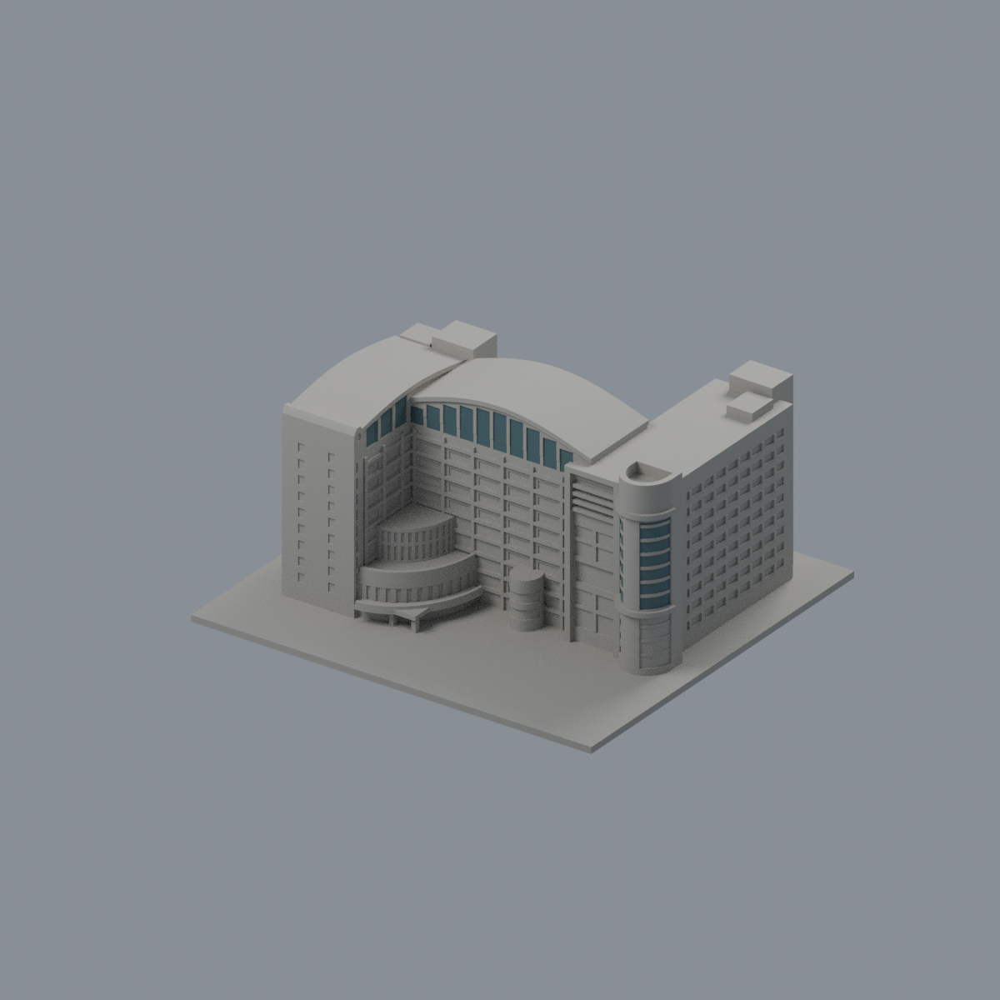
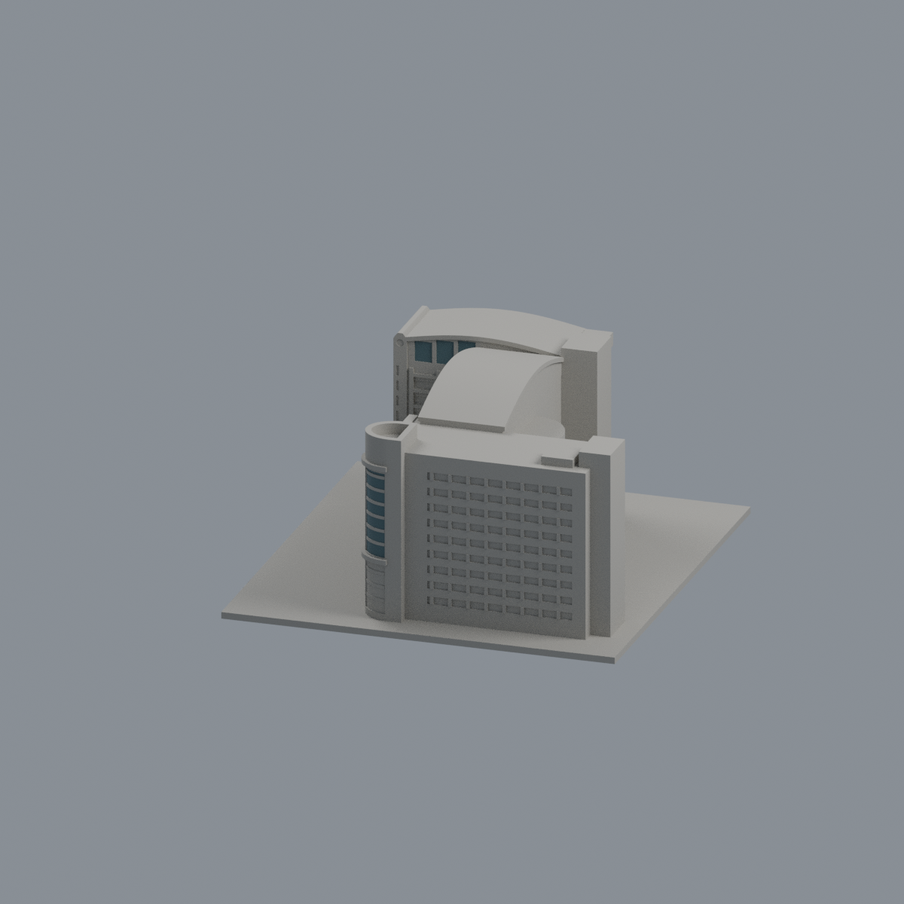
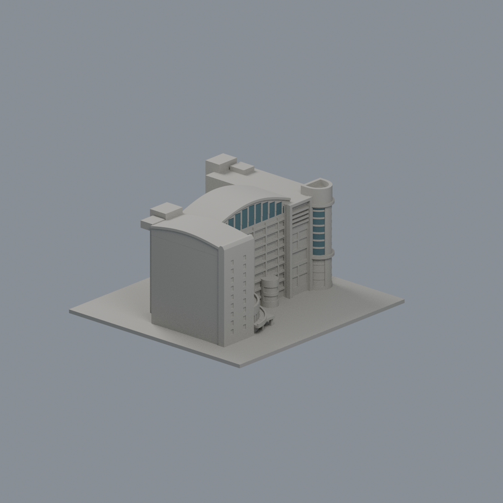
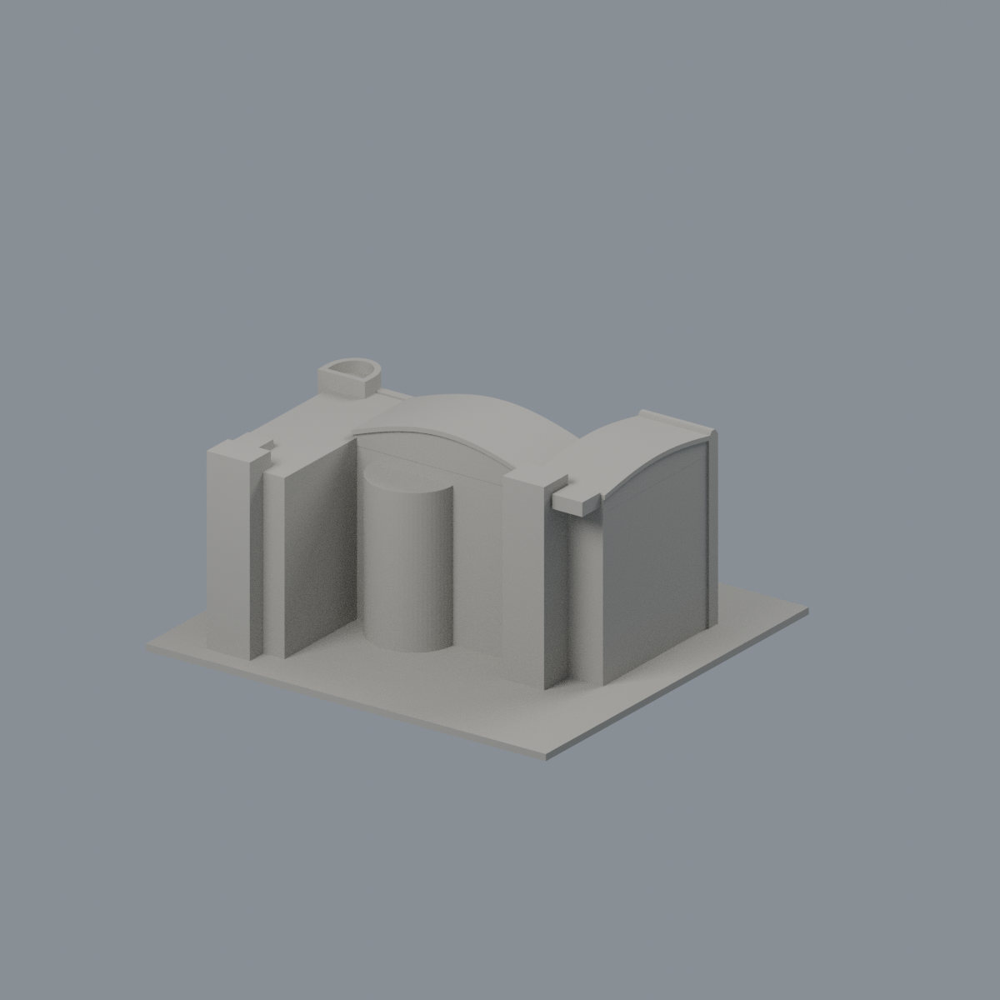
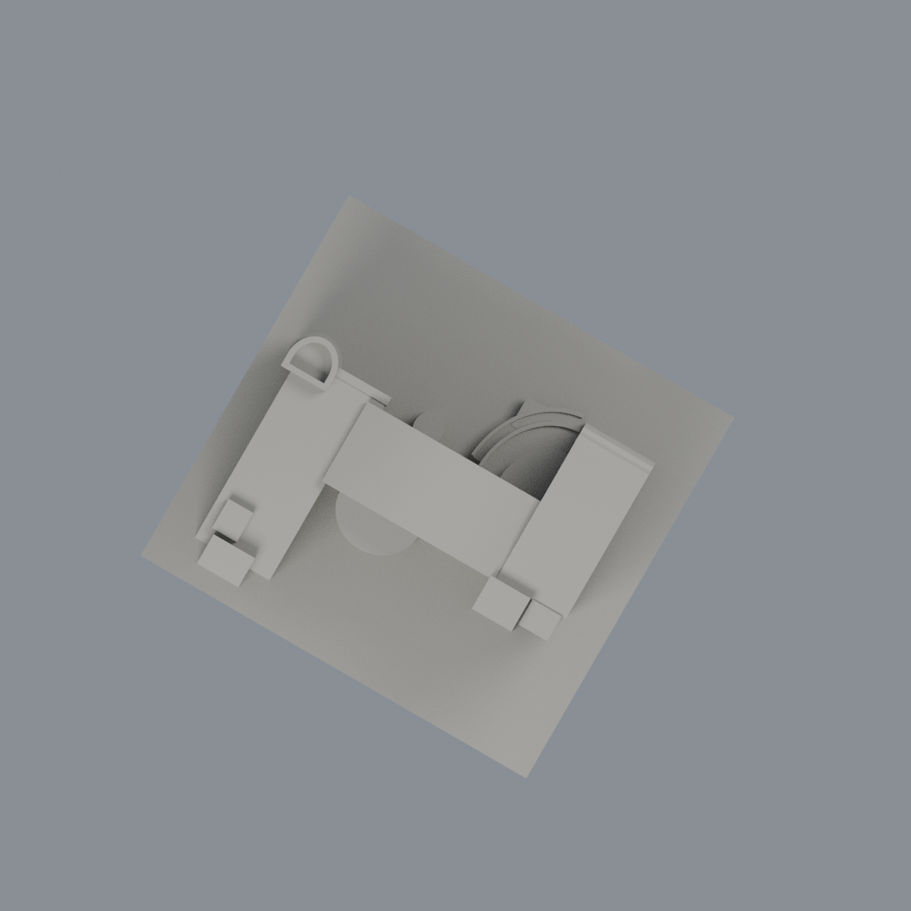

# 正修科技大學圖書科技大樓｜有界外觀近似

## 模型預覽


| 新版模型預覽 | 新版模型預覽 | 新版模型預覽 |
| :---: | :---: | :---: |
|  |  |  |
|  |  |  |

本件包括中央白曲頂、鐘端波頂翼、D形弧筒端平頂第三翼、背側高弧突與內院雙層閱讀弧面／低露台。以2017多面照片為主、2024正射與前空拍交叉核輪廓，非測繪復原。整校尚未完成，本件不代表全校。

- 含底座最長150mm，單位毫米；底座朝下。地景名義1.5m為展示假設。
- 原創參數：build_model.py；交付：model.stl、scene.blend。Blend由實際STL匯入可編修，源參數才是重建依據。
- 頂圖（歷史檔案留存，不作本頁預覽）、鳥瞰（歷史檔案留存，不作本頁預覽）、東面（歷史檔案留存，不作本頁預覽）、西面（歷史檔案留存，不作本頁預覽）。全部公開PNG由同一交付STL直接渲染，沒有來源照片合成。
- 三翼進退不對稱；高屋頂正射視差不當大懸挑。主白頂名義43m、主峰43.8m等數字只為比例候選，不是實測高度。
- 全背面細窗沒有足夠來源，保守省略；2024增設PV未納入。局部1–3F平面只是圖書館使用區，不能把整棟10F用途當三層。
- 曲頂與端簷、細框、環板、柱根皆列印加厚／背接；鐘冠局部截峰、鐘面圓槽及鐘端細窗縮小、D頭極細上百葉省略。淺刻抽象玻璃分格不代表精確建築立面。


## 列印限制與驗證

尚未實體試印，也未產生特定機型切片路徑。門架、外環、簷板及入口棚下方應檢查支撐；拆支撐時避免扳折細框與方柱。不要任意縮小。

[QA](QA.md)逐項列原mesh、0.2mm逐原Polygon erosion/opening、原三角法向首弦及其後空氣、連續角根與源／Blend／PNG重建。原嚴格失敗保留，指定例外已經獨立核驗與專案審核者裁定，不改成全部嚴格通過；這些抽樣不構成全方向最小壁厚保證。

[來源](sources.md)｜[可覆核控制點／列印化簡](source-controls.json)｜[逐項來源資料](sources.json)

## 重建

以requirements.txt記錄的Python套件版本及Blender4.3.2，於副本目錄依序執行：

```sh
python build_model.py
blender -b -t 4 -P render_preview.py
python run_all_checks.py
```

目前run_all_checks.py會保留兩支嚴格門檻的exit1，不能把它的失敗改為成功；幾何證據、已裁定的有限例外精確數值與限制見QA.md。若要驗SHA，請先複製包再執行會寫報告的指令，勿覆寫已凍結證據。

2026-10-15 獨立加密審核與指定例外詳見 [獨驗摘要](independent-audit-summary.json)；36筆為兩棚柱各18個跨層截面，獨立307500點有2383個短首弦，不能解讀為全域厚度達標。

## 原面有限玻璃代理外觀

[彩色3MF、可編輯Blend與五視角](appearance/README.md)：只染1396個完整原面（28冠窗＋1368 D筒上側玻璃），656.9861150828764 mm²，其餘29354面中性。110有限域全3頂點及實法向，原30750面／15373頂點與全部44原件保留。普通32窗、壁畫、下筒、框環、opaque及屋頂不染；不切面改幾何。2024照片metadata時區不強制調和；不附原圖／貼圖／壁畫。原strictfalse、有限例外與兩口徑抽樣照留，非實印保證。

