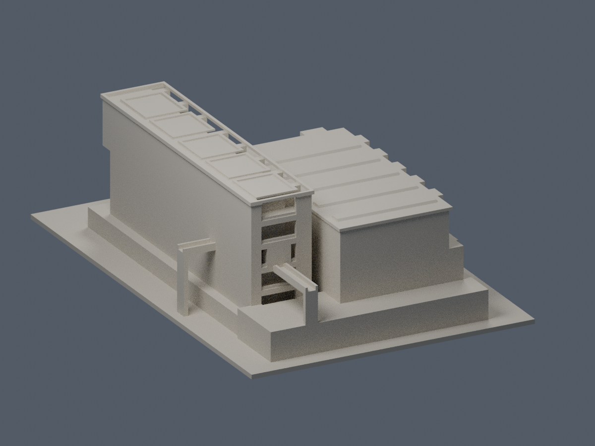

# 法鼓文理學院

## 揚生館

來源限定外觀近似模型，150 mm最長邊。以建築師平面、公開實景及NLSC屋面交叉判讀；高度與背面局部推估、列印加粗均列於模型文件。未試印，不保證免支撐。

| 正面 actual STL | 背面 actual STL |
|---|---|
|  |  |

[模型、來源及數位檢查](金山校本部/buildings/dila-yangsheng-hall/README.md)。數位審核紀錄見隨附報告；是否正式發布以統一發布清單為準。

本批僅揚生館；其他教學、行政、住宿與宗教空間未建模，不代表全校完成。後續可延續建築師整體校園來源逐棟研究，先釐清法鼓文理學院與僧伽大學／寺院棟界。
