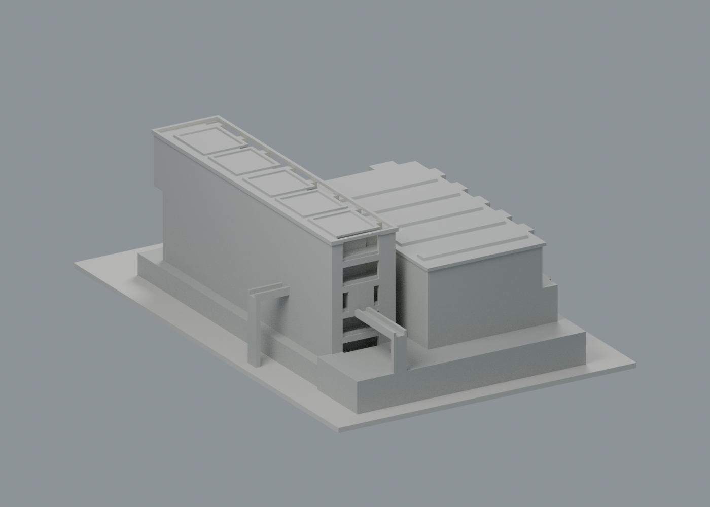
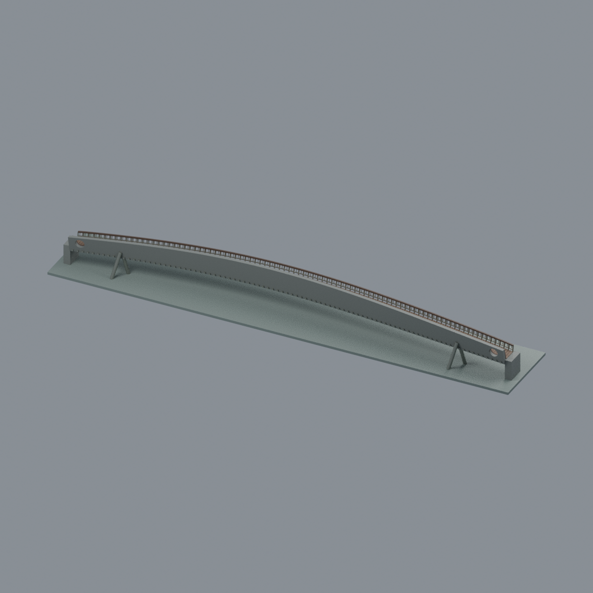
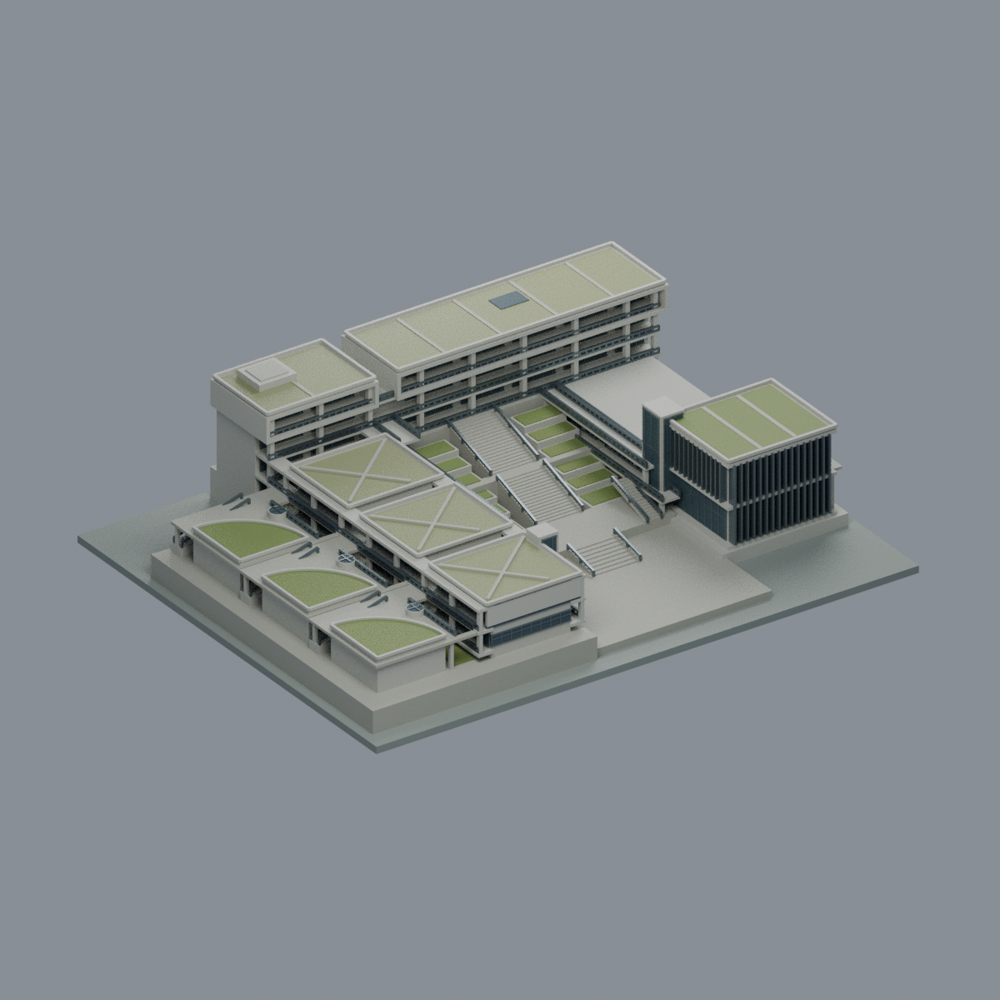

# 法鼓文理學院｜金山校本部

本校目前 **3 套**，套件數不等於整棟建築數，非全校完成；此橋不同於揚生館模型的局部小橋。

## 揚生館

來源限定外觀近似模型，150 mm最長邊。以建築師平面、公開實景及NLSC屋面交叉判讀；高度與背面局部推估、列印加粗均列於模型文件。未試印，不保證免支撐。

| 建築模型 | 建築模型 | 建築模型 |
| :---: | :---: | :---: |
| 正面 actual STL  背面 actual STL  |  **[法鼓文理學院・大願橋整橋外觀近似](buildings/dila-great-vow-bridge-middle-span-segment/README.md)** |  **[綜合大樓（GA／GB／GC）](buildings/dila-administration-teaching-complex/README.md)** |

[模型、來源及數位檢查](buildings/dila-yangsheng-hall/README.md)。數位審核紀錄見隨附報告；是否正式發布以統一發布清單為準。

既有揚生館之外的大願橋已升級整橋外觀近似，仍只計一套；另新增綜合大樓GA／GB／GC，其他未涵蓋住宿與宗教空間仍待研究，不代表全校完成。後續可延續建築師整體校園來源逐棟研究，先釐清法鼓文理學院與僧伽大學／寺院棟界。

揚生館已補[可見外觀五材質交換版](buildings/dila-yangsheng-hall/appearance/README.md)：可見混凝土灰、窗凹與灰金屬欄框，陰影不當黑漆，未確認屋後中性。原幾何、351 筆 >1% 薄損樣本及特定例外完整保留，未經新 FFF／試印；仍為既有單包，不代表全校完成。

## 大願橋整橋升級

大願橋由中央裁切片段升級為整橋主要外觀近似，維持單一套件：變寬曲橋、單高外傾箱梁、雙端真圓通孔、低開欄、圓橫梁與兩岸非共頂雙斜管，中央無落水墩。286×47×28.1mm、7材質Blend/3MF/STL、5真實mesh圖；原始67332三角單閉殼、格式實編回讀與九檔隔離重建byte一致。141層輪廓有效，保留32層／2565個0.8mm薄片段警告、細欄杆0.34mm，需支撐或拆件評估；未實印、不保證免支撐。108m依建築師，曲率/肋數推估；2015 EXIF與2016啟用分開，非測繪或2026現況。 [模型與來源](buildings/dila-great-vow-bridge-middle-span-segment/README.md) · [列印告警](buildings/dila-great-vow-bridge-middle-span-segment/QA.md) · [歷史片段](https://github.com/root50643/taiwan-buildings-3d/tree/4e9dfa531b4b065b9ed16f88ff28bbf2fe87a3d0/法鼓文理學院/金山校本部/buildings/dila-great-vow-bridge-middle-span-segment)。本次新增綜合大樓後全校／校區共3套，不代表全校完成；最小端接塊與展示底板不是實際岸坡。

## 綜合大樓（GA／GB／GC）

綜合大樓GA／GB／GC完整相連主要外觀近似：GA四主要層、GB／GC各兩主要層、三扇形講堂與三圓採光筒、多層真穿空側廊及不同高中庭廣階；不是揚生館、大願橋或全校模型。依2015專案資料、攝日未知完成照與2020校方使用圖，非2026現況或竣工測繪。243.6×195.3×59.64mm、7色Blend/3MF/STL與5實mesh圖；70652三角單閉殼、299有效切層、46空實點、strict材質及Blend真頂點存讀、乾淨9件byte一致與獨審通過。保留10層0.8mm水平薄島警示、0.378mm帽與0.525mm條，側廊與採光構件需支撐，未實印；後向小窗細格近似，不代表全校完成。

[模型與來源](buildings/dila-administration-teaching-complex/README.md) · [驗證與限制](buildings/dila-administration-teaching-complex/QA.md)。既有兩套模型幾何與QA不變。
