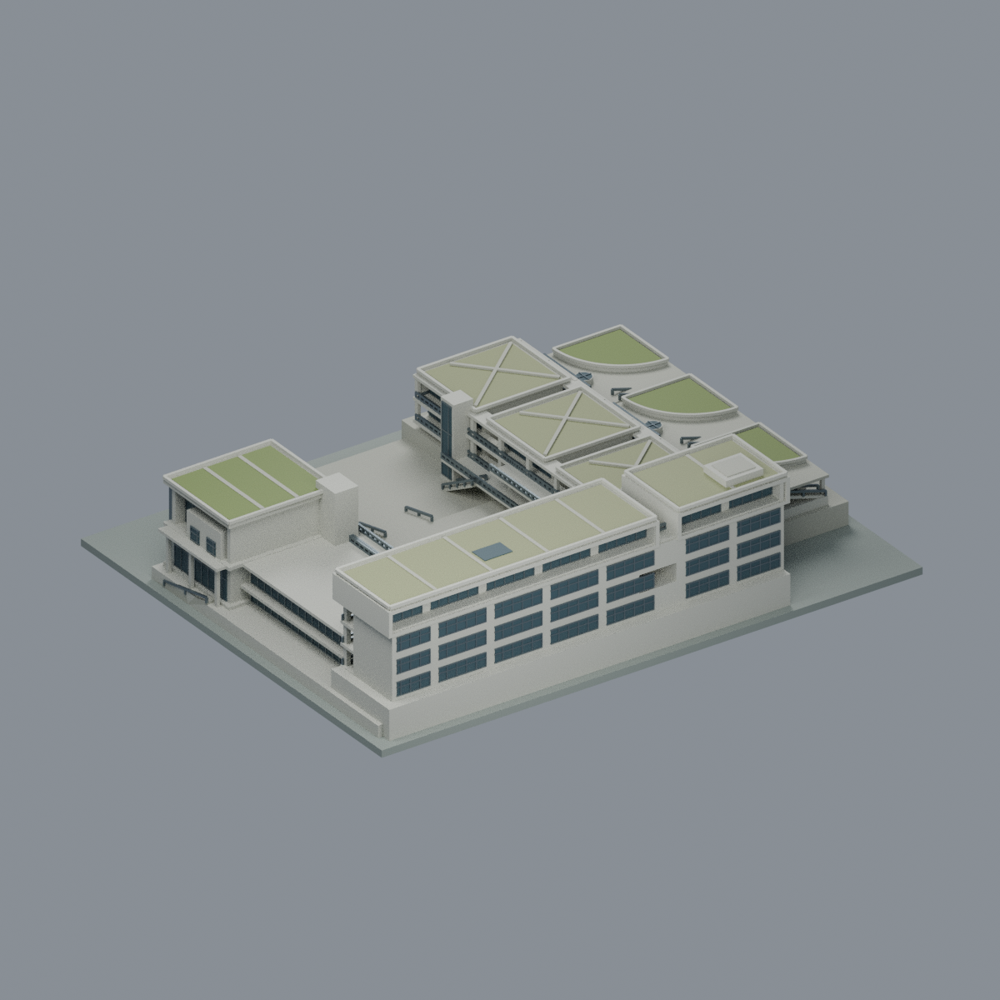
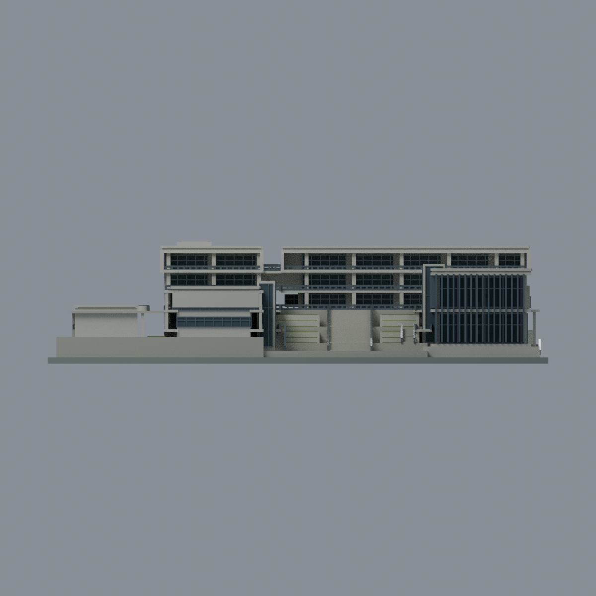
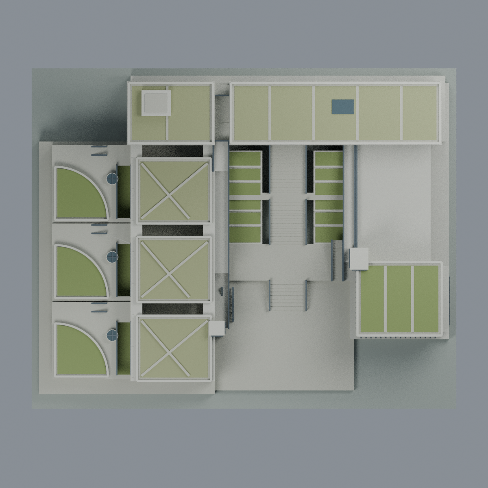
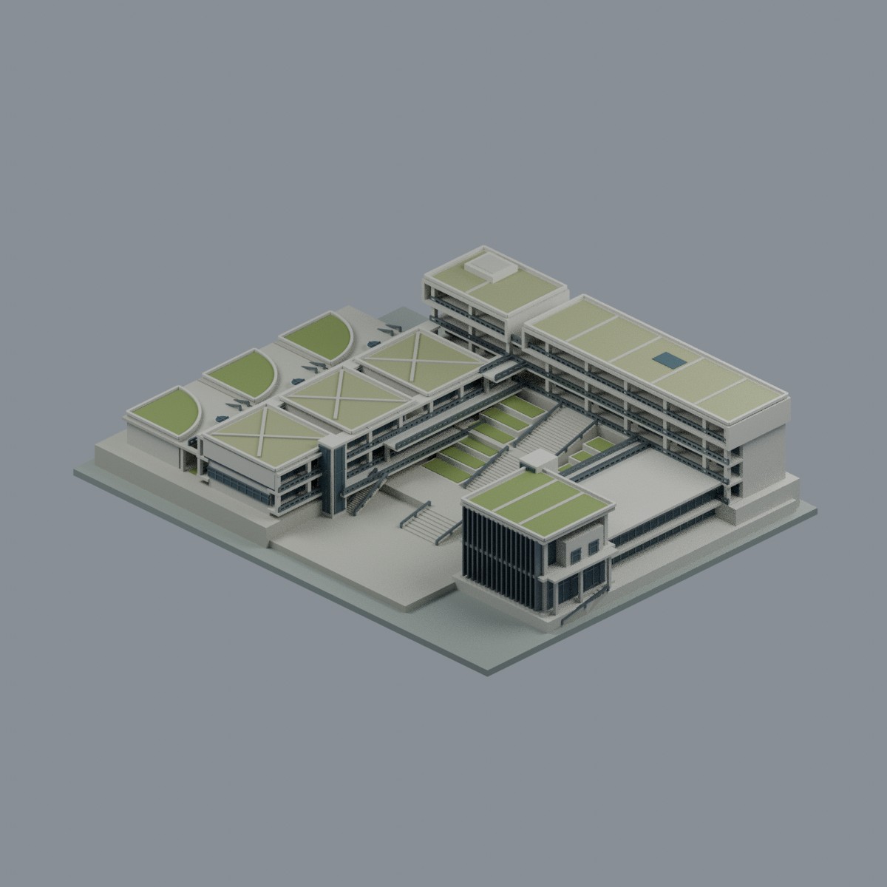

# 法鼓文理學院｜綜合大樓（GA／GB／GC）

[學校圖鑑](../../../README.md) · [金山校本部](../../README.md) · [全部模型](../../../../README.md)

**完整相連主要外觀近似模型**，金山校本部。GA行政教學高翼、GC教學與三扇形講堂、GB生活／大慧館相連低翼合為一套，不是整校或另外三棟模型。

## 來源版本與範圍

依設計者2015專案資料及可見成品照片、2020校方使用平面交叉製作。2015是專案標示，實拍拍攝年月未知；2020手冊的2025/10網址是上傳路徑。**不宣稱2026現況、實測比例尺或竣工測繪。** 平面以比例描讀，1比例單位對2.1展示毫米；沒有可靠完整尺寸圖，不能反算工程尺寸。

包含GA主要四層及斷開的長短頂框、GC兩層三串教室與開放採光槽、三個四分之一圓扇形講堂／綠頂及三圓筒採光井、GB兩層挑高大空間與低連接段、玻璃核心、外遮陽板、不同高度院落、廣階、柱廊、真穿空連廊與外露低層坡地基部。屋頂綠化分區及斜步道是貼附屋面，不是懸空梁。

排除大願橋、揚生館、禪悅書苑／分離宿舍、寺院、溪流池塘、全校道路及山坡。剖透視的切開車庫不是永久開放面；被埋地下部分採封閉實體，不照剖圖挖開。展示底座和局部支承地坪不是完整地形測繪。

## 檔案與可編輯性

- `scene.blend`：可編輯三角網格、分面材料與毫米場景；不是圖片替代模型。
- `model.3mf`：同形狀7種可改色的不透明基礎材料。
- `model.stl`：同三角形幾何，STL本身不儲存色彩或透明度。
- `previews/`：五張從實際mesh渲染的完整視圖；不是實景或概念設計圖。
- `build_model.py`、`render_model.py`、`rebuild.py`與驗證程式：原始來源圖片不參與重建。

清水模、金屬深遮陽、暗玻璃、綠屋頂以照片可見材料為依據。玻璃採不透明微型代理；大部分封閉室內實體化。背面樹遮小門窗、窗分格、百葉／扶手數、綠化植栽與機電細節是披露近似，不是逐件調查。平面圖向右像素軸轉世界+Y、向下像素軸轉世界+X，先校正手性再生成真mesh；前方看入時GC在左、GB在右、GA在後，不使用翻轉PNG偽造方向。

## 列印界線

**未做實體列印，不保證免支撐或任何機型成功。** 廊橋、挑廊、頂框、講堂平台及室外梯須支撐規劃。欄杆名目0.903mm、主要廊橋板1.155mm；採光井十字條0.525mm、部分窗梃和薄玻璃代理更薄，FFF可能合併或遺失。全局切層中的薄島失敗保留在`qa-layers.json`，不以通過水密檢查冒稱全部最小壁厚通過。

## 重建與驗證

建模Python需`numpy scipy trimesh manifold3d shapely rtree`；交換驗證另需`lib3mf`；Blender 4.3.2。實際版本見`qa/toolchain.json`。

```sh
python build_model.py
blender -b -t 4 --python-exit-code 1 --python render_model.py
python run_all_checks.py --lib3mf-python /path/to/python-with-lib3mf
python rebuild.py --output /new/empty/output --blender blender
```

`render_detail.py`另以不切割、不隱藏的實mesh產生院內QA圖，只補燈，不改寫交付Blend。依賴或作業環境不同不保證PNG byte一致；本次乾淨重建證據以JSON為準。

| 前側 | 後側 | 正立面 |
| :---: | :---: | :---: |
|  |  |  |

| 俯視 | 另一側斜視 |
| :---: | :---: |
|  |  |
