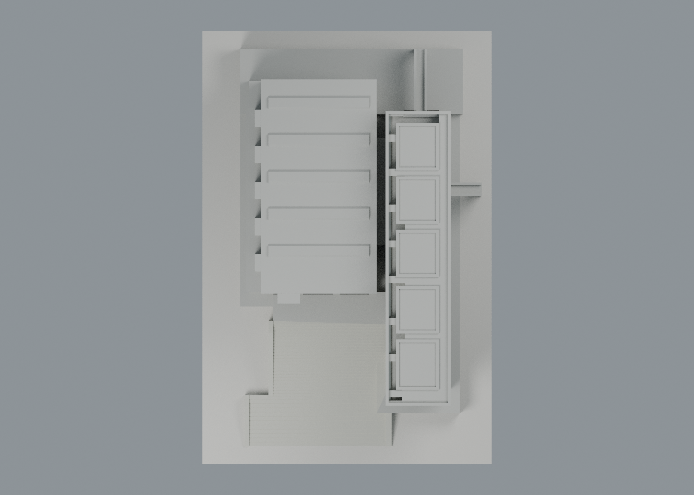
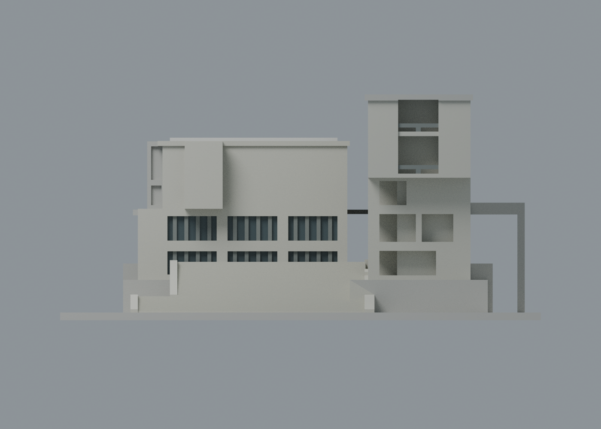

# 法鼓揚生館：可見外觀五材質交換版

依建築師正面實照，將原全棟暖石色改善為可見清水混凝土灰、球場南面深色窗凹與灰金屬窗框／欄帶；陰影中的混凝土仍使用同一灰色。**2,090 頂點、4,276 三角面直接沿用原 STL，座標及面序完全不變，未作共面細分。** 五個可編輯材質身份，不限制四色；是既有揚生館單包更新，不增加校數或包數。

| 模型預覽 | 模型預覽 | 模型預覽 |
| :---: | :---: | :---: |
| 正面：混凝土、現有窗凹與欄帶  | 背面：本圖未確認部分中性  |  |

| 模型預覽 | 模型預覽 | 模型預覽 |
| :---: | :---: | :---: |
| 頂視：未確認屋頂不套色  | 正立面：陰影由場景照明產生  |  |

## 下載與編輯

- [通用表面色 3MF](yangsheng-appearance.3mf)：單一原網格，毫米單位。
- [可編輯 Blender scene](scene.blend)、[五材質調色表](palette.json)、[逐面材質及角色](face-materials.json)。
- [原 STL](../model.stl) SHA256：6911fef40511720dfc947c740e96094c3d993fdba473bc3369af1914b850eb7f。

這是表面材質交換，沒有將色區切成封閉實體，沒有噴頭映射、機器設定或 G-code。不同軟體未必能把顯示色轉為多材料列印；GUI 匯入未測。深窗用不透明色代理玻璃反射與遮蔭，不代表測得的材料色或透射率。

## 來源與配色界線

本次完整實看[姚仁喜 大元建築工場官方作品頁](https://www.krisyaoartech.com/en/projects/education/Dharma-Drum-Institute-of-Liberal-Arts)的[單張正面原圖](https://www.krisyaoartech.com/data/goods/gallery/202209/1664345573805412406.jpg)。左棟可見「揚生館」字，雙量體、外階、左側球場南凸盒及右側高框／通廊對應既有模型。拍攝日期未核實，網址的 202209 目錄不當作拍攝日，不宣稱 2026 年現況。

- 依原建模座標對應照片：主要到達面在 **y−**；長棟朝向中間通廊的立面朝 **x−**。沿用原來源的南／西標籤作辨識，沒有新做地理方位量測。材質腳本反算原平面像素座標，僅定位既有表面，不把原像素比例升格為工程測量。
- 球場南面實牆、南凸盒實面、長棟可見高框／柱墩／退縮壁與簷下採同一混凝土灰。**照片中深凹陰影不被當成黑塗料或黑玻璃**；保留凹空，由場景光線自然形成明暗，沒有新增黑封板。
- 深玻璃僅用原球場南面六個低層有背窗凹；未將未知西側五盒側窗比照上色。照片的實際玻璃與陰影仍無法完全分離，色值是外觀代理。
- 原窗細框、長棟通廊低欄帶、南高框內退欄頂與中央欄柱用灰金屬近似。**原欄杆以加粗欄帶／柱簡化，並未因此補出實景細豎柵**；露出構件採同材質是有限構件外推，不能稱每一小面都被照片直接看見。
- 可見兩段外階與擋牆採混凝土代理，仍為原地形簡化。底板是展示色，沒有把草地、植栽或石砌地坪材質補進模型。
- 球場西側五盒、長棟東面、後面、屋頂、橋段及未分類面維持中性。舊來源中的其他照片／平面／航照仍僅保留其原幾何用途，本次沒有重新逐張實看，不算本次未見面材質證據。
- 不套用其他棟的綠屋頂或棕欄，不補模板孔、細磚紋、館名字形、人像、室內或鄰棟。

所有色值都是未校色照片的視覺近似，不是建材色票。原照片與私人對照不公開；[本次來源覆核](qa/source-appearance-review.json)列來源與雜湊，[原來源](../sources.json)及[尺寸推估](../source-dimensions.json)保留原版本。

## 原幾何、歷史 QA 與薄構件限制

含底座尺寸仍為 **100 × 150 × 46.990002 mm**。原深度、地形、橋截斷、五道低幅屋帶及玻璃不透明凹面的簡化全保留；配色不提高幾何精度。[原模型說明](../README.md)、[原 QA](../QA.md)、[原網格驗證](../validation.json)、[原逐 Polygon 檢查](../layer-component-check.json)、[原構件損失摘要](../component-loss-summary.json)與[原射線／根接檢查](../recess-root-check.json)全部位元保留，本次未重新執行製造檢測。

原 0.2 mm 截層有 **235 層、770 個原 Polygon**；逐件開運算未消失或分裂，但 **351 筆超過 1% 損失**屬 8 族跨層樣本，不能誤稱 351 支獨立柱。南框兩支中央欄柱的 9 筆樣本最大損失 **13.14696384744%**、保留 86.85303615256%；不能用整層最大 0.14996534288% 掩蓋。原 47 個 1 mm 抽樣的較小整層值，也不能取代上述逐件結果。

原 8 筆角外微殘差最高 0.006287658521 mm²，以及原 README 所列獨立真四角區外 0.006852099738 mm²／原構件 0.1025258520%，均保留，不改稱純角零損。既有有限尺寸／原面根接證據只支持原本這些特定例外，不是全方向、全域壁厚或可印保證。

原玻璃細框／橋欄約 0.82 mm，南框中板 0.935 mm、欄帶內退 0.85 mm、中央柱約 1.0251 × 1.0251 mm，仍接近製造限制。細欄、橋端、懸挑與簷口需要切片評估支撐和拆除，不能任意縮小。**未作新的 FFF 切片或實體試印，不保證免支撐。**

## 本次交換與場景檢查

[3MF 嚴格匯入／材質往返](qa/exchange-validation.json)、[scene 重開](qa/scene-validation.json)、[四圖紀錄](qa/render-manifest.json)。交付 XML／lib3mf 逐面比對原 STL float32 座標及面序完全一致；每邊兩個反向面、vertex-link 單循環、單一連通表面殼、正體積及零退化面另核。嚴格匯入零警告；只改一材質再寫出讀回，保留其他顏色及全部面指派。SDK 測試寫出最大量化差約 0.00000381470 mm，零退化面；測試改色檔不交付。

標準 Python 執行 source/build_appearance.py，由原 STL 及 palette.json 位元一致地重建 3MF／逐面清單。Blender 4.3.2 執行 source/render_appearance.py 產生四圖與 scene，再執行 source/verify_scene.py；source/verify_exchange.py 使用 numpy/lib3mf 作獨立對照與改色往返。這是外觀交換 QA，**不取代原 351 筆特定例外審核**。

原 scene.blend、八張單色圖與所有 QA 檔保留在上一層。原 readme-view-check.json 記錄的是當時的單色圖片路徑／雜湊；最新三層 README 改用 appearance/ 圖片，現行圖片引用由此次發布檢查另核，沒有覆寫舊的展示證據。

要重現含原單色 README 引用的整套歷史展示檢查，可使用[更新前固定版本](https://github.com/root50643/taiwan-buildings-3d/tree/2249681ba2bf2fe00181c90183138a614f9974b7/法鼓文理學院/金山校本部/buildings/dila-yangsheng-hall)，避免把當時圖像雜湊誤當本次配色圖的雜湊。
