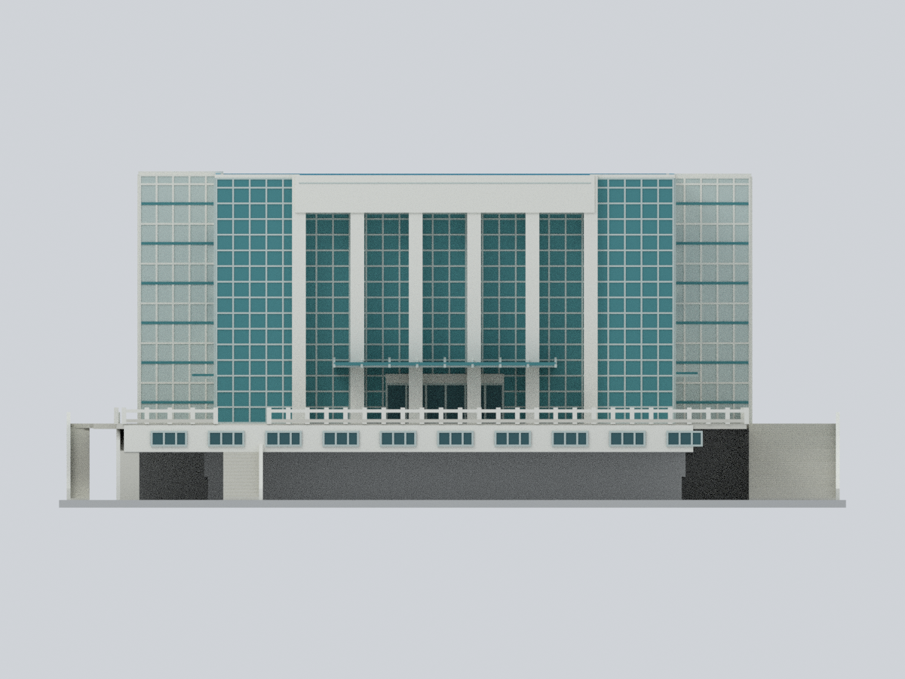

# 淡江大學

已收錄4套外觀代表模型；不是全校或全校區完成。

## 模型圖鑑

**宮燈教室群既有範圍：** 七棟坡地教室的跨來源有界微縮近似；不是同年復原或實測。數位審核紀錄見隨附報告；是否正式發布以統一發布清單為準。

| 建築模型 | 建築模型 | 建築模型 |
| :---: | :---: | :---: |
| 正向 actual STL  |  **[淡江大學海事博物館｜低細節外觀代表模型](淡水校本部/buildings/tku-maritime-museum/README.md)** |  **[淡江大學｜淡水校本部｜書卷廣場竹卷雕塑與舊圓階座](淡水校本部/buildings/tku-scroll-square-monument/README.md)** |
|  **[紹謨紀念體育館｜2021–2022已裝光電完整地上外觀近似版](淡水校本部/buildings/tku-shaomo-gymnasium/README.md)** |  |  |

[模型、來源與列印限制](淡水校本部/buildings/tku-palace-classrooms/README.md) · [數位驗證](淡水校本部/buildings/tku-palace-classrooms/QA.md)

書卷廣場竹卷雕塑與舊圓階座為未定年舊完整圈階外觀近似，不拼接2025新步道，不代表2026現況；[來源、模型及版本界線](淡水校本部/buildings/tku-scroll-square-monument/README.md)與[QA及保留警告](淡水校本部/buildings/tku-scroll-square-monument/QA.md)。641個全局切層保留11層／11個薄成分及512個懸挑面，未實印、不保證免支撐。既有宮燈教室群與海事博物館的範圍及列印限制仍各自有效。

[此次新增清冊](inventory_updates_scroll_monument_20261022.json) · [四件模型索引](model-index.json)；只是4套模型，不等於4棟建築或全校完成。

[紹謨紀念體育館｜2021–2022已裝光電完整地上外觀近似版](淡水校本部/buildings/tku-shaomo-gymnasium/README.md)：紹謨紀念體育館：2021–2022公開資料記錄的已裝光電完整地上外觀比例近似，含前方六道高柱/凹玻璃、雙玻璃角、後側外凸梯塔、下部量體、3F前凸、4F露台、不對稱外梯及低矮光電區。排除相鄰游泳館、雕塑、室內與地下層。總高/樓層高鏈/地形未驗證，背面及部分下部接地面依平面作中性近似；3F前凸下方展示空隙不是已核實的真實懸挑或地形。206×140×88mm為展示尺寸、無建築比例尺，非2026現況/測繪/竣工復原；不混舊裸露屋頂與新光電。STL、8材質3MF、可編輯Blend、Python重建與9圖；0.35–0.44mm框料、0.26mm光電分格及挑簷/露台/欄杆列印限制保留，需支撐評估，未實體試印。
