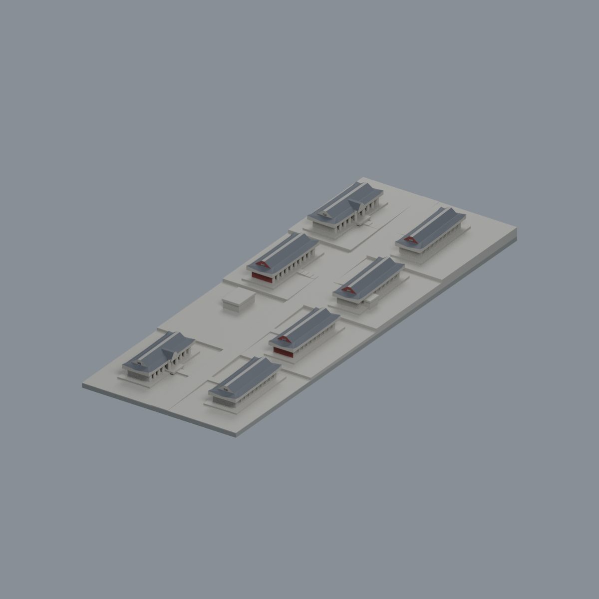

# 淡江大學

已收錄3套外觀代表模型；不是全校或全校區完成。

## 模型圖鑑

**宮燈教室群既有範圍：** 七棟坡地教室的跨來源有界微縮近似；不是同年復原或實測。數位審核紀錄見隨附報告；是否正式發布以統一發布清單為準。

| 建築模型 | 建築模型 | 建築模型 |
| :---: | :---: | :---: |
| 正向 actual STL  反向 actual STL  |  **[淡江大學海事博物館｜低細節外觀代表模型](淡水校本部/buildings/tku-maritime-museum/README.md)** |  **[淡江大學｜淡水校本部｜書卷廣場竹卷雕塑與舊圓階座](淡水校本部/buildings/tku-scroll-square-monument/README.md)** |

[模型、來源與列印限制](淡水校本部/buildings/tku-palace-classrooms/README.md) · [數位驗證](淡水校本部/buildings/tku-palace-classrooms/QA.md)

書卷廣場竹卷雕塑與舊圓階座為未定年舊完整圈階外觀近似，不拼接2025新步道，不代表2026現況；[來源、模型及版本界線](淡水校本部/buildings/tku-scroll-square-monument/README.md)與[QA及保留警告](淡水校本部/buildings/tku-scroll-square-monument/QA.md)。641個全局切層保留11層／11個薄成分及512個懸挑面，未實印、不保證免支撐。既有宮燈教室群與海事博物館的範圍及列印限制仍各自有效。

[此次新增清冊](inventory_updates_scroll_monument_20261022.json) · [三件模型索引](model-index.json)；只是3套模型，不等於3棟建築或全校完成。
