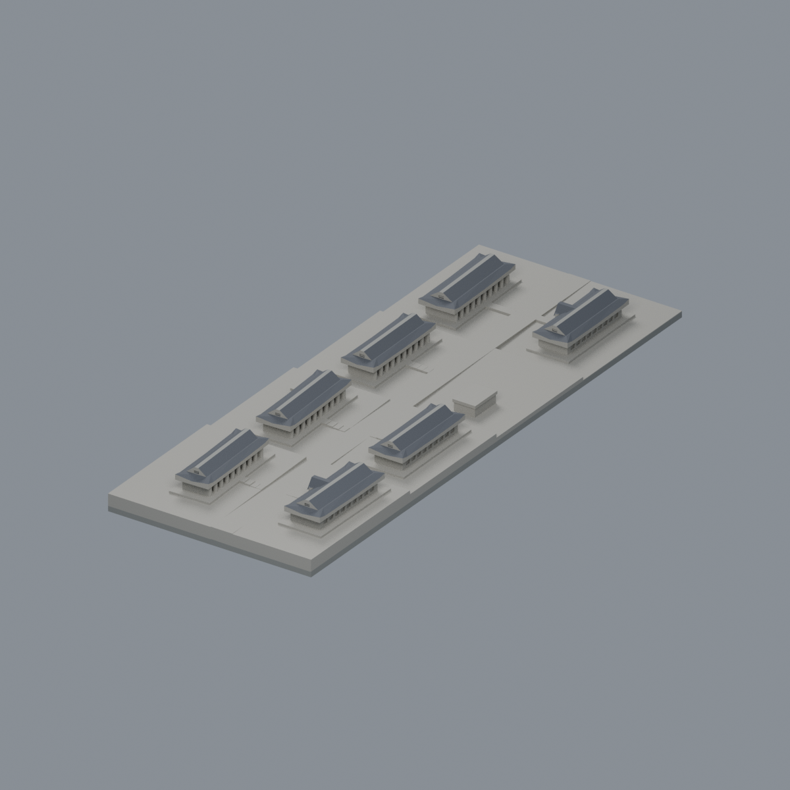

# 淡江大學・淡水校本部

已收錄2套外觀代表模型；不是全校或全校區完成。

## 宮燈教室群

七棟坡地教室的跨來源有界微縮近似；不是同年復原或實測。數位審核紀錄見隨附報告；是否正式發布以統一發布清單為準。

| 建築模型 | 建築模型 | 建築模型 |
| :---: | :---: | :---: |
| 正向 actual STL  反向 actual STL  |  **[淡江大學海事博物館｜低細節外觀代表模型](buildings/tku-maritime-museum/README.md)** |  |

[模型、來源與列印限制](buildings/tku-palace-classrooms/README.md) · [數位驗證](buildings/tku-palace-classrooms/QA.md)
