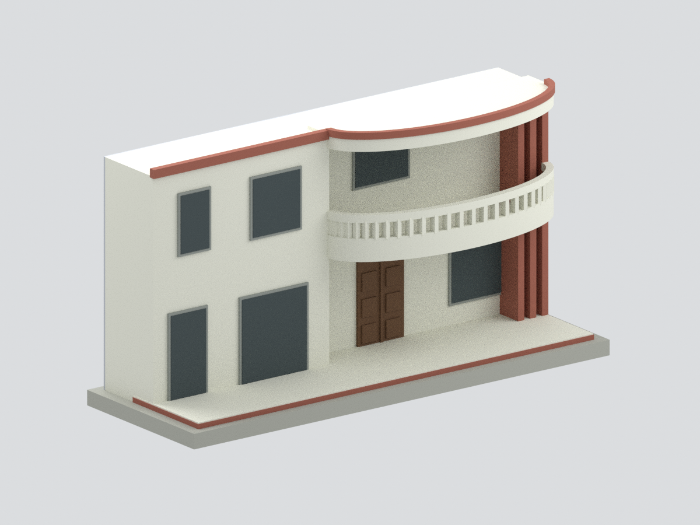

# 淡江大學校史館暨張建邦創辦人紀念館（原瀛苑）主立面截段

依淡江大學官方兩張可讀照片製作的**改修後舊瀛苑主正面有界外觀研究**，不是整棟館舍，也不是已驗證的 2026 年現況。兩圖呈現不同入口改修展示狀態，本模型只採共同可辨的舊主正面；照片上傳路徑 2023/10 不能視為拍攝日期。

## 範圍與近似

- 包含左側兩層矩形立面、四個大小不一的主要窗開口，以及右側上下弧形廊、下實心白色曲面欄牆、短矩形欄孔、白色上扶手、白色曲面頂簷與紅褐頂壓邊。
- 右側三片可見紅磚色豎向片作簡化；被樹遮蔽或後退的構件不補齊。木門及窗為不透明簡化面，不重建展覽或室內。
- **排除左側新入口、鏡面電梯及附屬量體**，這些確實出現在來源中，只是不在本模型範圍；亦排除未知後部、花池、庭園及植栽。
- 後面為明確的中性截斷面，厚度由作者選定，不是館舍實際進深或後立面。
- 曲線採橢圓弧擬合、29 根規律短欄柱為重複構件簡化，**不是已查證總數**。窗寬、層高、曲率、欄孔、階臺、窗框及門板均無實測尺寸，不能作修繕或工程使用。
- 七色為未校色照片近似。模型尺寸約 133 × 46.2 × 69.65 mm；每名義單位為 7 mm，不代表實物比例尺。底座為作者展示支撐。

## 產物

生成與驗證程式、STL、面色 3MF、Blender 可編輯構件、六張實際網格視圖及 QA。隱藏構件為聯集前作者操作，允許重疊；可見正式網格為單連通聯集。數位拓撲通過不代表實機試印或保證無支撐可印，曲面頂簷與欄孔應另行切片評估。

來源照片未獲再散布授權，不包含於模型包。見 [SOURCES.md](SOURCES.md)、[REBUILD.md](REBUILD.md)。
