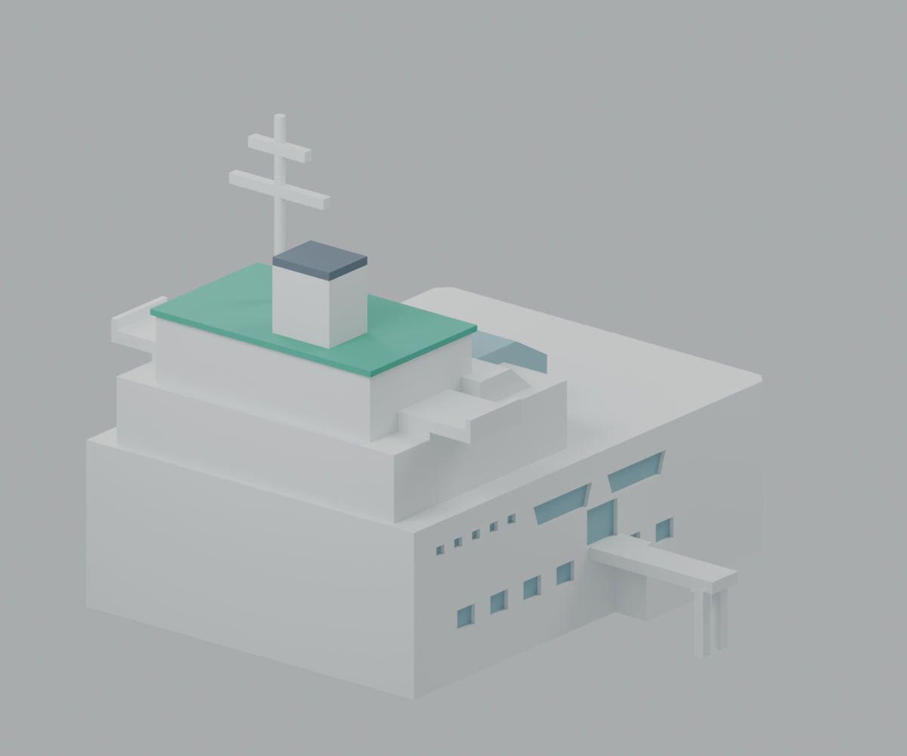

# 淡江大學海事博物館｜低細節外觀代表模型

**本模型需要支撐，並須在自己的切片器完成支撐安排與拆除確認。** 獨立覆核為條件式GO；沒有實際生成支撐、切片或試印，不保證支撐可移除，也不宣稱免支撐。

| 前方甲板視角 | 相反視角 |
|---|---|
|  |  |

[下載STL](model.stl) · [列印前操作說明](PRINTING-LIMITS.md) · [獨立覆核與兩條排除路徑](qa/public-review/README.md) · [全部預覽與相機](previews/render-manifest.json)

依官方公開影像建立原創幾何，描述**未定年外觀**，不是測繪、BIM、精確2024或2026現況。照片檔名202403／202408不是拍攝日期。此件是宮燈教室群以外新增的海事博物館，不是文錙藝術中心；淡江其他校區與建物未完成。

保留寬長近矩形主身、前方開放平甲板、階梯退縮量體、雙側懸挑駕駛艙翼、角狀玻璃體、綠色上屋頂、直立長方煙囪狀量體及桅杆。沒有尖船首、地下船殼或額外屋頂亭，沒有封滿甲板。鄰棟高樓、飛機、樹與室內排除；欄杆、索具、設備與文字省略。玻璃是實心幾何的原創顏色示意，STL不含透明材質或色彩。

## 尺度與來源

以mm匯入，總包絡148 × 140 × 130 mm，包含窄入口橋及桅杆；主身104 × 140 mm，開放甲板Z=44 mm。全部尺寸是可見外框內的比例估算，沒有實物測量標尺；後端、樹遮下緣、窗數與橋墩細部是保守代表處理。入口橋與短樓梯只通側門，不延伸到屋頂甲板。

九張官方照片已下載並實際觀看，兩主空拍SHA符合指定值。[逐圖來源與雜湊](sources.json)及[像素覆核](qa/independent-source-review.md)保留使用範圍。582f09af健康中心走廊排除；6e34bd59只支持側門樓梯。校園圖第15號是上游研究已核對的背景，本包沒有重新取得，不以它提供尺度。官方照片僅供私人研究，原圖、縮圖、照片材質與審閱衍生圖均不分發。

## 支撐安排的交付條件

1. 以本尺寸、+Z向上檢查。翼下須允許從Z=44甲板上長出支撐，或使用在切片器確認能繞過主身的外部分枝；僅用底板支撐不能覆蓋全部翼下。
2. 橋墩間支撐分塊，不可環抱兩墩成為不可斷開的大塊；主橋下往+Y側退出，窄墩間可沿Y=-2.6的X向通道分塊處理。橋端(-90,-4,8.4)向-X的3mm工具路徑有碰撞，明確排除。
3. 橫臂左右與上下支撐分開；靠煙囪的下橫臂支撐朝前-Y拆除。(0,41,95)向+Y會撞煙囪，明確排除。不可把高處開放空間當成低處支撐能向後整塊抽走的證據。
4. 在自己的切片器逐層確認所有懸垂、接點、分塊、工具與支撐取出空間，保護1.6mm薄邊及2.8mm桅杆；必要時採可溶支撐並確認4mm墩間、8.2mm臂間能進液與清除殘料。若實際安排有困住支撐或需要折斷細部的情況，須重新設計支撐，不能直接列印。

詳細座標、替代路徑與保留的兩個false結果見[列印限制](PRINTING-LIMITS.md)及[獨立支撐原值](qa/public-review/print-audit/support-results-final.json)。空氣中的理想工具通道不等於真實支撐可移除。

## 數位檢查與重建

固定STL SHA-256：`42097fab9a62dccd4042ba18bc49d3c5b9a44e66ff71e91962e68b56d74bc8b1`，64,584 bytes，1,290面。獨立檢查為單連通封閉流形、正體積，非法自交0。**約1.60mm僅為1,290條面心內法線取樣的最低弦長，不是全域最小壁厚。** [完整QA](QA.md)保留方法、控制與原始失敗鏈。

依requirements.txt安裝Python 3.13相依套件後，在本模型目錄執行：

```text
python source/build_model.py
python source/render_preview.py
python source/verify_bindings.py
python qa/independent_qa.py model.stl --out qa/local-rerun.json
python qa/independent_qa.py --selftest --out qa/local-controls.json
```

生成器與parameters.json共同定義原創形體，上部細部常數明列在生成器。STL重建位元組相同，場景只有一個模型網格，三角面與STL一致；十張預覽由實際STL渲染。公開版僅去除私人路徑與PNG文字／時間metadata，像素IDAT、固定STL、原始失敗flags及數值保留。[發布綁定](qa/publication/rebuild-scene-preview-binding.json)與[去識別紀錄](qa/publication/metadata-redaction.json)記錄差異。front/rear等是模型視角，不代表實測方位。

v1薄刻紋、翼根狹縫、v1自交演算法原旗標及v2橋後窗槽問題均保留於qa/history及qa/independent。修正後只有明示的列印簡化；沒有為取得全綠而改寫失敗值。獨立覆核固定候選ID為c09925e44d758a46156241ddb7995d7f92ca6c9f；公開版不改固定STL。
