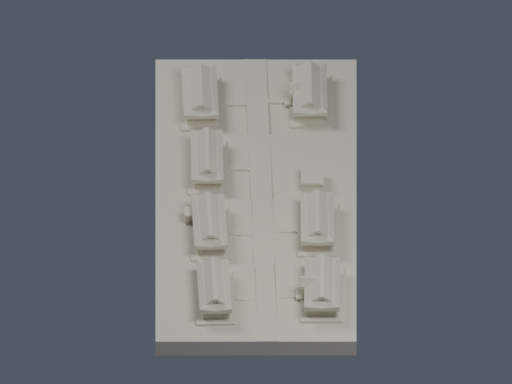

# 淡江大學・淡水校本部・宮燈教室群

跨來源有界群組微縮近似，非精密單棟復刻。七棟主教室分離排列於坡地，整體以連續底座接成單一表面殼。數位審核紀錄見隨附報告；是否正式發布以統一發布清單為準。

| 西南西端正向 | 東北東端反向 |
|---|---|
|  |  |

## 範圍與來源
- 七主棟 N1、N3、N4、S1–S4；N2 小附棟和南側廁所另作低量體，不補第八棟主教室。
- 2015 校方平面、2021-04-22 兩向斜空拍、年代不同的官方近地照與 NLSC 航照共同支持。NLSC「2024」是水印，不是確認拍攝日；不稱同年復原。
- 主棟簷線由原 1792px 航照等倍率旋轉逐棟描點；近似長 30.5–31.9m、寬 10.8–12.0m。屋頂投影不是牆基。描點、旋轉、±5px 遮擋誤差及比例詳 roof-traces.json。
- 高度沒有官方標高：模型比例約 0.83mm/m，牆簷相對樓面約 4.34m、脊約 7.53m 僅照片有界選值；坡台高差同為近似。附棟高度與背部細節保守簡化。
- 前廊向大道、背面大窗、上山牆下短坡及角翹、N1/N4 中央交叉山牆與露天橫路為主要辨識特徵。相鄰覺軒花園不在本件。

## 列印簡化與限制
- 全底座 150 × 56mm；單棟屋頂僅約 25–26mm 長。主柱直徑 1.1mm、脊頂截平約 1mm、屋簷加厚，前廊端牆 1.2mm。瓦當、逐片瓦、宮燈及細窗格省略；不可把加厚形態當作實物原尺寸。
- 屋簷翹角和脊平頂為保留群組辨識及數位連通而簡化，不適合任意再縮小。露天階路踏步不作行走規範或實測坡度用途。
- STL 無單位，按 mm 匯入；底座平放。前廊與出簷可能需要支撐，須按材料、噴嘴和切片另行試印。未做實體列印，不保證無支撐可印。
- 單殼、侵蝕及射線檢查是數位篩查，不代表全方向薄壁、懸挑或所有自交已窮盡驗證。

## 重建與驗證
Python 依 requirements.txt 安裝；Blender 4.3.2。依序執行 build_model.py、blender -b -t 5 --python render_preview.py、run_all_checks.py。PNG 由實際 STL 產生，Blend 只有一個同幾何網格。原圖私人核對，交付不含來源圖或 PDF。

詳 sources.json、QA.md、roof-traces.json、各 JSON 報告及 SHA256SUMS。

## 獨立薄損補充
57層1066個原Polygon零侵蝕／opening消失或分裂。52個跨層截面樣本超過1%，不是52根實體柱，最大損失1.9313920238%、保留98.0686079762%。獨立查核保留原始opening計算，只在定位轉角時以0.00001mm去除共線細分點，再量真正轉角0.41mm鄰域；鄰域外損失最高2.08235×10⁻¹⁰mm²，於1×10⁻⁸mm²比較容差內，屬數值殘差。這不同於作者原0.6mm定位範圍，沒有擴大opening保留門檻或修補原網格。
132項原STL射線重現包含74柱上下根與開廊淨空，廊端牆1.2mm；上部通氣槽側根原指定位置至少0.95mm，追加28個槽側位置橫向最小0.9746054mm，實際外屋面法線向內連續進入主體，未見封閉薄皮。這些是指定位置證據，不是全模型／全方向最小壁厚；群組微縮的屋簷、柱廊、脊端仍應檢查支撐和拆除風險，不得任意縮小，尚未實體試印，不保證無支撐可印。
