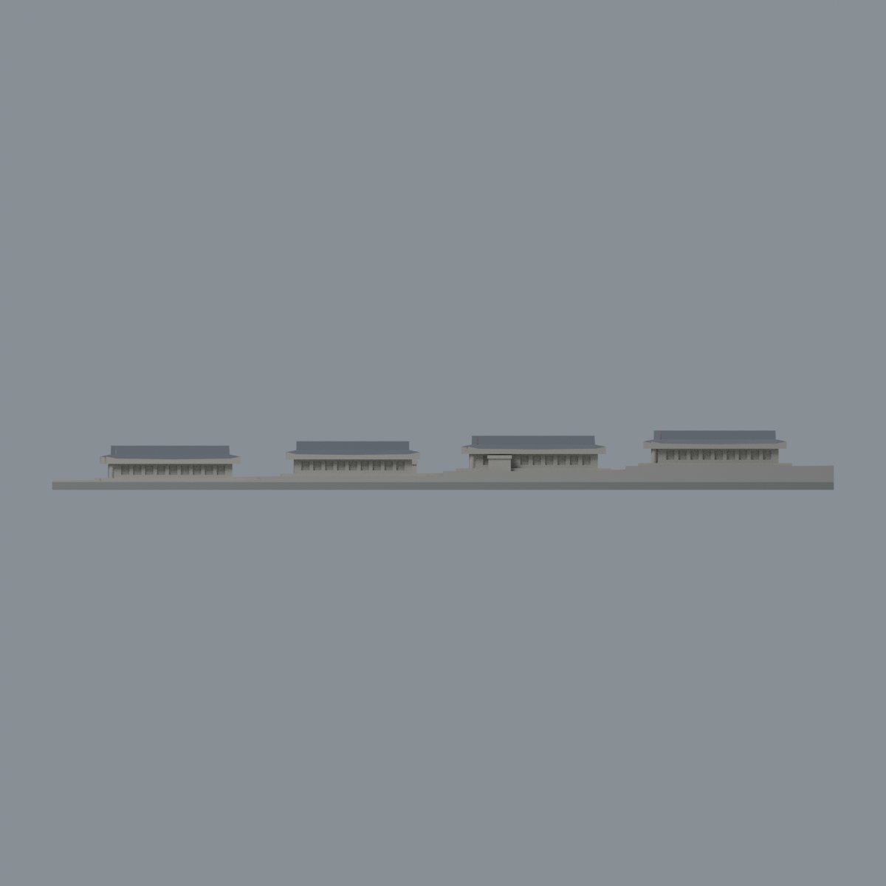
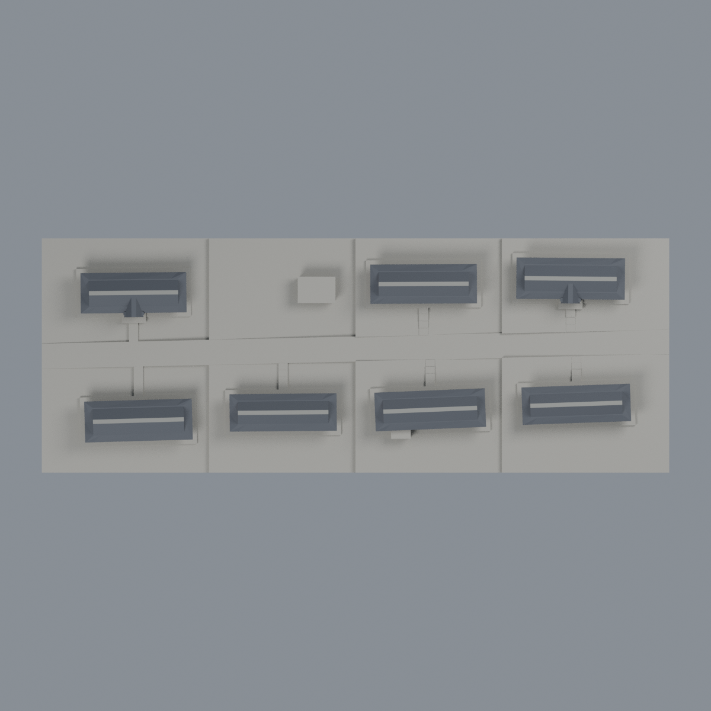

# 宮燈教室群：2021 可見面五材質外觀版

本次只對原有 **11,064 三角面／5,414 頂點**加表面材質，不改座標、面序或形體，不細分，也不把群組拆成新增七件模型。原 STL 位元保持。

| 模型預覽 | 模型預覽 | 模型預覽 |
| :---: | :---: | :---: |
| 西南西端向東北東  | 反向：未知牆面保持中性  |  |
|  |  |  |

[彩色 3MF](tku-appearance.3mf) · [可編輯 Blender](scene.blend) · [材質色表](palette.json) · [逐面指派理由](face-materials.json) · [原 STL](../model.stl)

## 來源與逐棟登錄

實際閱讀[淡江官方宮燈教室素材分類](https://photo.tku.edu.tw/index.cshtml?typ=014024)及攝影者的[2021-04-22 空拍記錄](https://mnya.tw/yo/word/2431.html)，配色依後者的[宮燈大道斜空拍照片](https://mnya.tw/yo/wp-content/uploads/2021/2431-5.jpg)實際觀察。文章發表於 2021-04-23，標示拍攝日 2021-04-22；不是 2026 現況照。官方分類頁不冒充已成功讀取其全部原圖。參考原圖只私人核對，未隨本包散布。

原腳本定義東北東為 +X、北列為 +Y。以下沿照片大道由近至遠逐一對應，不以單棟顏色覆蓋全群：

| 原模型 ID | 照片位置 | 本次可用色面 | 明確保留中性 |
|---|---|---|---|
| N1 | 左側最近、前景有交叉山牆的長屋 | 深灰屋面、灰脊代理 | 被裁切的短端及遮蔽牆 |
| N3 | 左列中段可見紅色西短端 | 深灰屋面、灰脊、西短牆及上山牆素紅 | 長側牆、東端、廊內 |
| N4 | 左列最遠、白色短端附近 | 深灰屋面、灰脊 | 短端不因鄰棟紅色而塗紅 |
| S1 | 右列最近、畫面底緣截去下半部 | 深灰屋面、灰脊 | 畫外牆及端部 |
| S2 | 右列中前段、明顯紅色近端 | 深灰屋面、灰脊、西短牆及上山牆素紅 | 長側牆、東端、廊內 |
| S3 | 右列中後段 | 深灰屋面、灰脊、可見西上山牆素紅 | 樹遮下牆、其餘立面 |
| S4 | 右列最遠 | 深灰屋面、灰脊、可見西上山牆素紅 | 下部及其餘立面 |

N2 小附棟與 S3 南側廁所保持中性，不能塗成第八棟紅色教室。原有中性坡台、道路、階梯與底板不依照片樹色塗綠；不增添模型原本省略的樹木、宮燈、逐片瓦或裝飾。

五材質為：未知中性色、深灰瓦面、有限可見西端紅色、灰脊代理、展示底板。色值未校正，日照與遮蔽影響明顯；不是實測建材色票。七屋面的整面深灰沿同一屋面材料連續性有限外推，不能理解為每個坡面都有近照。原有加厚、平截屋脊用灰色代理，不新增實物瓦脊。紅色只對完整既有三角面作有限配色，不加入磚紋、百葉或窗框。

[登錄與來源 QA](qa/source-review.json) · [原逐棟幾何控制](source/building-controls.json) · [原模型及年代限制](../README.md) · [原來源](../sources.json)

## 可重建、可編輯及 QA

由本資料夾上層提供原 model.stl；安裝 [依賴](source/requirements.txt)，使用 Blender 4.3.2：

1. `python appearance/source/build_appearance.py`
2. `python appearance/source/verify_exchange.py`
3. `blender -b -t 4 --python-exit-code 1 -P appearance/source/render_appearance.py`
4. `blender -b -t 4 --python-exit-code 1 -P appearance/source/verify_scene.py`

[獨立重建 ZIP](rebuild-source.zip)含原 STL、四支腳本、逐棟控制與依賴，不含第三方照片。[SHA256 清單](SHA256SUMS)

[交換／拓撲核驗](qa/exchange-validation.json)確認逐面座標與順序完全相同、全部面指派、單連通、有向水密、頂點 link 單環、正體積，零退化及重複面；lib3mf 嚴格讀取零警告，實際單材質編輯後寫出再讀回，其他材質與面指派不變。SDK 六位小數存檔的量化誤差另列，測試編輯檔不是正式交付檔。

[場景存讀／編輯](qa/scene-validation.json) · [渲染記錄](qa/render-manifest.json) · [獨立重建](qa/rebuild-validation.json)

## 製造限制仍適用

原尺寸 150 × 56 × 約 11.4 mm；七棟仍連在同一連續底板上。3MF 是表面色而非分色封閉實體、切片專案或 G-code；未測切片 GUI、噴頭映射或實體列印。原幾何／場景／所有歷史 QA 均保留；原層檢、薄損及射線檢查本次未重跑，不能將本次材質 QA 當成新的全面製造認證。細柱、廊簷與屋脊須評估支撐與搬取，不保證免支撐可印，也不適合任意縮小。
