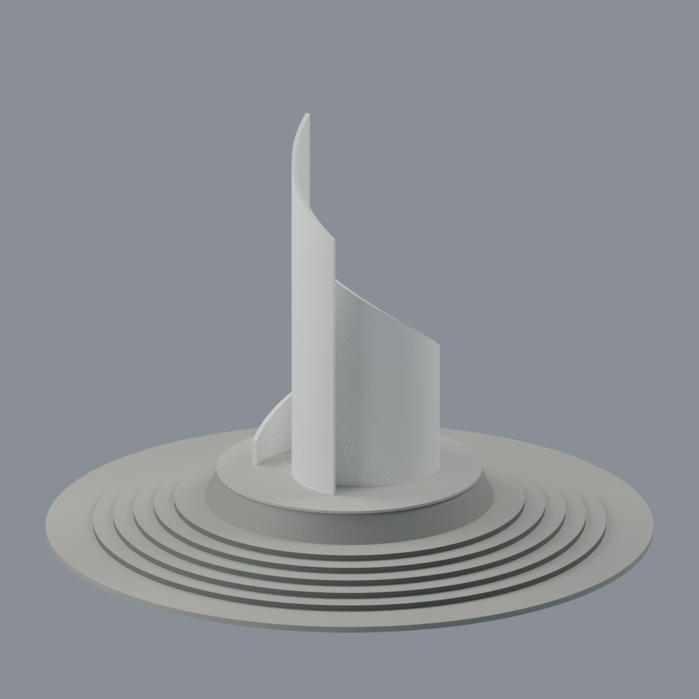
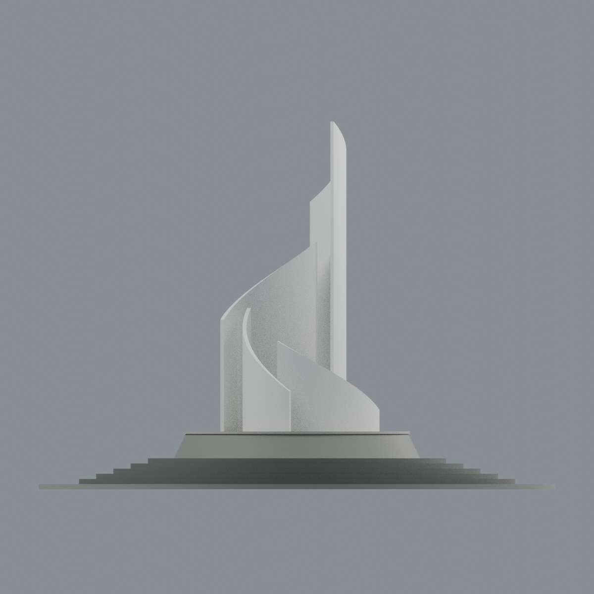
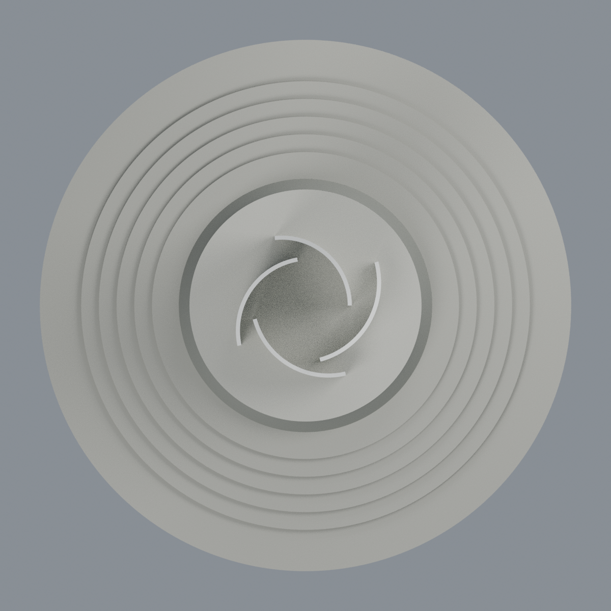
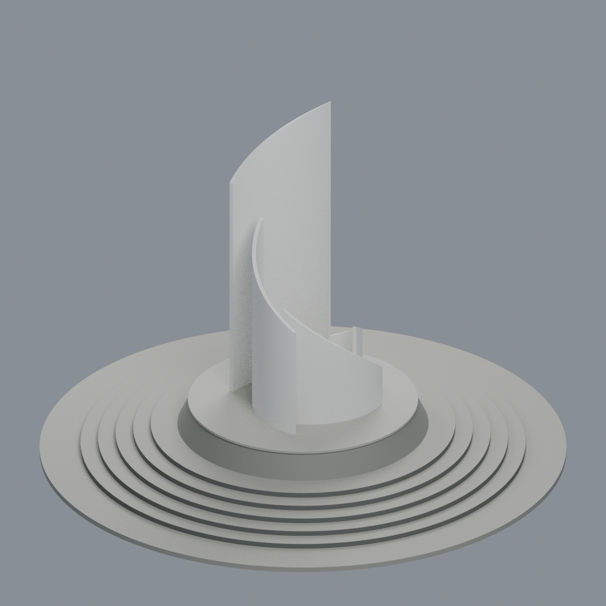

# 淡江大學｜淡水校本部｜書卷廣場竹卷雕塑與舊圓階座

**完整單一地標外觀近似；不是整座廣場、不是測繪、不是2026現況。** 林貴榮設計、1986年竣工；依原拍日期未知的官方照片，選擇完整舊圈階版本，**不混入2025景觀改造新步道**。

[可編輯Blender](scene.blend) · [五材質3MF](model.3mf) · [單色STL](model.stl) · [來源](SOURCES.md) · [QA與警告](QA.md)

## 最終mesh實渲五圖
圖片直接使用交付3MF內與STL逐三角相同的幾何，不是概念圖、照片或AI影像。

| 正面斜視 | 反面斜視 | 立面 |
|---|---|---|
|  |  |  |

| 俯視四片分離曲線 | 側高斜視 |
|---|---|
|  |  |

## 保留的主體
- **四片分離白色曲板**，各有斜升自由頂緣；最高片、次高片、兩片較低，非等高複製。
- 曲板間真正透空豎縫與中央空間，無上蓋、中央實心核或額外連接牆；不是單一螺旋筒。
- **5圈窄環踏階＋最外1圈寬低平台**，其上高斜石鼓座及薄凸頂緣；不把薄唇算成第六圈窄階。
- 5具名不透明材質：白曲板、深灰階側、灰踏面／寬台、斜石鼓座、薄頂緣。石紋與個別接縫簡化。

展示尺寸 **180.00 × 180.00 × 128.15 mm**，11,292三角面，1連通閉殼（四片經底座相連）。**沒有實物縮尺比例或與其他模型直接拼接承諾**；所有弧心／弧角／高度／間距與基座尺度只是照片近似。

## 編輯與實印限制
Blend和3MF保留逐面材質分派；STL無色。單一網格仍可編輯頂點、面與具名材質，參數化生成腳本可獨立改四片的高度、角度、厚度與底座尺寸。格式交換、材質編輯另存重開、Blender單頂點與材質編輯往返已驗證。

**未實印、未跑印表機切片器、不保證免支撐。** 1.35mm法向高曲板及自由尖緣有晃動／折斷風險；鼓座薄唇有懸挑。641全局0.2mm切層保留**11薄層／11薄成分**；局部保留0薄樣本，另有**512個向下超45°面**。數位閉殼不等於實印通過，須自行安排擺向、支撐、加厚或拆件。

## 重建與檢查
依[requirements.txt](requirements.txt)裝Python依賴，另需Blender4.3.2。無外部貼圖、字型、原圖或下載步驟。

```bash
python build_model.py
blender -b -t 4 --python-exit-code 1 --python render_model.py
python qa_model.py
python check_features.py
python verify_exchange.py
blender -b -t 4 --python-exit-code 1 --python verify_scene.py
blender -b -t 4 --python-exit-code 1 --python verify_render.py
python rebuild.py --output ../new-clean-rebuild --blender blender --threads 4
python verify_identity.py
python verify_package.py
```

`rebuild.py`只接受新空目錄，檢查4核心檔與5PNG共9檔byte一致。套件／Blender版本改變可能改變布林或渲染輸出。`verify_exchange.py`可用`BUILD_PYTHON`指定含建模依賴的Python。完整雜湊見`SHA256SUMS`，它不包含自身。
