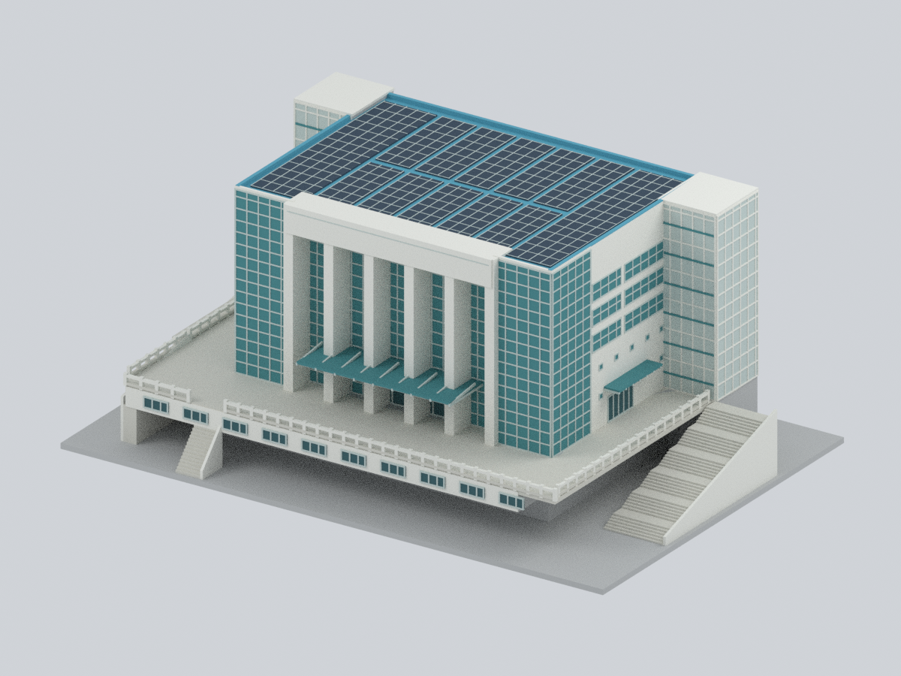
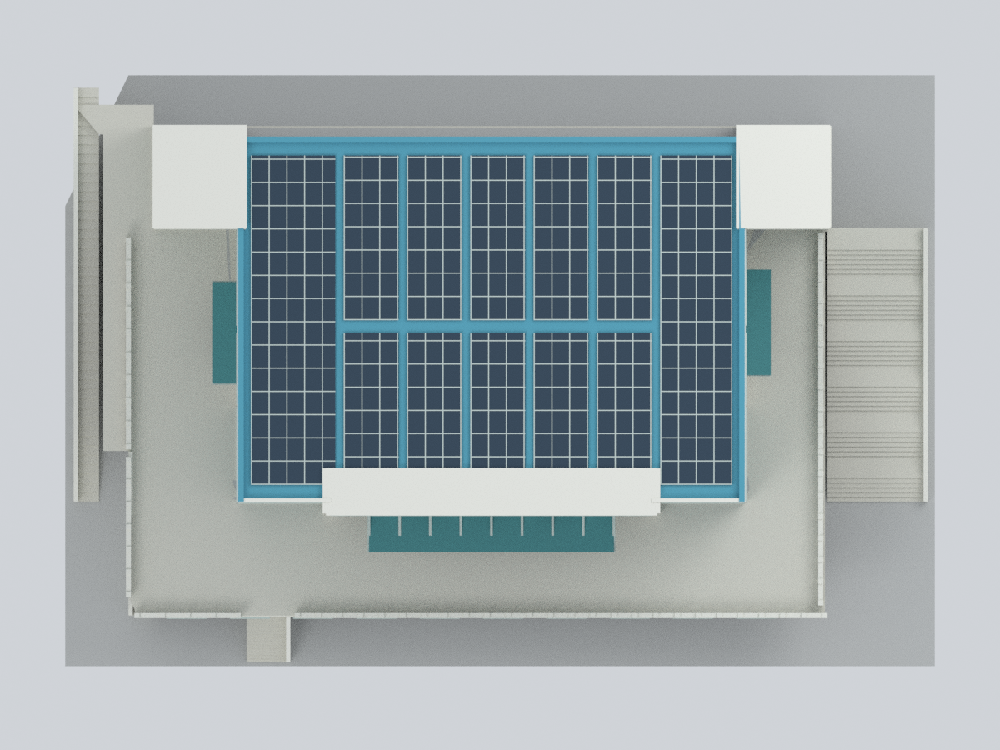
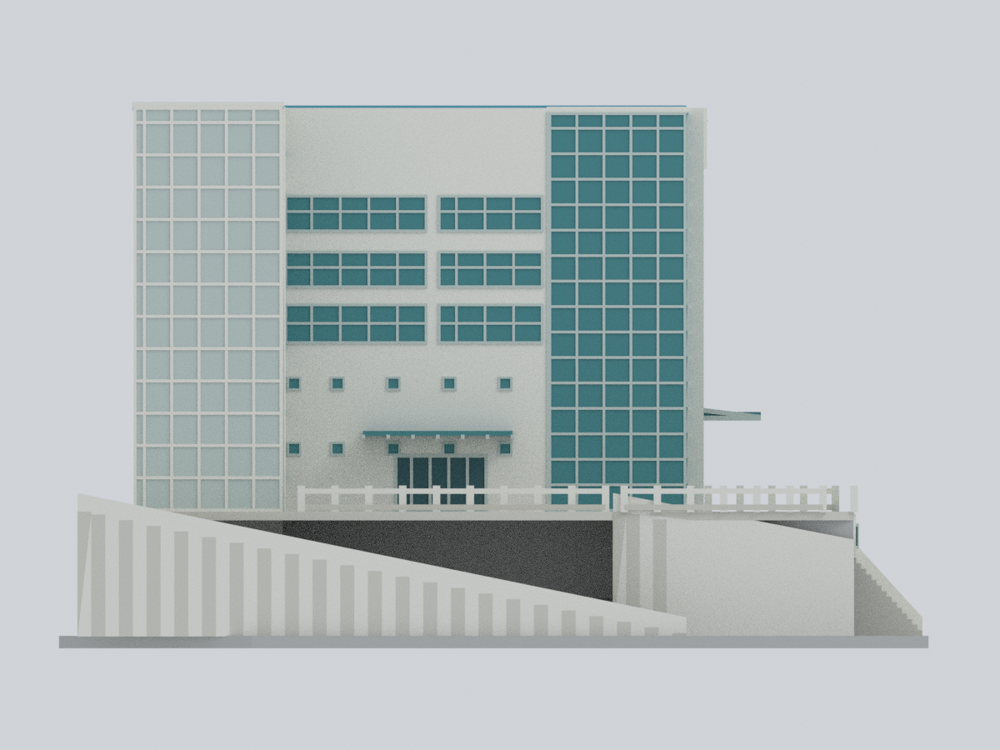
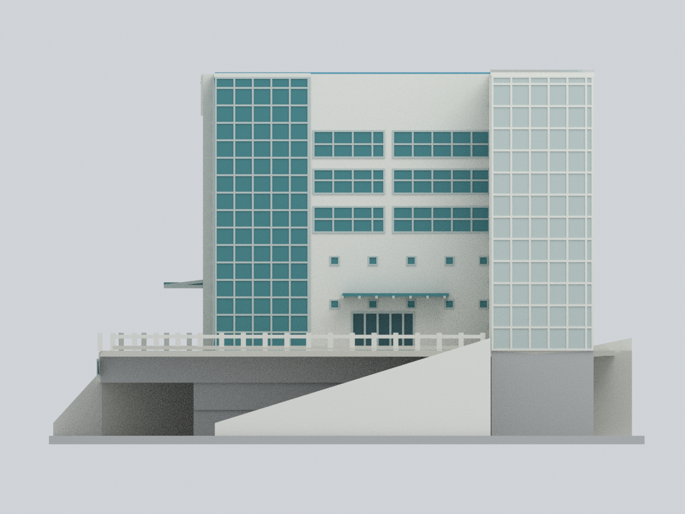
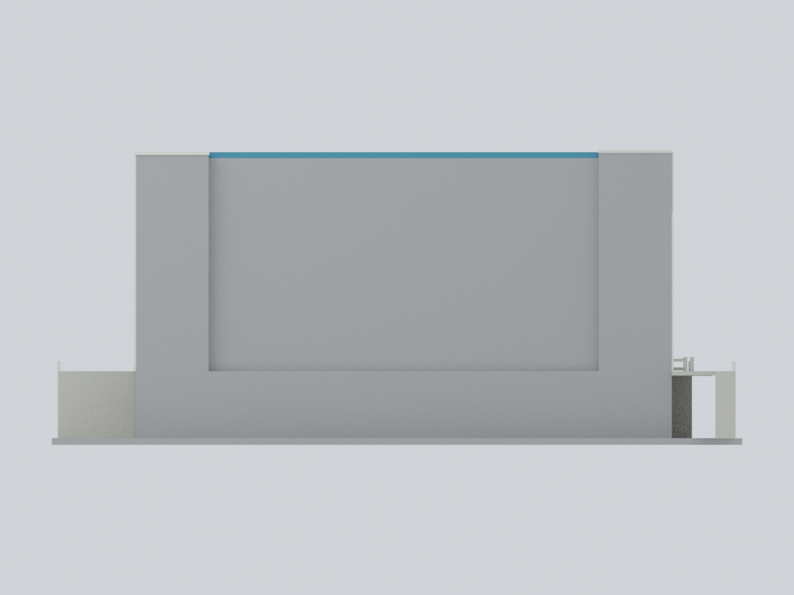
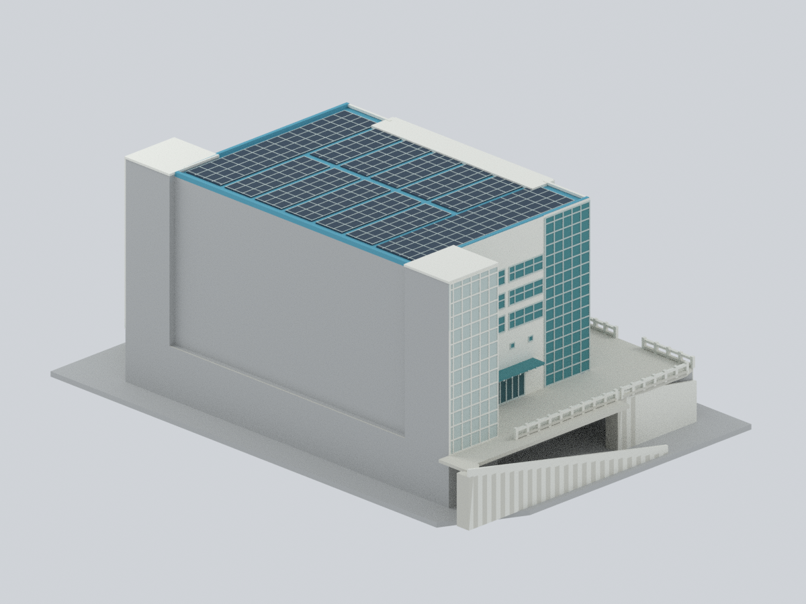
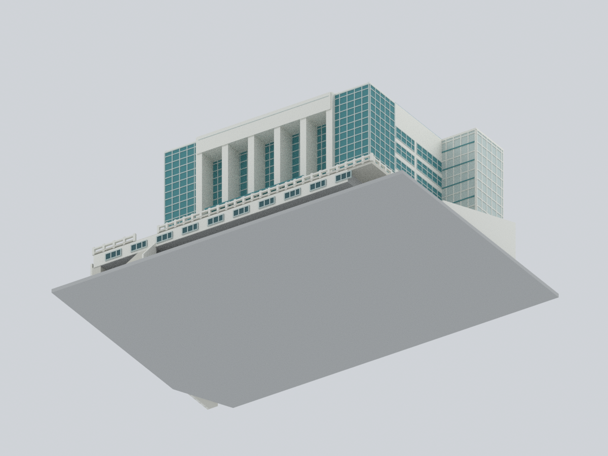
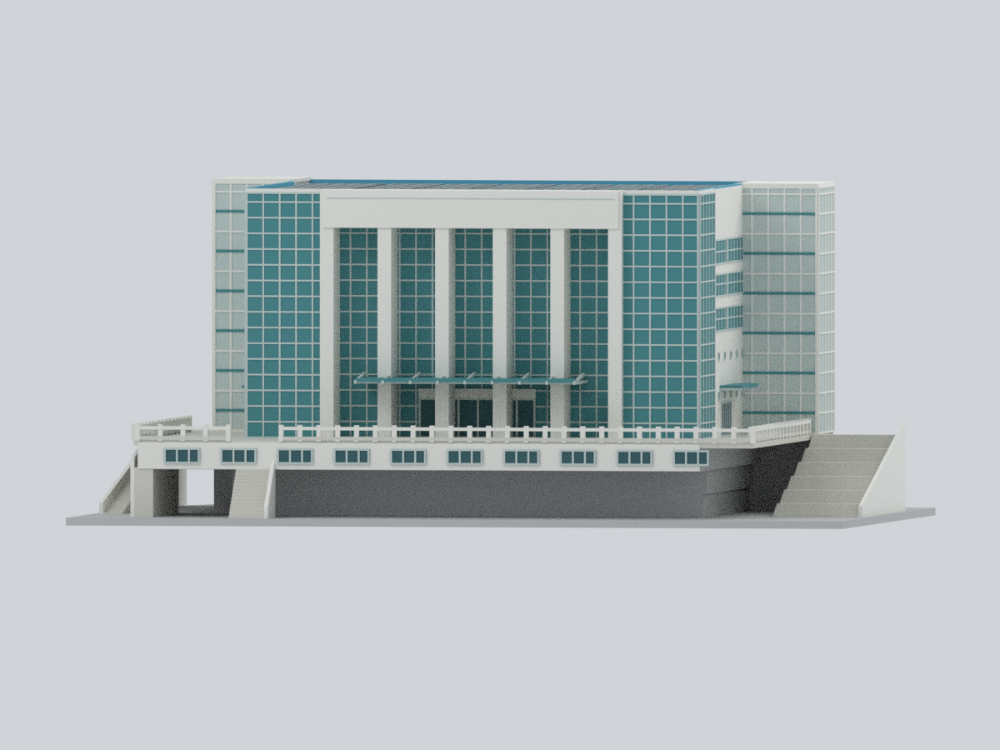

# 淡江大學紹謨紀念體育館｜彩色完整地上外觀近似模型

**2021–2022 年公開資料所記錄的已裝設太陽能板狀態。** 本件為可編輯、可重建的完整地上外觀代表模型，不是測繪、竣工圖、2026 現況或工程模型。主體、前方六道高柱及凹入玻璃、雙玻璃角、後側外凸梯塔、下部量體、3F 前凸空間、4F 露台、不對稱外梯與低矮光電區均保留。相鄰游泳館、雕塑、內部與地下層不在範圍內。

## 模型與實際輸出預覽

| 正面 | 主斜視 | 屋頂 |
|---|---|---|
|  |  |  |
| 左側 | 右側 | 背面 |
|  |  |  |
| 背面斜視 | 底面 | 低角度正面 |
|  |  |  |

九張圖均由本包的實際輸出網格與面材質渲染，不是來源照片或概念示意圖。

- [可編輯 Blender 原生檔](tku-shaomo-gymnasium.blend)：單一連通網格，8 個可改材質、逐面來源分類。已實際改一個頂點與材質、儲存並重開驗證；不含外部貼圖。
- [彩色 3MF](tku-shaomo-gymnasium.3mf)：真正逐三角形 base-material 顏色，已嚴格重讀、往返匯出及實際改色重開驗證。
- [單色 STL](model.stl)：同一幾何；STL 本身不保存顏色。
- [數值參數](parameters.json)、[色票](palette.json)、[面分類](face-materials.csv)、[幾何分類規則](mapping-rules.json)。

## 尺度、資料與限制

- 主體寬 **120 顯示毫米**，整體包含示意底座約 **206 × 140 × 88 mm**；這是模型顯示／列印選擇，**不是建築比例尺**。
- [比例研究](proportion-study.json) 記錄實際平面上的局部尺寸、像素端點、雙軸校準及另一房間約 3.3% 的殘差。不同平面日期／比例不同，未作全圖 DPI 換算。較低兩層的實際埋入／露出程度不明，3F 前凸下方的顯示空隙不能解讀為已驗證的懸挑或真實地形。高度採多視角照片比例近似；總高、樓層高鏈及地形均未驗證。
- **背面與部分下部／接地面是平面所約束的中性近似。** 空白面不表示實際後牆沒有窗戶；沒有把正面或側面鏡射成背面。
- 4F 的 11 m、7F 的 12 m 是廳內淨高，不是樓層高；B1 不是 B2；8F 開放廳平面不是屋頂圖。
- 光電區僅代表已安裝狀態；不把舊五條裸露屋頂與新滿鋪陣列拼接。細分格線不等於實際模組數；不提供電氣或安裝細節。
- [完整不確定性表](uncertainty-ledger.json)／[來源網址與權利說明](sources.json)。素材權利歸原權利人；公開可閱不等於可轉載。包內只有獨立簡化幾何、程序顏色、連結與模型實際渲染，沒有來源照片、PDF、裁圖或貼圖。不表示校方認可。

## 重建

需要 [列明的 Python 套件與 Blender 版本](source/requirements-model.txt)。可分別使用已安裝 geometry 與 lib3mf 的 Python 環境；腳本不下載資料、不連網。

```bash
python source/rebuild.py --out rebuilt \
  --geometry-python python --three-mf-python python3 --blender blender --threads 4
python source/compare_rebuild.py --original . --fresh rebuilt --report rebuilt-comparison.json
```

只用 `source/*.py`、`parameters.json`、`palette.json` 在乾淨輸入／空輸出目錄重建，未提供任何網格或圖片。頂點、面、材質、STL 與九張 PNG 已比對。高階量體／高度／露台／階梯／屋頂區受參數控制；部分細部偏移仍在 `source/build_geometry.py`，參見參數契約，不宣稱每個描述欄位都會驅動幾何。

## 數值 QA 與列印

[網格／剖層](qa/geometry-validation.json)、[自交預檢](qa/self-intersection-validation.json)、[開口射線](qa/feature-validation.json)、[3MF](qa/3mf-validation.json)、[原生可編輯性](qa/blend-validation.json)、[重建比對](qa/rebuild-validation.json)、[視覺核對](qa/visual-review.json)。連通、水密、邊與頂點流形以及每 0.2 mm 的截面檢查不是實際擠出路徑或實體試印。

前方大挑簷、雨棚、露台與欄杆仍需切片／支撐評估；主要 0.44 mm（局部最細 0.35 mm）框料與 0.26 mm 光電分格是受本體支撐的表面細節，小尺寸列印可能消失。玻璃不透明、室內填實、欄杆與踏步簡化，不能據此推論真實結構與安全性。**尚未實體試印，也不宣稱免支撐。**
