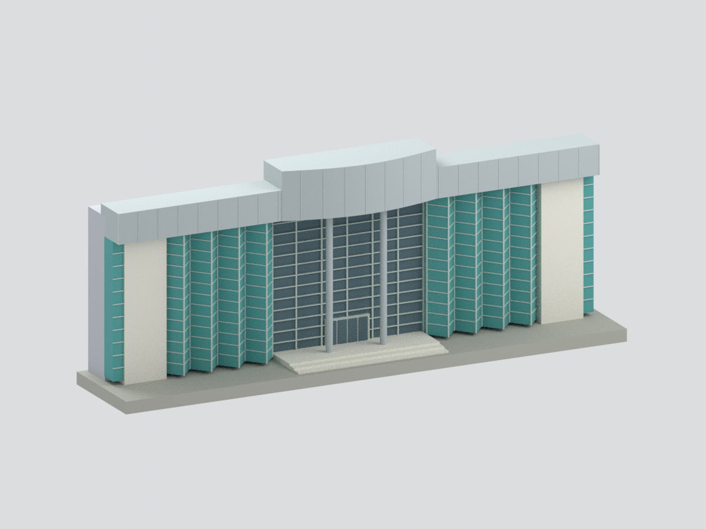

# 淡江大學 紹謨紀念游泳館｜正面立面截段

以淡江官方公開外觀照片為視覺依據的彩色簡化模型；**不是完整游泳館，不是 2026 現況測繪**。本館代號 N，與既有紹謨紀念體育館 SG 模型不同。

## 可驗證範圍
保留正面銀色水平檐帶、中央向前彎曲且高出兩翼的冠頂、兩支圓形高柱、中央凹入入口玻璃、兩側各四個主要玻璃折面、外側白色寬柱及窄玻璃帶。中央冠頂為平面方向前凸曲線，並非立面上的拱形屋頂。

模型含 STL、七色 3MF、可編輯 Blender 場景、隱藏的分件構造、可重建 Python 腳本及六張實際網格渲染。150 × 30.3 × 58.5 mm 為模型尺寸：每個任意建模單位換算 6 mm，**不是已知實物縮尺**。

## 證據與限制
- 官方照片拍攝日期未能核實；網址中的 2023/12 不是拍攝日期。素材庫照片亦不能證明現況年份。
- 外形與色調依可見照片估算，未取得測量圖、官方立面尺寸、完整屋頂或後部證據。
- 保留的淺厚度是人為截段；灰色後面為截面，不是建築後立面。上視圖只顯示截段封閉面，不是游泳館屋頂。
- 玻璃用不透明青綠／藍灰色面表示；不重建反射、室內泳池或內部樓層。框架每折面 12 條橫桿、中央網格、四片門板、檐口接縫均為規則化近似，**不主張精確數量**。
- 冠頂平面曲線、立柱直徑、玻璃折深、門窗尺寸均未測量。框線為可見性適度加粗。
- 三層入口階梯僅概括可見高差，不主張真實階數。金色館名文字、景觀欄杆、樹木、道路、相鄰建築、未見屋頂與後部全部省略。
- 作者底板不是基地輪廓。封閉單體不代表已完成試印或具工程結構意義。

## 檢查
`QA.json` 檢查網格拓撲及 STL／3MF 一致性；`REBUILD-QA.json` 檢查乾淨重建；`BLEND-QA.json` 對照實際場景網格與七色；`FRAMING-QA.json` 檢查五張整體視圖至少 1% 留白。`entry_detail` 是允許裁切的細節圖。`SOURCE-VISUAL-QA.json` 若提供，為獨立來源／外觀審查，不能取代未提供的實測資料。

來源照片未附入公開包，未嵌入材質，未轉印成貼圖。來源使用限制見 [SOURCES.md](SOURCES.md)。重建方式見 [REBUILD.md](REBUILD.md)。
