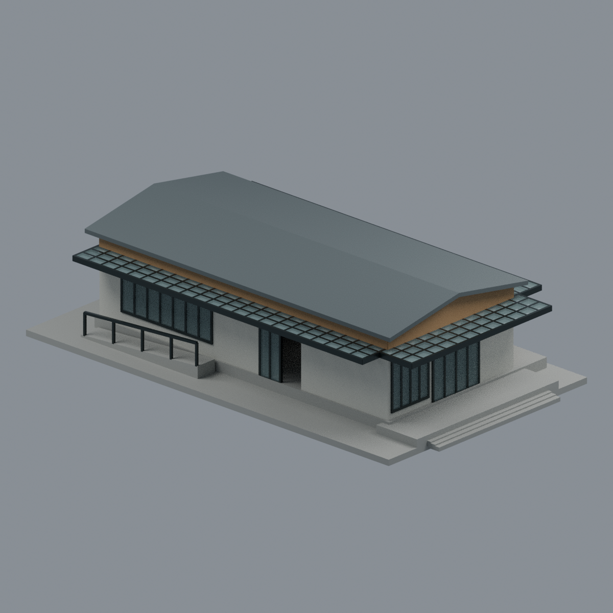
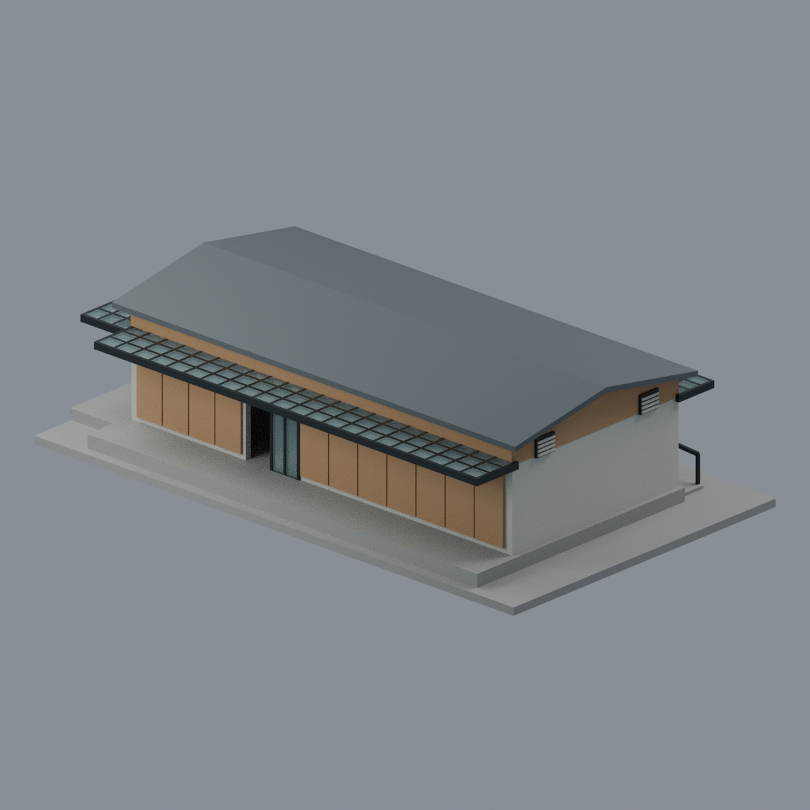
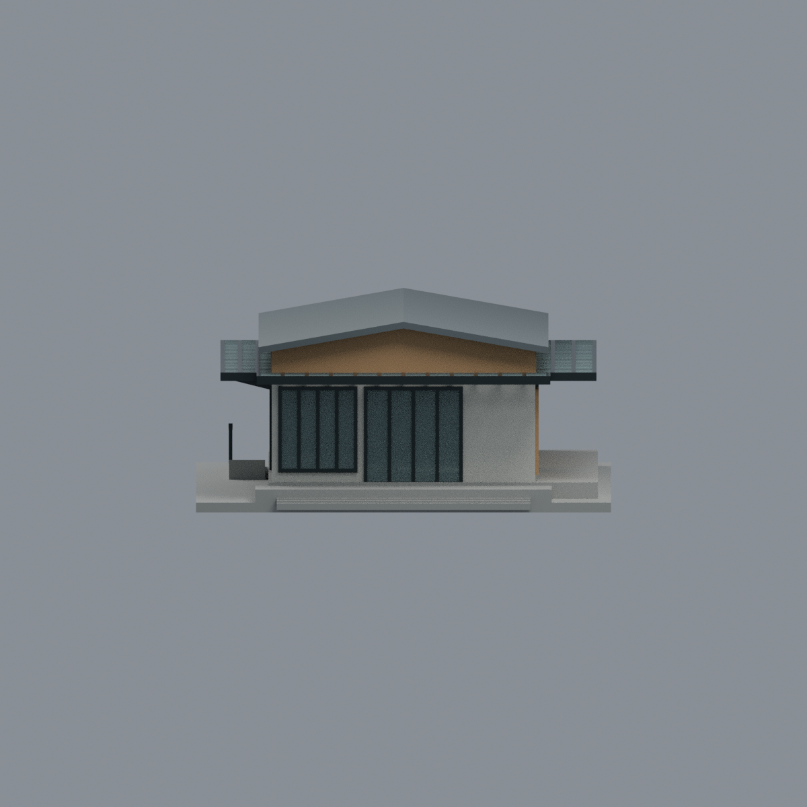
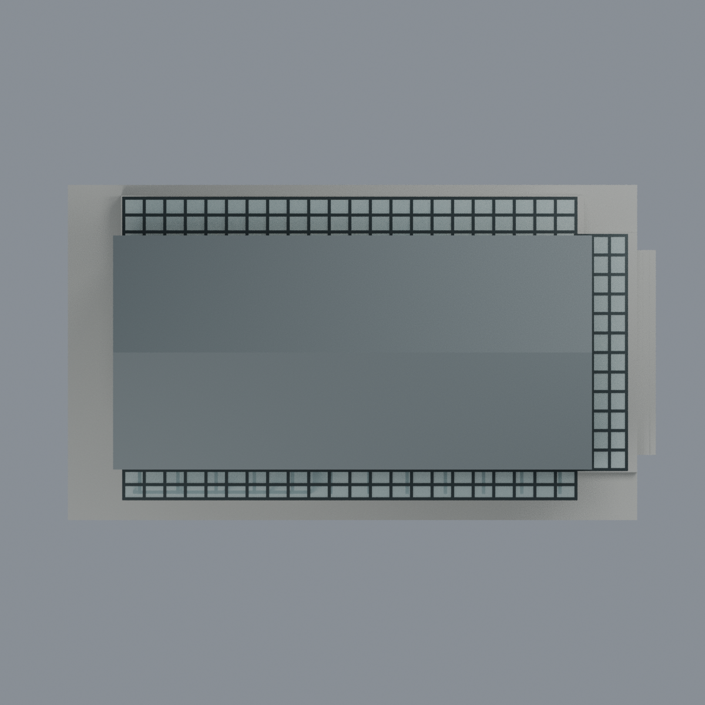
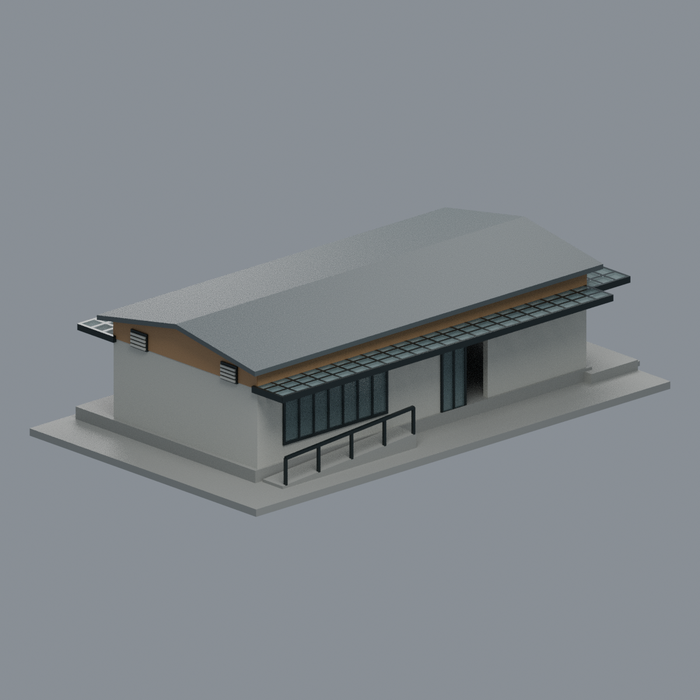

# 玄奘大學慈恩精舍選佛場

**2025論文所示整修完工單棟外觀近似；非測繪、非2026現況認證。** 場域：玄奘大學香山校本部旁慈恩精舍／玄奘文教園區；2025-05-07啟用，照片原拍日期未知。

單層長矩形、沿東西長向的低雙坡頂、木色上段／灰下牆、東玻璃入口與寬石階、東南黑格透明低挑簷、南長窗與側門、坡道欄、西兩個小百葉、北平板置物櫃和同軸側口。入口保留部分開啟負空間；門開啟狀態是展示近似。

## 邊界與近似
北共享通廊只含本棟界面及可見格架／地板，**在另一棟邊界截斷，外沿沒有虛構獨立柱**；這是單棟展示截斷，不代表現實的自由懸臂或結構分析。另棟開山堂、寮房、紀念碑、草坡／樹與整個園區不納入。西面未補成一圈玻璃罩。模型底板是有限展示地面，不是地籍或地形測量。

尺寸221 ×126 ×57 mm為模型毫米，無可靠實物比例尺。屋坡、櫃扇／格架／窗格／階數、坡道尺寸均照片比例估值。入口題字、細木紋、櫃內、排水燈具、隱藏構造、佛像與室內陳設省略；不能聲稱完整室內復原。未知p34平面沒有用來推幾何。

## 檔案
- `scene.blend`：可編輯三角網格、6材質、相機與燈光。
- `model.3mf`：同一毫米mesh、逐面多色與RGBA；不是耗材設定。玻璃灰藍alpha 95/255，檢視器支援可能不同。
- `model.stl`：相同實片與框架，**STL沒有顏色或透明度**，不能把透光片當不存在的幾何。
- 五張 `previews/*.png` 渲染實交付mesh，不是AI概念圖。
- 來源、許可、`QA.md`、重建與驗證腳本及SHA256SUMS。

## 五視圖
| 東南整體 | 西北／北通廊截斷 | 東立面 |
|---|---|---|
|  |  |  |
| 鳥瞰 | 西南整體 | |
|  |  | |

## 製造限制
未實印、不宣稱免支撐。透光片名義厚0.9 mm不是全模型最薄保證；屋脊、坡屋沿與斜撐近切層有真實薄尖失敗，見QA。長簷、北截斷通廊、主屋頂與中空室內需要支撐／拆件及設備評估。不能把虛構柱塞入來規避支撐。

## 重建
```sh
python -m pip install -r requirements.txt
python build_model.py
blender -b -t 4 --python-exit-code 1 --python render_model.py
python qa_model.py
python check_features.py
python verify_exchange.py
blender -b -t 4 --python-exit-code 1 --python verify_scene.py
blender -b -t 4 --python-exit-code 1 --python verify_render.py
python rebuild.py --output /tmp/hcu-hsuan-fo-hall-new-rebuild --blender blender --threads 4
```
輸出重建目錄必須不存在；核心四檔＋五PNG比較實際bytes。物件是合併且連通的可編輯三角網格，不是分層BIM或參數化施工圖。
