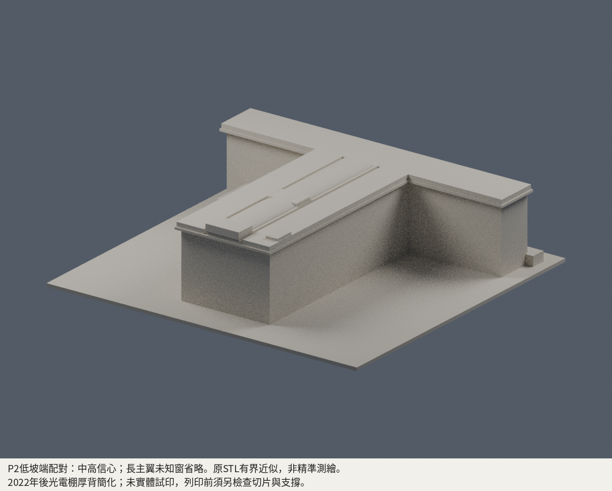

# 玄奘大學圖書資訊綜合大樓｜有界近似模型

狀態：有界近似版。數位審核紀錄見隨附報告；是否正式發布以統一發布清單為準。未做實體試印。

| 正面模型 PNG | 背面模型 PNG |
|---|---|
|  |  |

[左側預覽](previews/left.png) · [右側預覽](previews/right.png) · [俯視預覽](previews/top.png)

## 建物與時間範圍

本件為玄奘大學香山校本部的圖書資訊綜合大樓，官方亦稱圖書資訊大樓；白聖長老紀念大樓（行政大樓）是另一棟。

模型以官方《2024 年永續報告書》的「圖資」斜空拍及 NLSC 正射影像建立 T 形橫翼、長主翼、局部低 L 翼與主要屋頂量體，並用 2013 年參訪刊物及 2018 年部落格中的現場照片補立面與入口。這是跨年資料拼合的有界近似，沒有聲稱重現某一天的完整建物現況。

- 屋頂採光電設備於 2022-11-03 併聯後的外形。模型的厚背光電棚以可製作的整體量體簡化面板及支架，不是原始裸屋頂，也不是逐片光電板復刻。官方所標棚架 2.5 m 是該設備的名義高度，不能當全棟層高。
- 2013 是參訪刊物的日期口徑，2018-06-25 是部落格文章日期；兩組照片的個別拍攝日期均未核定。
- NLSC 影像可見的「2024」浮水印不直接等於拍攝日期。正射只支持屋頂投影與校園相對位置，不能當作牆基、全樓高度或地形測量。

精確來源 URL、每項支持範圍與日期口徑見 [sources.json](sources.json)。第三方原始照片、PDF、正射瓦片及其裁切只供來源核對，不隨公開模型包重散布；本頁 PNG 是模型預覽。

## 保留的主形與有意省略

- T 形主體、寬挑簷、厚背光電棚、中央低幅曲面屋帶及可辨主要屋頂服務量體。
- 正面約五排可見窗帶、連續大柱帶與水平樓板線；入口保留兩根方柱、厚簷與前階坪。窗格位置與柱距依照片比例整理，沒有實測柱網。
- 2018 年 IMG_4356 的候選面別為正面橫翼東北低坡端／P2 轉角。方向牌、道路分岔及建物鄰接拓樸的交叉核對給予中高信心，仍不是唯一確證。該照不能直接當成 T 形長主翼的側面，也不能複製到長主翼兩側。
- 照片低坡端可見四排高窗、兩排較短窗帶與更低的車道開口；模型只以局部露出表現這項坡地差異，不把可見排數等同標準地上樓層數。
- 長主翼兩側及樹遮背面的窗列尚無足夠直接影像，故保留素面。素面表示未知細節省略，不表示實建無窗。局部連接廊道也不足以恢復完整外形與長度。
- 不建室內空間、全校地形、地下室內部、細小欄杆、逐片光電板及未能辨識的屋頂設備。

## 尺度與列印簡化

生成腳本的名義尺度為每實景公尺對應 1.15 mm，約 1:870；原STL實際外包為150 × 140 × 38.40000153 mm，底座厚1.6mm，7798個三角面；精確原始網格、重建與檔案摘要見 [QA.md](QA.md)。

正射初描的橫翼屋頂包絡約 119 × 18 m、長主翼約 40 × 82 m，均是屋頂投影量級，不是測量牆基。建築立面、屋頂及地形高程尚無完整圖說：

| 名義設定 | 口徑與限制 |
|---|---|
| 主屋面 27.6 m | 照片試配高度；不是實測全樓高度，也不含更高的光電棚、中央曲帶與屋頂服務量體 |
| 局部低 L 翼 9 m | 量體高度推估，尚無立剖面確證 |
| 前庭相對高差 4 m | 為解釋入口與低坡端露出關係的場地示意，非地形測繪；端部漸降同屬示意 |
| 入口圓簷頂截至 14.2 m | 生成腳本為列印形體所做的截平、背接簡化；不是原建築圓簷最高點的測量值 |

這些公尺值均使用模型的相對基準，不是海拔。全樓未測繪，亦未確認完整層高、柱距、低翼高度與地下層露出範圍；不能用於工程、測量、修繕或無障礙設計。

## 容易誤讀的資料

- 1997-03-25 是學校／圖書館成立的館史口徑，不是本樓已證實的竣工日期；原設計者與竣工年份仍未確證。
- 官方 6F 教師研究室分配表是室號與使用資訊，確證有 6F，不是平面圖、完整樓層上限或「每個立面有六排窗」的證據。
- 官方攝影棚資料的 B1／B2 與 12 m 高度只適用其描述的局部空間；不能把 12 m 當全樓或標準層高，也不能讓 B1／B2 沿建物整圈同高外露。
- 官方館舍 36,418.33 平方公尺是總樓地板面積口徑，不能當占地，也不能直接除以樓層數推算牆基尺寸。
- 已排除實為中正大學的 Flickr 施工照。受阻而未實看之廠商／Pixnet 圖片、未取得有效影像的影片，不列作本模型幾何證據。

## 檔案與驗證

- [STL](model.stl)、[Blend 場景](scene.blend)、[生成腳本](build_model.py)
- [來源與日期口徑](sources.json)、[數位 QA 記錄](QA.md)
- [校區目錄](../../README.md)、[學校目錄](../../../README.md)

最終發布前，須以同一份未修補的成品 STL 檢查原網格拓樸、逐層連通與薄特徵、預覽一致性及重建摘要，另確認入口簷、挑簷、窗柱與棚架的具體切片條件。水密、單殼或局部厚度數值本身都不保證實體列印成功。未試印，不可任意縮小；材料、噴嘴、層高、支撐與成型方向須另由實際切片決定。

表面柱帶外凸與窗凹各名義0.12m，相對落差在模型約0.276mm；它們背接實牆，該數不是最薄壁。兩端細帶內縮進牆，入口在窗差集後融合，避免空背薄尾或小舌。

重建：安裝requirements.txt後，執行 `python build_model.py`、`blender -b -t 4 -P render_preview.py`、`python run_all_checks.py`。PNG繁中註記另需python3的Pillow與Noto Sans CJK字型；此次環境為Blender4.3.2。
