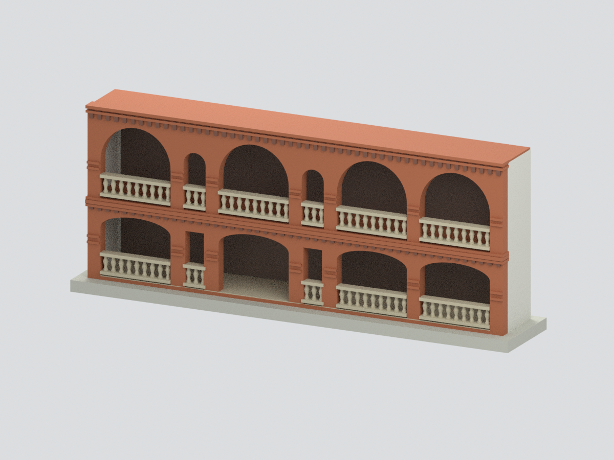

# 真理大學淡水校區

現行收錄 **3 套模型包**；數量不等於完整建築棟數，亦非全校／校區完成。新件與既有件的年代、截段範圍及未試印限制請閱各模型頁。

### 既有批次來源與列印限制（數量為各批歷史範圍，非現行總數）

當批1件指定歷史主體模型，不代表校區或全校所有建物完成。

## 牛津學堂（1999調查圖所繪主體，不含後加建）

| 建築模型 | 建築模型 | 建築模型 |
| :---: | :---: | :---: |
| 模型預覽 同一建物有限材料示意  |  **[真理大學大禮拜堂：北側雙塔入口截段](buildings/au-chapel-north-entrance-segment/README.md)** |  **[真理大學牧師樓：雙層拱廊主立面截段](buildings/au-reverends-house-arcade-segment/README.md)** |

模型預覽

模型預覽

[開啟模型與檔案](buildings/au-oxford-1999-core/README.md) · [返回學校](../README.md)

保留完整兩長翼、前橫堂、通空柱廊與後段院落；明確排除中庭／背側後加建，不稱1882原貌或2026現況。150×130×66.1mm，70層opening損失>1%；小端飾與尖塔1.15–1.2mm，完整警告在[薄件說明](buildings/au-oxford-1999-core/THIN-FEATURES.md)。需切片確認支撐，未實體試印。

[有限材料色系與可編修檔](buildings/au-oxford-1999-core/appearance/README.md)：僅596個原三角面指定磚／瓦／前欄板青綠材料家族，其餘13,446面保持未知中性，原14,042面幾何不變；不是整棟彩色完成、1999精準原色復原或2026現況。較晚照片拍攝日期未定、色碼未校正；配色不另計一套，原薄件與支撐警告保留。
