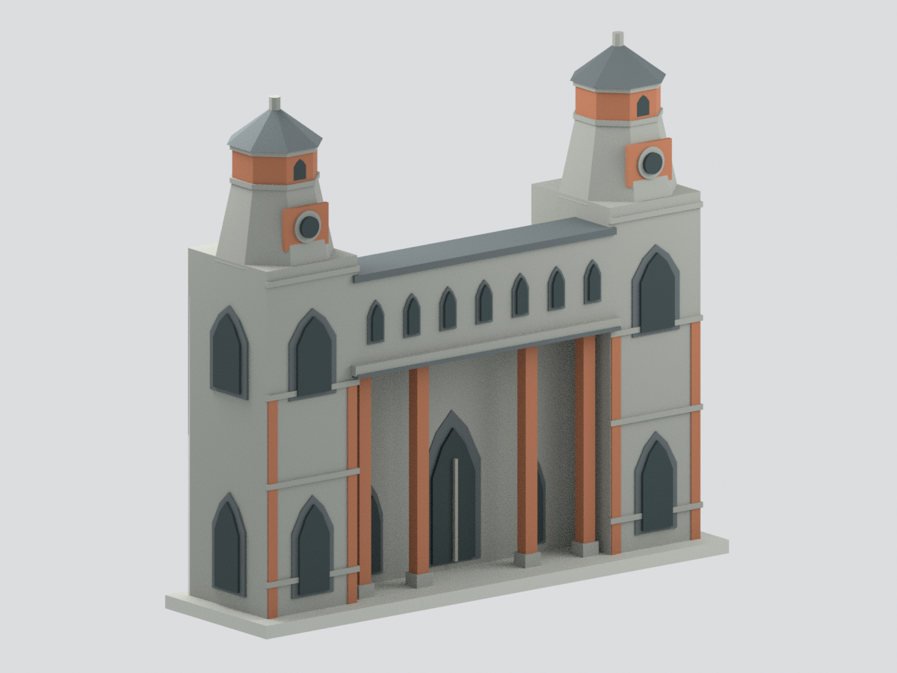

# 真理大學大禮拜堂：北側雙塔入口截段

這是根據真理大學官方外觀照片製作的 **北側雙塔與入口門廊淺截段研究模型**，不是整座教堂。七扇上層尖拱窗、雙塔、圓窗、灰石與橙紅磚色帶及多面坡頂為主要辨識元素。

## 範圍與限制

- 兩座塔的前面、照片可見的左塔外側開口，以及中央入口門廊。
- 後端以淺色平面明確截斷。沒有重建完整中殿、三角形屋頂平面、地下室或室內。
- 全部尺寸、塔坡與門窗位置由照片比例估計，**沒有實測或施工圖尺寸**。模型約 154 × 43 × 139 mm；尺寸不代表建築真實大小或實體比例尺。
- 顏色由官方照片作未校色的近似。石材接縫、磚紋、標誌文字、植物與人物省略。黑色門窗為實心色塊，並非透明玻璃或真實穿透開口。
- 照片可見的塔側圓窗與燈室側窗在本版省略，並非判定實物沒有這些窗。深色窗框略加粗為製作性簡化。
- 八角塔燈室為可見多面形態的作者近似；背面面數與開口未經確認。雙塔同高採對稱假設，非測量結果。
- 所有支撐柱、窗框和小型頂飾均為可製作性簡化；尚未試印。不能把水密檢查視為實機列印成功。

## 檔案

- `model.3mf`：含六種面材質顏色，單一連通實體。
- `model.stl`：單色幾何，與3MF共用相同三角面。
- `scene.blend`：實際網格、材質、相機與隱藏的可編輯原始構件。
- `build_model.py`、`render_model.py`、`validate_model.py`：重建、渲染和格式檢查。
- `mesh-data.npz`、`construction-parts.json`、`editable-parts.json`：幾何與構件依據。
- `QA.json`、`build-summary.json`、`render-manifest.json`：機器可讀檢查和視角資訊。

## 重建

在獨立Python環境安裝requirements.txt後執行 build_model.py、validate_model.py。再以Blender背景模式執行render_model.py並指定輸出資料夾。詳見REBUILD.md。

官方照片僅作私人參考，未附於此公開模型包。來源與觀察依據見[SOURCES.md](SOURCES.md)。
