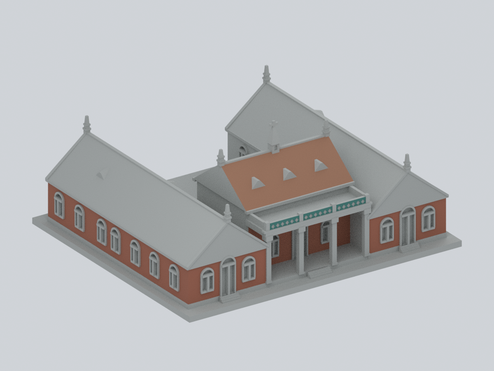
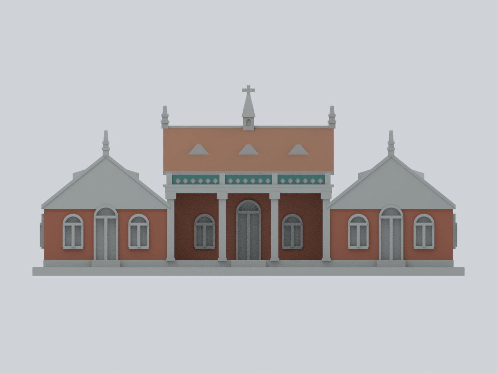
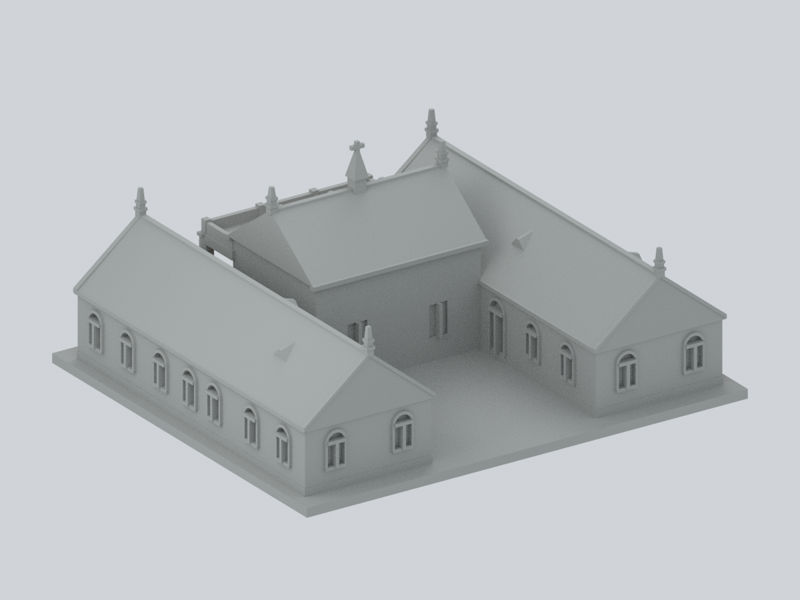

# 真理大學牛津學堂

## 模型預覽

| 有限材料左前斜視 | 有限材料正立面 | 背面維持未知中性 |
| :---: | :---: | :---: |
|  |  |  |

## 1999調查圖所繪主體，不含後加建

這是依《理學堂大書院調查研究及修護計劃》（1999年12月）附錄一現況圖一至十二，自行建立的歷史主體外形近似模型。包含左右兩條完整護龍長翼、前段橫向正堂、前步口柱廊、底台與階梯；不是只取前門，也不是1999完整院落。

**版本：v1 凍結。已完成數位QA與外觀核圖；尖塔／端飾薄件警示與支撐限制仍保留。**

## 既有主體網格的有限材料色系示意

[材料色系示意、九視角與可編修檔](appearance/README.md)：原 **14,042 個保朝向三角面精確保留**，只對 **596 面**指定磚、瓦與前欄板青綠材料家族，**13,446 面維持未知中性**。不是整棟彩色完成、1999精準原色復原或2026現況；不新增建物或幾何。未知中性不代表實物灰色材料。

下載[可編修 Blender](appearance/au-oxford-1999-core-appearance.blend)、[逐面材質3MF](appearance/au-oxford-1999-core-appearance.3mf)；[Python重建](appearance/source/rebuild.py)使用原公開STL、數字參數、色盤與程式，不需要照片。材料家族來自較晚官方照片，拍攝日期未定，色碼只是未校正展示代理；前山牆、長翼屋坡、右長牆、背面與內院仍不推色。原STL、Blend、7張預覽及薄件／支撐警告原樣保留，未實體試印。

## 原始幾何與既有無色預覽

俯視（歷史檔案留存，不作本頁預覽） · 正立面（歷史檔案留存，不作本頁預覽） · 背立面（歷史檔案留存，不作本頁預覽） · 左側（歷史檔案留存，不作本頁預覽） · 右側（歷史檔案留存，不作本頁預覽）

## 範圍與年代

- **刻意排除中庭及背側後加建。** 1999報告第75頁的文字／照片證實增建當時存在，第78頁的「拆除」是未來建議。本模型不聲稱增建當時已拆或不存在。
- 保留主體的實線牆與屋頂；不把背立面的虛線增建輪廓實體化，不使用附錄二／第76頁復原考證所示的第四條背翼。
- 不稱1882原貌復原，也不稱2026現況。1999報告已記錄歷次屋瓦、地板、門窗和尖塔整修。
- 正堂朝院後牆沒有單獨完整正視細部；按平面一窗一門、剖面牆高與屋檐關係簡化。其窗框、拱形、增建接觸痕跡並非完整考證。
- 圖五背立面沒有完整畫出越過所排除區域看見的前段正堂。本版中間正堂的背視投影由圖一／三及剖面共同約束；不能把該投影說成背立面逐線摹寫。
- 掃描有折痕、彎曲與跨頁縮放。本版保留比例和主要外形，不是工程測繪，不宣稱所有尺寸有直接標註或使用統一實物縮尺。

## 幾何保留與簡化

- 兩條116mm長翼完整到底，各有前後山牆；左右外長面各7個主要拱窗。前山牆各1門2窗，後山牆各2窗。
- 兩護龍朝院面各1拱門2拱窗。前柱廊4根前柱形成3個通空柱跨，後方正堂牆仍有中央拱門及兩側窗。
- 兩翼屋脊沿長向；中央正堂屋脊橫向且較高。保留7處小三角氣窗：正堂前坡3處，各翼外坡後段及內坡接正堂處各1處。
- 後段院落上方通空；底座厚3mm，院落可見的是底座，沒有添加第四條後翼或將院落填成建築實體。
- 磚縫、瓦壟、細扇形窗格、屋脊雕飾未逐一復刻；門窗採有背板凹槽。窗梃加粗並實際接回牆背，不是游離小片。
- 柱廊欄杆以實心帶加淺菱形凹紋近似，未製作脆弱鏤空格網；氣窗與尖塔也已加粗、截尖。

## 檔案與重建

- [model.stl](model.stl)：毫米單位，150 × 130 × 約66.1mm，含底座，最長邊150mm。
- [scene.blend](scene.blend)：由同一交付STL匯入的可編輯網格；毫米設定，附相機與預覽燈光。
- [build_model.py](build_model.py)：原創參數幾何重建來源；[requirements.txt](requirements.txt) 記錄套件版本。
- [render_preview.py](render_preview.py)：直接讀交付STL，生成7張PNG與Blend；[preview-provenance.json](preview-provenance.json) 綁定STL及PNG雜湊。
- [sources.json](sources.json)：官方URL、年代、頁次、各特徵依據與未知範圍。原報告及照片不隨公開包散布。
- [validation.json](validation.json)、[layer-component-check.json](layer-component-check.json)、[thin-feature-check.json](thin-feature-check.json)、[void-check.json](void-check.json)：完整數值檢查。
- [qa-summary.json](qa-summary.json)、[THIN-FEATURES.md](THIN-FEATURES.md)、[實測尖塔截面](qa/ornament-sections.png)、[端飾連接／寬度射線](ornament-check.json)、[SHA256SUMS](SHA256SUMS)：驗收摘要、薄件注意及逐檔雜湊。

重建及重新驗證須在工作副本進行，不覆寫凍結版本。安裝requirements.txt後執行 `python build_model.py`；使用Blender 4.3.2執行 `blender -b -t 4 -P render_preview.py`。再依序執行 `python validate_model.py`、`python check_thin_features.py`、`python check_layer_components.py`、`python check_voids.py`、`python check_ornaments.py`、`python render_sections.py`、`python test_fail_closed.py`、`python verify_package.py`。亦可用 `python run_all_checks.py` 一次重跑主要數位QA。截面圖程式使用Noto Sans CJK字型（Linux常用fonts-noto-cjk套件）。校驗採原STL，不修補後掩蓋失敗。

## 數位QA與列印警告

- 14042三角面；單一連通表面、水密、每邊2面、各vertex link單環、原法向／繞序及正體積通過。獨立重建STL SHA與saved Blend幾何一致。
- 0.2mm層距、起點z=0.071mm，共331層。所有輪廓degree2閉合，個別／合成Polygon valid；1047個原Polygon逐一0.4mm侵蝕及再膨脹後，**零消失、零分裂**。沒有buffer(0)或其他invalid修補後續判通過。
- 通空射線確認3柱跨能到達退後正堂牆、9個院落點直達底座、後側中央沒有第四條背翼；正向控制也確認前柱與兩全長翼存在。
- **仍有薄件警示：** 70層（z=52.271–66.071mm）整層opening損失>1%，最大9.593913655528649%。逐原Polygon有568項損失>1%，最大9.987884182374136%；完整層／構件面積與未四捨五入值在JSON。這些多集中於尖塔、截尖端飾和方角，不可用總比例掩蓋。
- 尖塔十字及頂端約1.2mm、端飾最窄1.15mm、窗梃1.05mm但接回實牆、前柱2.5mm。細件仍脆弱；勿任意縮小，清支撐及運送時避免壓折。
- **底座朝下**放置。三柱跨水平頂板、梁下、屋檐、氣窗和端飾可能需要支撐；柱跨淨寬約15.4–15.7mm，不能承諾免支撐或可靠橋接。支撐接觸窗梃／尖塔可能造成破損，須在實際切片器檢查。
- 0.8mm XY opening是幾何輔助篩檢，並非全方向最小壁厚、噴嘴路徑或力學驗證。**未完成Cura／Prusa工具路徑驗證或實體試印，不保證可印。**

## 來源

[臺北縣政府委託、李乾朗主持，《理學堂大書院調查研究及修護計劃》（1999-12，官方PDF）](https://www.tshs.ntpc.gov.tw/files/file_pool/1/0L258380706033318514/%E3%80%90%E5%85%A7%E6%96%87%E3%80%91%E7%90%86%E5%AD%B8%E5%A0%82%E5%A4%A7%E6%9B%B8%E9%99%A2%E8%AA%BF%E6%9F%A5%E7%A0%94%E7%A9%B6%E5%8F%8A%E4%BF%AE%E8%AD%B7%E8%A8%88%E7%95%AB.pdf)。頁碼採PDF物理頁（1起算），不是掃描跨頁的印刷頁碼。查核日期：2026-10-14。

此件完成不代表真理大學全校、所有校區或所有建物完成。
