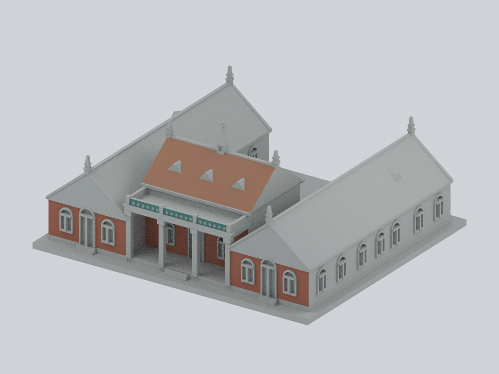
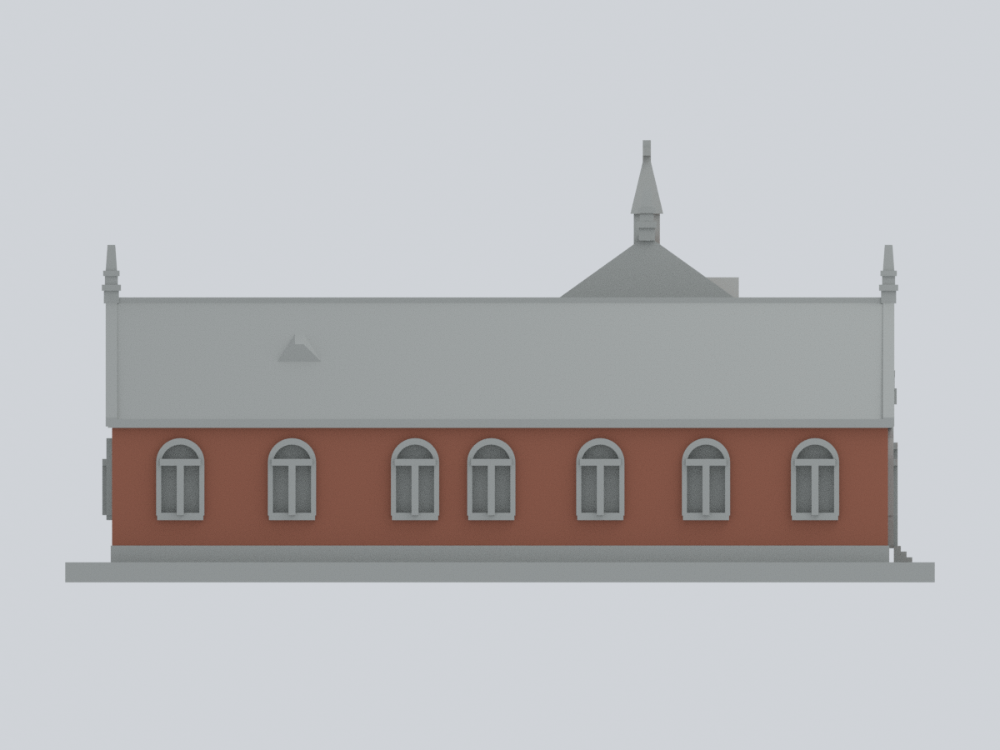
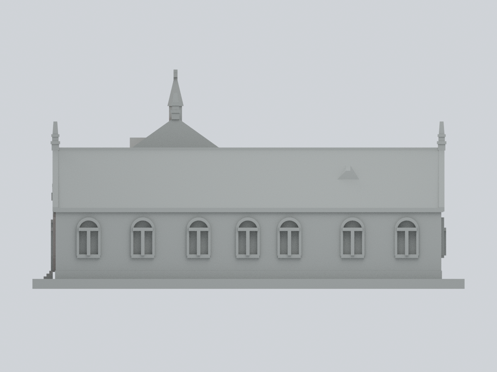
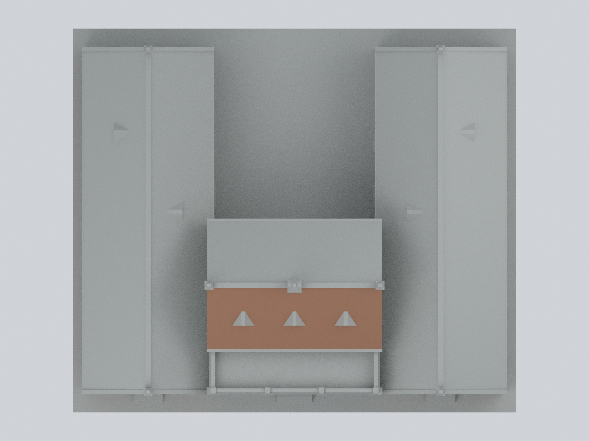
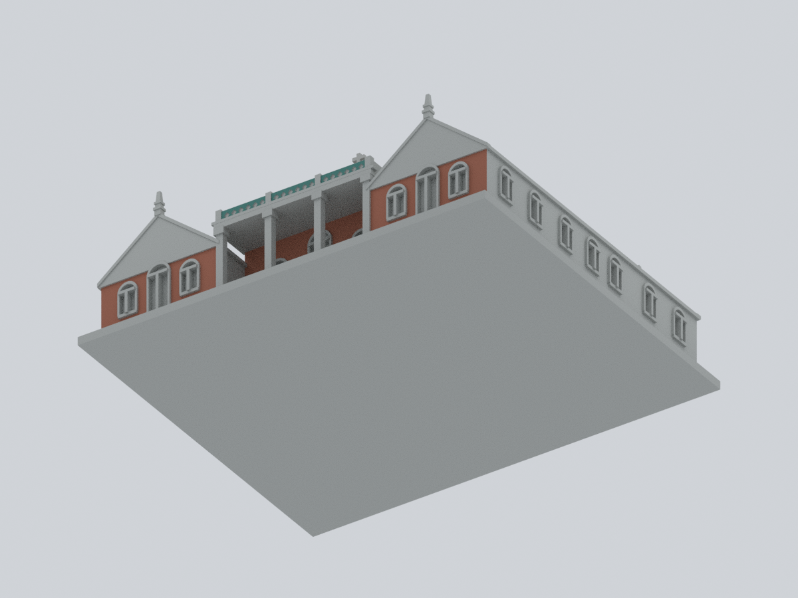
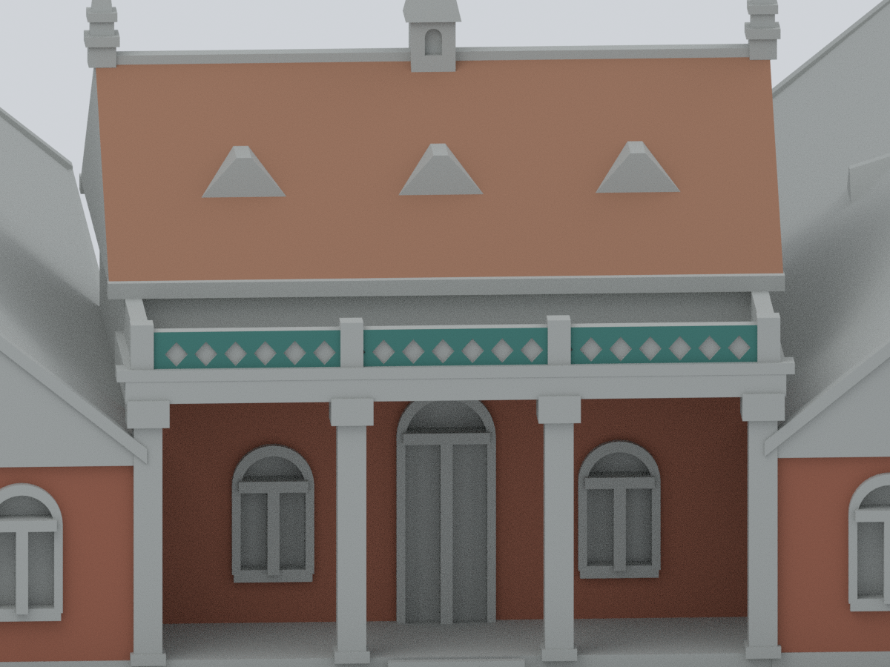

# 牛津學堂｜1999 主體幾何上的材料色系示意

真理大學・淡水校區。**只替既有 14,042 個原始三角面中的 596 面指定代表性材料色系，13,446 面保持未知中性。** 這不是 1999 精準原色復原、2026 現況重建、整棟彩色完成，也不是新增建物。原始 STL、原模型 Blend、原預覽及既有幾何 QA 均不修改。

材料家族參考較晚的官方照片；**照片拍攝日期未確定**。以下色碼只是低飽和展示代理，未經色彩校正，不是照片量測、標準塗料號或歷史原色。

## 九張實際模型預覽

同一可編修原網格、同一逐面材質；沒有照片貼圖、生成影像、UV 塗色、額外建築構件或遮罩。正面為模型 −Y，不是地理方位。近景只變更相機，非另一模型。

| 左前斜視 | 右前斜視 | 正立面 |
| :---: | :---: | :---: |
|  |  |  |

| 背面：未知中性 | 左外長面 | 右外長面：未知中性 |
| :---: | :---: | :---: |
|  |  |  |

| 頂視：僅正堂前坡有材料色 | 底視 | 前欄板與正堂近景 |
| :---: | :---: | :---: |
|  |  |  |

## 檔案與可編修性

- [原始 STL](../model.stl)：702,184 bytes，SHA-256 `b7966d5a426accfdf6a816a3261748512f564f245a40513f2e55e22754280406`。只讀輸入，不複製另一個變形 STL。
- [逐面材質 3MF](au-oxford-1999-core-appearance.3mf)：毫米、單一原網格、4 個標準 base materials；每個三角面都有明確材質屬性，不是只給整個物件一種顏色。
- [可編修 Blender](au-oxford-1999-core-appearance.blend)：原始頂點／三角面、4 個材質槽、原面索引 `original_stl_triangle_index`；無幾何修飾器、UV、外部圖像或內嵌腳本。保留相機與燈光供重新渲染。
- [完整 14,042 面材料表](face-materials.csv)、[數字面 ID 與頂點指紋](parameters.json)、[色盤](palette.json)、[來源清冊](sources.json)、[雜湊](SHA256SUMS)。

## 有限材料範圍

| 材料／區域 | 原面數 | 面積 mm² | 限制 |
| :--- | ---: | ---: | :--- |
| 磚色 `#9A5E49`：左外長牆 | 205 | 1,465.193 | 僅主牆；窗組、屋檐與基座不含。 |
| 磚色：左右兩翼前牆 | 150 | 879.214 | 僅主牆；門窗、拱框與整個山牆不含。 |
| 磚色：退後正堂前牆 | 93 | 958.008 | 柱廊下的可對應牆面；上方隱藏條帶不含。 |
| 瓦色 `#9B7058`：正堂前屋坡 | 28 | 1,428.149 | 僅主要平面；屋脊、氣窗、尖塔及後坡不含。 |
| 青綠 `#3A7770`：前欄板 | 120 | 122.012 | 僅三段外側平面；柱、側欄、頂緣及菱形凹紋不含。 |
| **有材料色合計** | **596** | **4,852.576** | 未切面，未以中心點放寬範圍。 |
| 未知中性 `#A9ACA9` | **13,446** | — | **不是把實物認定為灰泥、石材或灰漆。** |

全部前山牆保持中性：原幾何未忠實分離照片中的白色波浪邊飾，不能整塊塗磚色，也不抽取底部零碎面湊數。四個長翼屋坡、右外長牆、內院、背面及正堂後坡均不由正面或對稱關係推色。正堂隱藏條帶原面 `11498`、`11595` 亦中性。右前角照片只能支持首窗附近，不能證明整面右長牆。

窗組包含磚拱、淺色內框、深木扇與彩色玻璃，尚未完成逐面材料對應，因此**不另設「石白」或「窗黑」**。前柱照片上的米黃包覆是暫時遮擋，不當永久材質。模型仍沿用原有簡化：實心欄板與淺菱形凹紋不是實物鏤空格網；磚縫、瓦壟與白色波浪邊飾未新增。

## 來源、年代與權利

- **BOCH-2／3**：[文化部文化資產紀錄](https://tcmb.culture.tw/zh-tw/detail?id=19850819000045&indexCode=BOCH_CountryCulture_11)的官方正面／左前角照片，支持磚牆及前欄板家族。EXIF 修改時間為 2015-03-09，**不等於已驗證拍攝日**。
- **AU-FRONT**：[真理大學古蹟介紹](https://www.au.edu.tw/p/406-1000-68649,r111568.php?Lang=zh-tw)的正面照，支持正堂前屋坡及正面材料家族。校方另外兩份照片是同一曝光的重編碼／加字版本，不算三個獨立角度。
- **NTPC-GUIDE**：[新北市文化資產資料](https://www.culture.ntpc.gov.tw/files/file_pool/1/0G300423289091859167/%E6%96%B0%E5%8C%97%E5%B8%82%E6%96%87%E5%8C%96%E8%B3%87%E7%94%A2%E8%B3%87%E6%96%99_%E6%8F%90%E4%BE%9B%E5%8F%83%E8%80%83.pdf)，PDF 物理頁 29／印刷 60–61，補充正面及右前角；非整個右外長面證據。
- **SURVEY-1999**：原模型[來源說明](../sources.json)所列 1999-12 官方調查報告，提供歷史主體幾何。物理頁 5–9 為灰階照片，**不提供 1999 彩色證據**。

2026-10-24 取回核對；取回時間、EXIF 修改時間、落成年及文資指定年均不是攝影日期。[sources.json](sources.json)記錄官方 URL、取回 UTC、SHA、用途及限制。

官方原圖、PDF、裁圖及對照拼圖未隨本包散布。照片權利不能以網頁描述文字的開放授權代替；真理頁面保留版權，文化部數位物件受著作權保護，其他官方 PDF 未確認再散布許可。公開預覽全部是本模型的原創渲染。

## 從公開輸入乾淨重建

需 CPython 3.12、[requirements.txt](source/requirements.txt)所列套件及 Blender 4.3.2。**在新工作目錄重建，不覆寫本包或原 STL。** 不需要來源照片、研究封存、私人紀錄、既有 Blend／3MF 或預覽 PNG。

```sh
python -m pip install -r source/requirements.txt
python source/rebuild.py --stl ../model.stl --out /path/to/new-empty-output --blender blender
python source/compare_rebuild.py . /path/to/new-empty-output --report /path/to/rebuild-comparison.json
python source/verify_package.py .
```

`rebuild.py` 只讀原公開 STL、Python、parameters.json、palette.json；依序建立 3MF、逐面表、Blend、9 張 PNG，再重開原生檔、執行真實編修副本測試、失敗關閉與 Blend 完整路徑緩衝區檢查。所有面以精確 little-endian float32 的**保朝向三頂點循環簽章**一對一比對；允許面序改變／循環排列，不允許反繞序、近似最近面匹配、切面、補面、修補、細分或移動。限定數字參數與色盤以雜湊鎖定，任何放寬需重新評估，不會靜默接受。

**3MF 寫出注意：** 本包用標準 3MF XML 保留可精確還原 float32 的座標，經 lib3mf 2.5.0 嚴格讀取零警告。該版本的通用 writer 即使設 15 位精度，仍使本案例 2,600 個頂點發生最多 `3.814697265625e-6 mm` 漂移；精確檢查會拒絕它，因此交付檔**沒有**使用該 writer。材質編修測試實際呼叫 lib3mf `SetDisplayColor`，再僅序列化改後的標準 `displaycolor` 屬性，保存所有頂點／三角面字串，再嚴格重開驗證。任意第三方軟體重存不保證位元精確，應重新檢查；不是以容差豁免幾何改變。

## 驗證與列印限制

- [幾何保留](qa/geometry-preservation.json)、[Blend 重開與真實材質／頂點編修](qa/blend-validation.json)、[3MF 嚴格讀取與真實材質編修](qa/3mf-validation.json)。測試副本刪除，交付原檔未變。
- [失敗關閉](qa/fail-closed.json)：竄改 STL、增加／替換面 ID、改指紋、增加／改色盤、反繞序、缺失／重複面全部拒絕；面序及三頂點循環排列正向控制可精確映射。
- [乾淨重建比對](qa/clean-rebuild.json)：9 PNG 的檔案 bytes 與解碼 pixels 全數相同，3MF bytes、逐面表與幾何／材質檢查也相同。Blend 不要求整檔 bytes 相同，兩份都實際重開核驗原網格與材質。
- [渲染參數](qa/render-manifest.json)、[完整 Blend 路徑緩衝區檢查](qa/path-buffer-audit.json)、[模型外觀自檢](qa/visual-self-check.json)。

此層只增加材料屬性，不新增任何可列印保證。原本約 1.2 mm 尖塔十字、1.15 mm 端飾、1.05 mm 窗梃等薄件仍脆弱；柱跨、梁下、屋檐、氣窗與端飾可能需支撐。原薄件檢查仍有 70 層整層 opening 損失超過 1%、568 個逐原 Polygon 項目超過 1%；不能以整體幾何通過掩蓋。底座朝下；未做切片工具路徑驗證或實體試印，不保證免支撐、可印或多色列印機相容。完整限制見[原模型 README](../README.md)及 [THIN-FEATURES.md](../THIN-FEATURES.md)。
