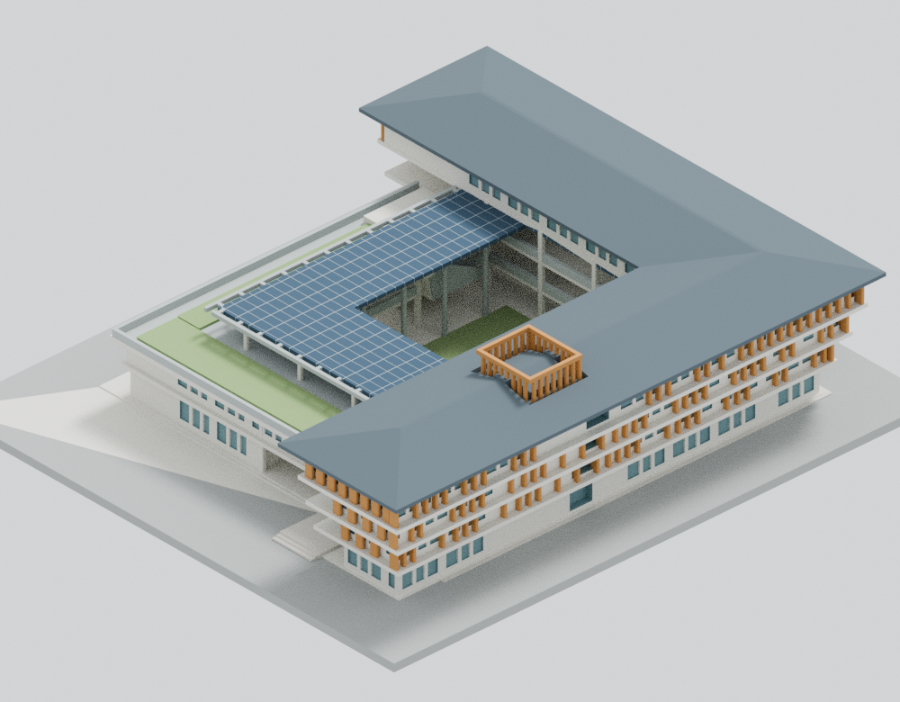

# 福智佛教學院宗德樓｜2024 外觀與列印模型

單棟宗德樓的來源約束外觀模型，版本 v17。學校為福智佛教學院，教育部115學年度名錄代碼1R10；建築設計為大藏聯合建築師事務所。未宣稱原建築師或攝影師授權、認可此模型。

## 預覽

| 正面 | 背面 |
|:--:|:--:|
|  |  |

## 模型

- 原 STL：`models/v17/model.stl`，37,330個三角面。
- SHA-256：`96481addb2b9ac4144cb5f012f19b57e047106021e93adb5c34df2c00770e1a3`
- Blender：`models/v17/scene.blend`，保存原 STL 幾何、原創程序材質與相機設定。
- 尺寸：210 × 187.5 × 54.625 mm，含3 mm厚基座。STL沒有內建單位，匯入切片器時採mm。
- 名義比例1:400（2.5 mm／估計建築米）。樓面0.15／4.63／8.47／12.31 m及主屋頂2.5:10為圖面直接值；其他尺度由公開圖說、完工照片比例推估，不是測繪資料。
- X為原平面紙面右，Y為紙面上，Z向上。四向圖採局部軸名，未宣稱地理真北配準。

保留高四層L翼、低兩層翼、開放內院、逐層外挑、灰色坡屋頂轉角、低翼花園與L形光電棚、竹格柵、入口挑空及橋廊、外廊與院梯。未建全校、寺院、地下層或室內家具設備。

## 來源與製造近似

來源URL、直接值及估計分類見 `sources.json`；細項見 `ESTIMATES-AND-SIMPLIFICATIONS.md` 和 `PRINTING-LIMITS.md`。原建築照片攝影依來源標示為朱逸文／朱逸文建築影像。原照片、建築師PDF及來源比較板不在本套件內，亦未當材質貼圖。

主要來源：[建築師專案頁](https://architdz.com/portfolio/2024-福智佛教學院宗德樓/)、[建築師公開圖說](https://architdz.com/wp-content/uploads/2026/05/2024-福智佛教學院宗德樓-圖說.pdf)、[學校校園導覽](https://www.bwbc.edu.tw/campus/)、[教育部115學年度名錄](https://stats.moe.gov.tw/files/school/115/u3_new.ods)。

竹絲合併為加厚翼片，細網護欄改連續護板，窗框／柱／棚架加粗，階梯併級並保留實心底。光電棚採等高厚板近似，傾角未精測。入口文字及微小緊固／排水細節省略。

設備屏腳周圍的封底環槽與兩處近脊連橋是製造補強，局部切去屋面並增設小托座，均不是原建築實景細節。院內一段梯向院內平移0.50 m、相鄰柱列向廊內0.20 m，也是已揭露製造調整。所有補強均經同STL外觀回核；這不構成測量精度或成品強度保證。

## 圖片與重現

`previews/v17/` 有7張主視圖（front、rear、top及四局部軸向）和4張入口／院內圖。圖片由原模型渲染，CPU Cycles 64 samples、固定seed0、單執行緒、曝光+0.35。現有Blender編譯不支援OpenImageDenoise，未使用去噪。

公開PNG僅移除明確白名單的File及時間／性能文字metadata。原IDAT、RGBA像素、色彩metadata和所有保留chunk完全不變；未重壓縮或改畫面。`render-manifest.json` 及 `metadata-cleanup-binding.json` 分別記錄公開圖與原圖的不同hash。原PNG的日期和耗時會隨執行改變，不能聲稱原PNG整檔bytes重現；獨立重渲另核像素／非變動metadata，以及相同清理後的公開PNG bytes。

原碼在 `source/`，參數為 `parameters.json`；`models/v17/` 內有同hash源碼快照。先備妥Python3.12、requirements.txt套件、Blender4.3.2及g++，實際環境版本見 `toolchain.json`。從本資料夾執行，輸出使用全新目錄：

    OMP_NUM_THREADS=1 OPENBLAS_NUM_THREADS=1 python source/build_model.py --output-dir models/rebuilt
    OMP_NUM_THREADS=1 OPENBLAS_NUM_THREADS=1 blender -b -t 1 --python source/render_preview.py -- rebuilt

上述渲染產生原始PNG；公開metadata整理及完整驗證重現入口見 `qa/README.md`。已驗證的bitwise重現範圍以本次實際工具鏈為限，不承諾不同Blender版本或硬體輸出相同bytes。

## 數位檢查與限制

有限範圍的獨立數位驗證已完成，`qa/QA-RESULT.json` 記錄 `bounded_verification_passed=true`；原數值射線 `strict_passed=false` 仍保留。完整證據、工具和正反控制位於 `qa/`。全部2,348份原控制與1,361份封裝控制檔案以固定metadata的兩個tar.xz封存，每個成員都有獨立SHA-256索引；安全解包與重現入口見 `qa/CONTROLS.md`。主模型的完整科學報告與壓縮原始數據維持原bytes。原拓樸／法線／單一閉合有向表面、819個切層中的29,220個Polygon，以及620,769組含鄰面與共面的精確閉AABB候選都有實跑證據。

373,300條原面法線射線沒有短於0.8 mm者，受測最短1.00 mm。原檢查器仍有12個射線旗標，原 `strict_passed=false` 如實保留；另以原run記錄的十六進位射線做全事件有理數分類。不要把精確分類寫成刪除或豁免原旗標，也不要把有限射線的最短值稱為全域最小壁厚。最終判定、normal／-O結果和各項邊界以QA摘要為準。

尚未實體試印，亦未指定印表機、材料、層高或噴嘴。基座朝下時，大挑簷、樓板外挑、橋廊和光電棚底需要在實際切片器檢查支撐，並考慮院內支撐拆除可達性。數位檢查不等於免支撐、材料強度測試或任何機器成功率保證；縮小後不得沿用這個尺寸的檢查結果。

歷史失敗模型、未完成的中斷資料、工作log及原PNG只留私人追溯；toolchain.json提及的失敗去噪探針log亦屬私人歷史，不在本公開包中。公開保留的是完成證據與重現所需的正反控制，預期拒絕的負控制不是失敗模型。
