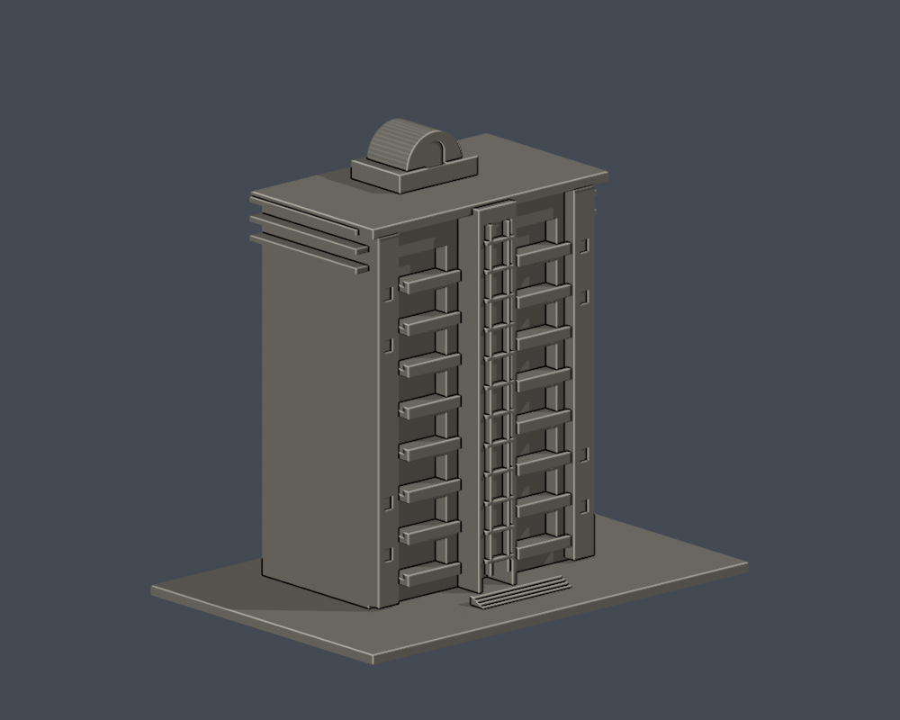
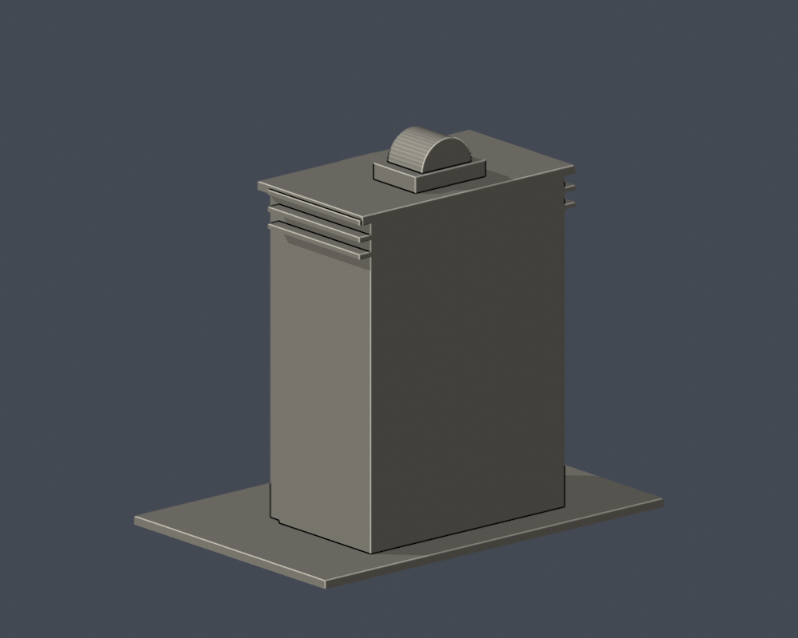

# 美和科技大學商學大樓（E）

東校區。這是公开外觀照片推估的可列印建築微縮研究，非測繪級BIM。館名依總務處和招生中心核對；現行網頁不保證照片為2026年。

## 外觀依據
- 中央玻璃垂直帶與雙側深陽台
- 頂部橫簷、屋頂拱形小核心及側邊篩壁

## 尺度與未知處
- 含底板 150.00 × 100.00 × 139.00 mm；各棟獨立縮放至最長150 mm，不能當同一比例校園拼圖。
- 無實測尺寸。整體深度、背面、隱蔽屋頂與被樹遮蔽位置為目測/簡化；背側不任意複製正面窗格。
- 官方照片很小，門窗数量、柱距、曲率及細部不是精密還原。省略空調、海報、文字和細欄杆；細框為列印加厚。
- 只重建本棟，不連同鄰棟、校園景物、中學或幼兒園。樓層表含屋頂層，與照片可見完整樓層不直接相等。

## 檔案與重建
安裝 requirements.txt 所列Python依賴，執行 build_model.py 產生 model.stl/model.obj。Blender執行 render_preview.py 從實際STL匯入，產生可編輯 scene.blend 及正面/背面/立面預覽。再執行 validate_model.py、check_layers.py、check_thin_features.py。

## 驗證及列印限制
- 原STL法向、流形邊/頂點、正體積、一個連通外表面、無分離內腔殼、原始重建SHA與blend/STL三角幾何：通過。
- 0.2 mm高度間距共 695 層截面閉合檢查：True。數值採非共面微偏移，非真正切片器路徑。
- 0.8 mm XY形態篩檢於1 mm間距抽樣，0 層超過1%形態開運算面積損失，最高 0.33%。小轉角也計入，不等於確定失敗或完整壁厚檢查。
- 挑空、水平屋簷、雨庇及窗洞頂緣可能需要支撐；請依材料、方向和切片器先檢查。未完成實體試印、支撐可移除性測試或完整切片驗證。

來源見 sources.json。第三方照片只供內部研究，本交付不包含原照片。

## 薄篩數值修訂

本包直接採canonical-edge-v2：固定共邊方向插值，節點度數2、閉環及Polygon有效斷言通過後，才進行1 mm間距0.8 mm XY開運算。舊算法可能因獨立端點取整漏環；舊工具/結果已替換，不是僅增附錄。STL、Blender、重建來源及原0.2 mm閉環驗證不變。

商學大樓舊薄篩的1層警示為數值漏環造成，修正後0層；不代表正式切片/试印或全域壁厚保證。

## 實際STL正背並排

| 模型預覽 | 模型預覽 | 模型預覽 |
| :---: | :---: | :---: |
| 正面  | 背面（未見部分按詳頁明示簡化）  |  |
