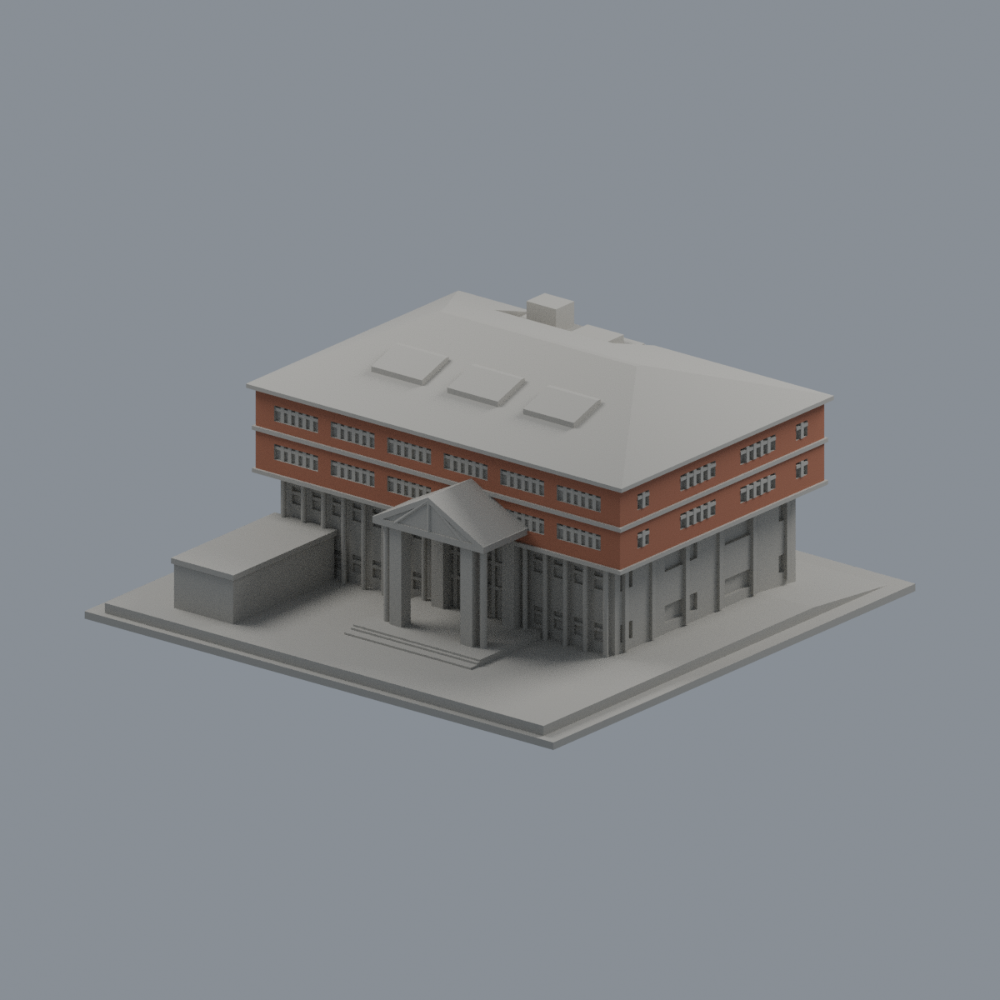

# 義守大學

本批僅完成學生活動中心有界近似，未代表全校完成。屋面/外觀主要依2022照片與2024正射；完整南背窗、高程剖面與地形未知已公開。

| 建築模型 | 建築模型 | 建築模型 |
| :---: | :---: | :---: |
|  **[義守大學｜校本部｜學生活動中心](校本部/buildings/isu-student-activity-center/README.md)** 學生活動中心：正面 |  |  |

[模型、參數源、Blend、QA及限制](校本部/buildings/isu-student-activity-center/README.md) · [屋頂](校本部/buildings/isu-student-activity-center/previews/top.png) · [有限原面彩色外觀](校本部/buildings/isu-student-activity-center/appearance/README.md)
