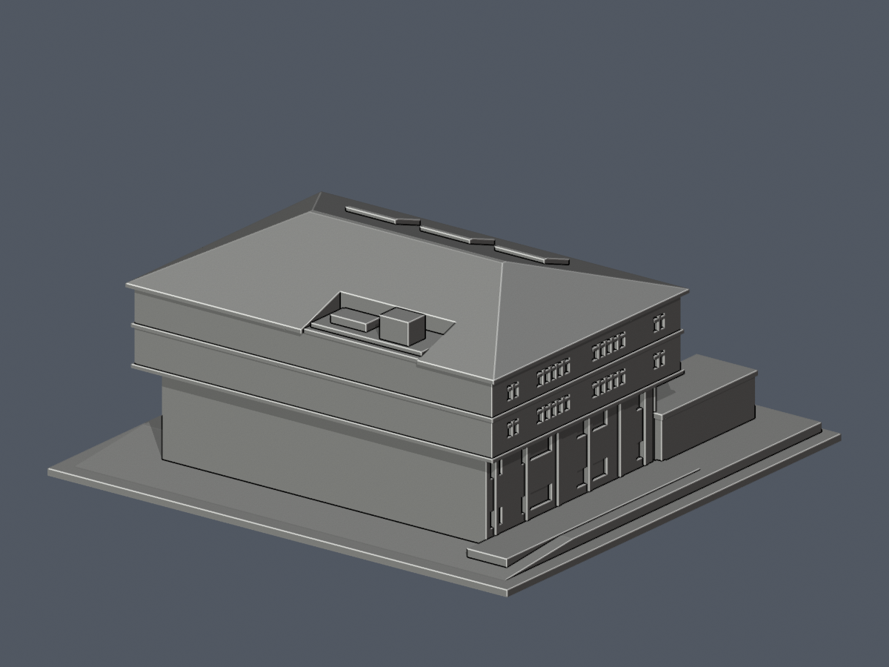

# 義守大學｜校本部｜學生活動中心

2022正面/西側照片與2024全屋頂為主要依據，2009池側及官方其他角度補證的完整主體有界近似；不是測繪、同年完整復原或全校完成。

| 正面 | 背面 |
|---|---|
|  |  |

[頂圖](previews/top.png) · [側東](previews/east.png) · [側西](previews/west.png) · [正立向](previews/north.png) · [斜俯視](previews/aerial.png)

## 檔案與尺度
- [model.stl](model.stl)：毫米，含底座150×145×66.550003mm，底座朝下。
- [scene.blend](scene.blend)：匯入同一STL的可編輯網格；[build_model.py](build_model.py)是原創參數來源。
- Python依賴見[requirements.txt](requirements.txt)，Blender 4.3.2；`python build_model.py`重建，再`blender -b -t 4 -P render_preview.py`重作實際STL預覽。
- 四坡屋面、南機房凹口、北三低斜片、四柱玻璃雙坡門廊、上2＋下2窗排、東北低附體與入口階梯均保留。泳池、劇場、體育館及停車場不併入。

## 近似及未知
- 屋簷44.5×31.5m源於2024正射像素比例，角點±5px約±0.69m，仍含屋簷和高物視差，不是牆基測值。照片只有薄簷，上牆採43.2×30.3m；OSM北牆40.4m只粗核，沒有硬套成每側2m巨挑簷。
- 檐17.8m、原型脊23m在照片配景候選界內，沒有高程測量或剖面。B1＋地上5F是官方資料，不能換成六等高窗層；模型依可見上2下2窗排。
- 南機房凹口僅截屋面，無證據挖穿牆。南背完整窗列未知，採保守牆面；南坡3細暗三角未證成獨立大盒，省略細節。
- 東北低附體名義4.5m、南地景差1m、平台和階梯是有界示意。全地下室未作全周高牆。官方面積2563/2569㎡、1988/1989時序口徑矛盾，未據此倒算尺度或斷言完工年。

## 列印化簡與限制
- 細窗框背接加粗：豎框約1.08mm，上氣窗橫框0.864mm；主立面線腳1.08mm。窗為淺凹面，並非玻璃真洞。
- 主脊局部截高0.25mm形成約1.52mm窄平頂；北三斜片上端截高0.4mm形成約1.21mm窄頂；主簷零厚邊改1.1mm垂直厚。這些是列印處理，不是真實建築細節。
- 門廊斜板豎厚1.6mm。三角玻璃屋蓋內填實，避免封閉隱藏腔；四柱下方仍有通空。厚梁向前補0.27mm接到原板前緣，消除微懸唇，外屋簷包絡不變。側柱背根完整接牆、細柱落地、四柱接入口平台。
- 未實體試印，亦未執行Cura/Prusa實際工具路徑。門廊、挑簷和凹處應檢查支撐；拆支撐保護細柱/框，勿任意縮小。數位篩檢與有限原面射線不是全模型所有方向最小壁厚或可印保證。

[來源](sources.md) · [完整QA](QA.md) · [驗證JSON](validation.json) · [逐構件](component-detail.json) · [原面射線](surface-chords.json)

## 原面有限磚材外觀層

[彩色3MF、可編輯Blend與五視角](appearance/README.md)：只染238個原+Y入口／−X花園上兩帶磚面，2900.7799204075227 mm²；其餘9388面中性。框窗／白帶／下牆／屋頂／東背全不染，不新增幾何。原9626面／4775頂點、STL bytes與原QA保留。官方2022為caption年非EXIF攝年，圖片來源秘書處、ARR保留，照片不附。歷史strict pass不是實印或全域厚度保證。
