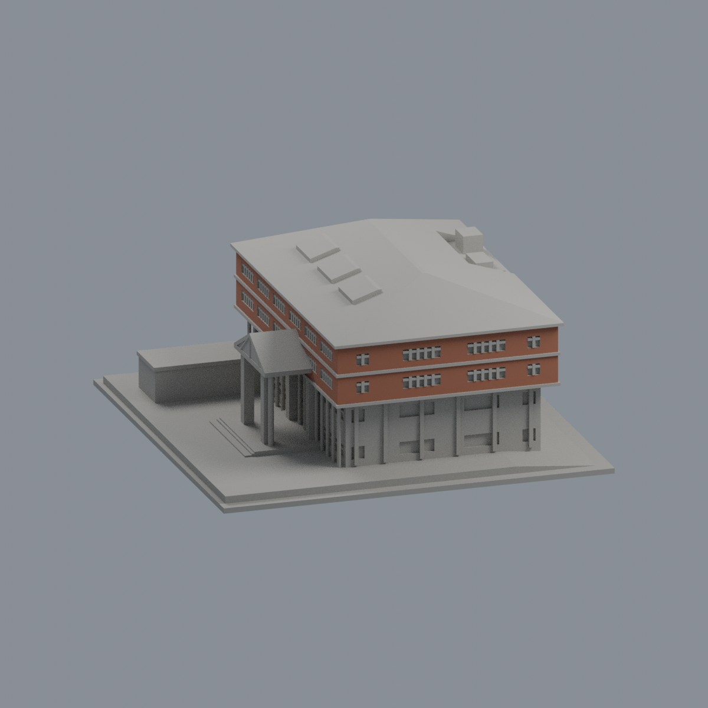
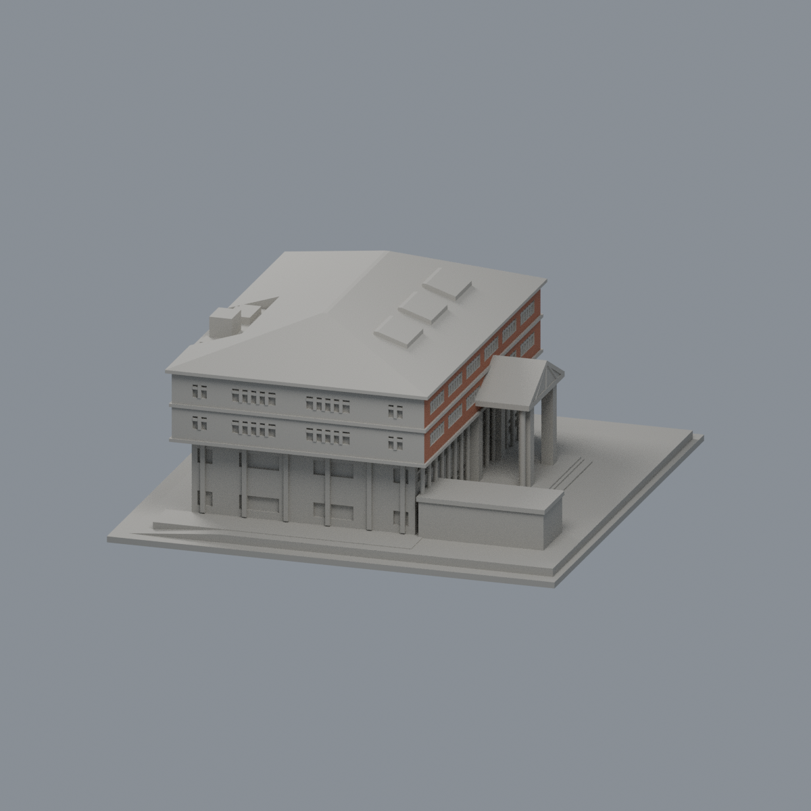
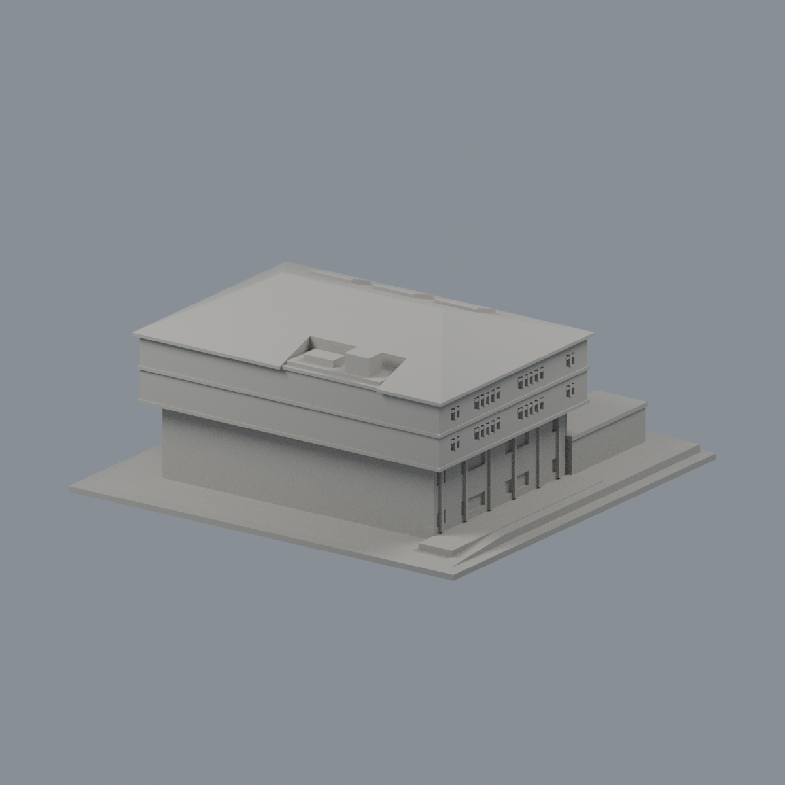
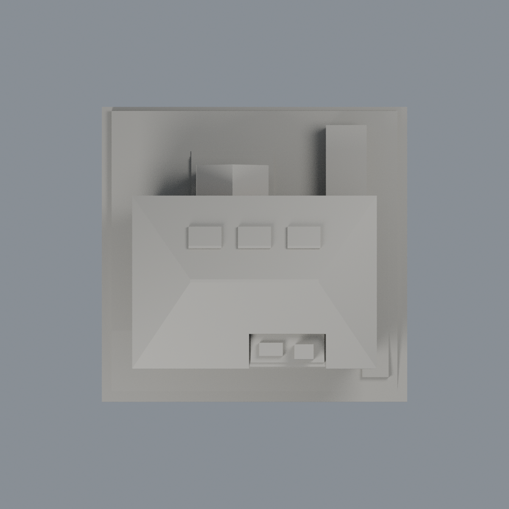

# 義守大學學生活動中心：原面有限磚材外觀層

既有模型的有限外觀改善，不是新增建築或全棟實景精準復原。只將+Y入口與−X花園側上兩帶的238個完整原磚面染為低彩度暖紅褐不透明代理色，合計2900.7799204075227 mm²；其餘9388面保持中性。兩組入口33／41面、兩組花園82／82面。沒有量測實景RGB、反射或材質厚度。

- [彩色3MF](isu-student-activity-center-appearance.3mf)：單網格、全部原頂點、兩個可獨立改色材質。
- [Blender原生可編輯檔](scene.blend)：全部原面；材質與頂點實際修改／保存／重開驗證。
- [入口正面](previews/front.png)・[花園側](previews/left.png)・[東側](previews/right.png)・[背面](previews/rear.png)・[俯視](previews/top.png)
- [重建原始碼ZIP](rebuild-source.zip)：解壓後依序執行 appearance/source/build_appearance.py、verify_exchange.py，再用 Blender --background --python 執行 render_appearance.py、verify_scene.py。Python numpy、lib3mf 2.5.0、Blender 4.3.2。

| 模型預覽 | 模型預覽 | 模型預覽 |
| :---: | :---: | :---: |
| 入口正面  | 花園側  | 東側  |
| 背面  | 俯視  |  |

## 嚴格範圍
四個有限外牆平面，原三角形三頂點與實際外法向全部落域才選取。框窗、白色橫帶、窗洞側壁、下牆與柱、入口山牆與門廊、屋頂、東側與背面、底座全不染。窗灰是未確認的原中性，不代表白色玻璃。不新增磚縫貼圖、切面或幾何。前／花園與東／背的配色分界是證據範圍，不宣稱真實建築材料接縫。

## 幾何、可編輯性與歷史QA
原STL bytes不變：9626三角面／4775頂點，150×145×66.55000305 mm。原面順序、三頂點、有向繞序、單位、底座與簡化保留；完整原34件另存私有完整備份，包括原QA／原預覽／原生檔。交付STL／3MF座標精確，SDK另存的隔離編輯測試副本有float32微量化（精確值見qa），不把它宣稱原位元完全不變。

原strict數位QA歷史pass：333層／2698多邊形，最大單元opening損失0.9668832297%、全層0.1092317211%；9626×4=38504有限表面樣本最短首段實心弦0.8099994659 mm，140屋頂樣本最小1.2053391 mm。4大入口柱、17細柱、2後支柱與12側壁柱根部連接。這些不是全表面任意方向最小厚度保證，本次不重跑歷史製造檢核，沒有實際切片路徑或實印保證；保留支撐評估，不建議任意縮小。

原README的2022正西／2024屋頂／2009泳池側混合年代、官方1988／1989和2563／2569 m²差異、南窗列未知、名目附屬／底座高度、照片推估高度與平面、四坡屋頂及凸板列印簡化等全部保留。本次只改善外觀，不解決既有幾何不確定性。

## 來源與權利
見 [SOURCES.md](SOURCES.md) 和 [LICENSE-NOTICE.md](LICENSE-NOTICE.md)。照片僅私下觀察，不附圖像、照片像素、貼圖或藝術品。2022是官方caption年而非EXIF攝年，不推論2026現況。技術完成不等於第三方權利清除或法律適用保證。
