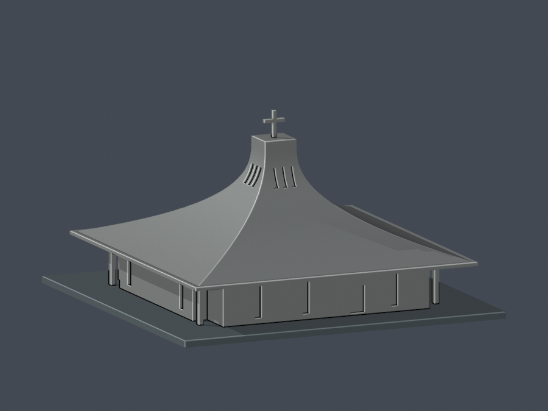

# 聖約翰科技大學｜校園建築外觀近似模型

這是逐件建模增量，目前一件主堂模型，不表示全校完成。曾用校名聖約翰大學與聖約翰科技大學；本資料夾採校方來源使用的聖約翰科技大學。

[淡水校區](淡水校區/README.md)

<table><tr><td><a href="淡水校區/buildings/sju-advent-church/README.md"> 降臨堂｜約2014主堂近似版</a></td><td>待續建物</td><td>待續建物</td></tr></table>

每件正背並排；同一件不拆占學校圖鑑三欄。原始第三方照片不隨公開包再散布。外觀已核准、作者QA通過並凍結；獨立硬性幾何與9張PNG重現檢查通過；薄損具體例外已核准，本說明補充仍待最終文件核對，尚未發布。

文件補充v1：原幾何與預覽不變；已更正降臨堂52整層及436跨層構件樣本的形態薄損警告，包含角柱與十字架。具體數據、接受理由及禁止任意縮小／支撐與未試印限制見建物README。
