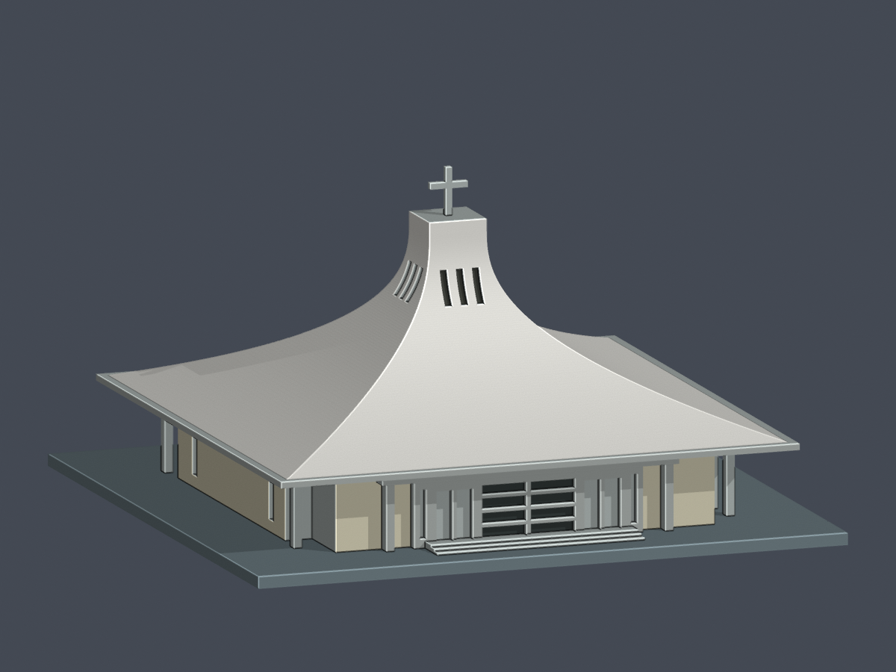
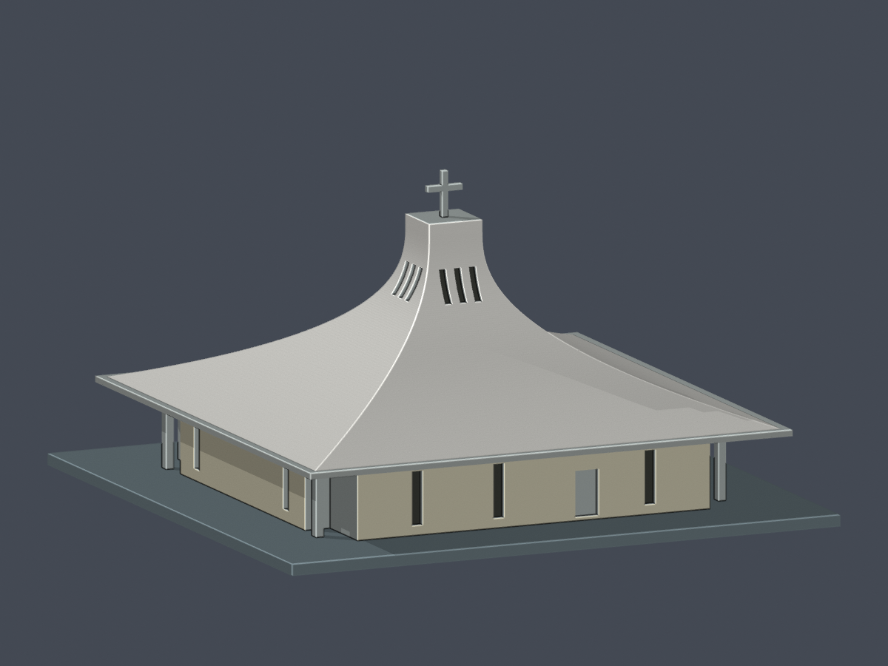

# 聖約翰科技大學｜淡水校區

[回學校](../README.md)

目前僅降臨堂主堂近似版；校區尚未完整建模，南側關懷中心及附屬鐘塔未納入。

| 降臨堂有限證據配色正面 | 降臨堂有限證據配色背面 |
|---|---|
|  |  |

[模型、限制與來源](buildings/sju-advent-church/README.md) · [有限證據配色／逐面材質 3MF](buildings/sju-advent-church/appearance/README.md)

2026-10-24 配色沿用原 3,972 面；2,218 面有有限來源依據，1,754 面保持未知／抽象底座中性。原 STL、原 Blend、原預覽及薄件／支撐限制不變，未實體試印；不增加模型件數。

文件補充v1：原幾何與預覽不變；已更正降臨堂52整層及436跨層構件樣本的形態薄損警告，包含角柱與十字架。具體數據、接受理由及禁止任意縮小／支撐與未試印限制見建物README。
