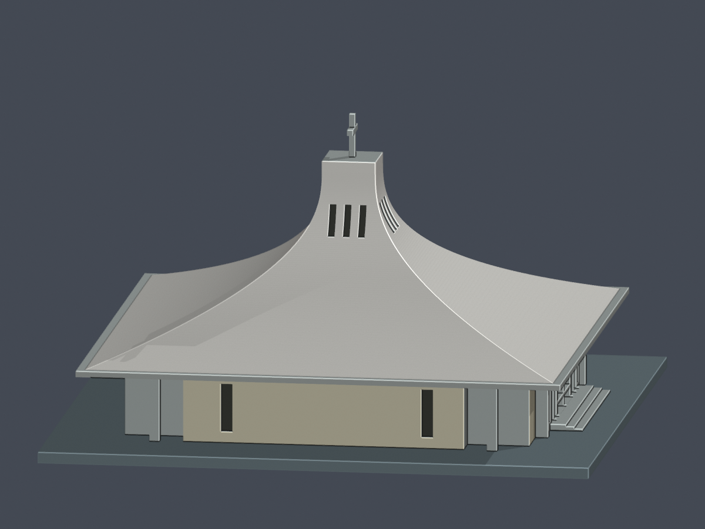
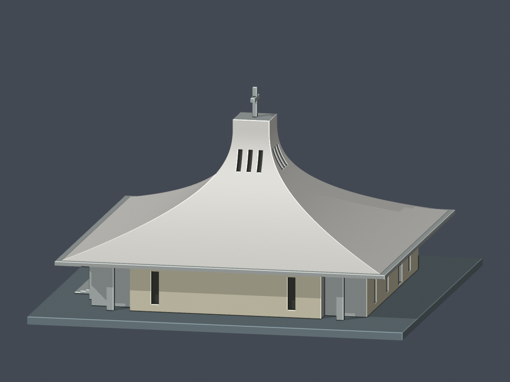
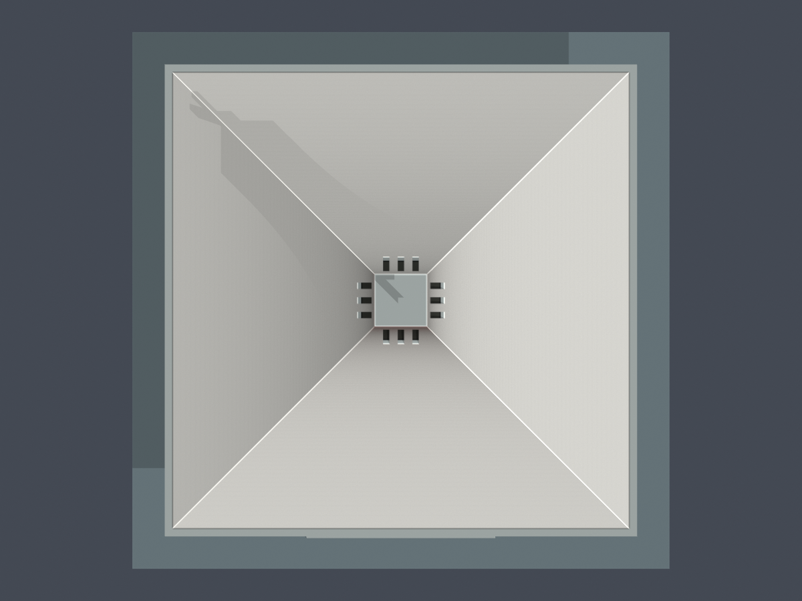
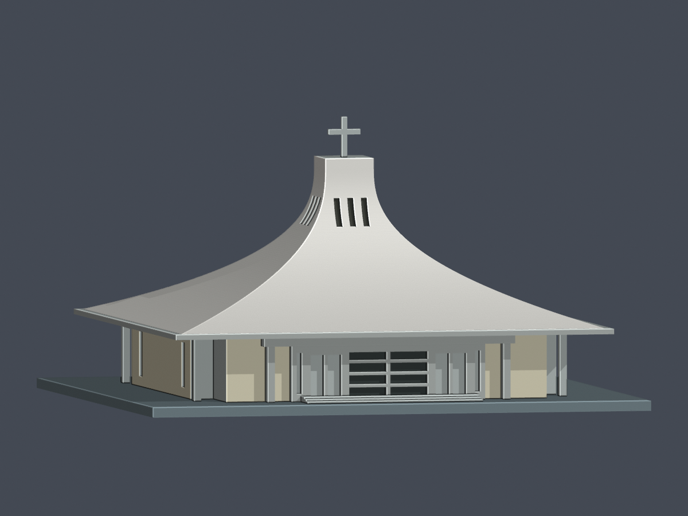
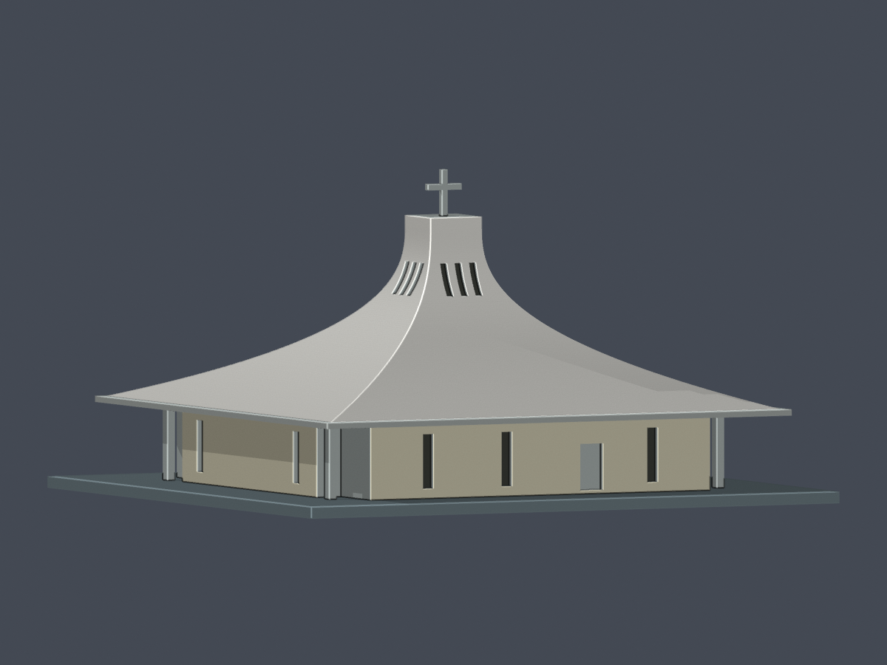

# 降臨堂｜有限證據配色層（約 2014 主堂）

[回原模型](../README.md)

| 模型預覽 | 模型預覽 | 模型預覽 |
| :---: | :---: | :---: |
| 正面<br> | 背面<br> |  |

此層只為原有 **3,972 個三角面**指定材質；未切面、未重建、未縮放、未改動原 `model.stl`、原 Blend 或原預覽。不是新增建物，也不表示全校或整棟外觀均獲驗證。

## 交付

- [scene.blend](scene.blend)：可編修單一網格，8 個命名材質；每面保留 `original_stl_face_id` 與 `evidence_region_id`。
- [sju-advent-church-materials.3mf](sju-advent-church-materials.3mf)：真正的 3MF Core `basematerials` 與逐三角面材質屬性，毫米；不是改副檔名的 STL，也不是只在 Blender 顯色。未提供特定切片器的噴頭/耗材分派；軟體可能忽略顯示色，使用者仍須自行確認。
- [左側](previews/side-minus-x.png)、[右側](previews/side-plus-x.png)、[頂視](previews/top.png)、[正面低視角](previews/front-low.png)、[背面低視角](previews/rear-low.png)。左右為模型 ±X；正面為 −Y，不是已測定的東西南北。
- [逐面對照](face-materials.json)、[材質與證據區域](material-manifest.json)、[公開來源與限制](sources.json)。所有照片僅供私下研究，**未附原圖、裁圖或照片貼圖**。

| 模型預覽 | 模型預覽 | 模型預覽 |
| :---: | :---: | :---: |
| 左側<br> | 右側<br> | 頂視<br> |
| 正面低視角<br> | 背面低視角<br> |  |

## 配色依據與未知部分

2012 校方正面及 2014 第一手背／側照片支援：外露曲殼和方頸側面為白／暖白、可辨識低牆面為淡奶油色、外露門廳與簷緣為淺灰、已對上的凹窗背面為暗灰。2018／2019 教堂照片只作較晚時期的補充核對。RGB 是顯示近似，不是校色測量、油漆規格或 2026 現況宣稱。

| 材質 | 面數 |
|---|---:|
| 外露曲殼／方頸側面暖白 | 1,304 |
| 可辨識低牆面淡奶油 | 67 |
| 已對上的門廳／簷緣淺灰 | 97 |
| 正門中央玻璃凹槽背面暗灰 | 16 |
| 上部窄窗背面暗灰 | 720 |
| 下部窄窗背面暗灰 | 14 |
| 未知中性灰 | 1,687 |
| 抽象底座中性對比色 | 67 |
| **合計** | **3,972** |

**2,218 面有限證據配色；1,754 面明確標為未知／抽象底座。** 未知包括十字架 42 面、未見方頸頂面 8 面、向下表面 126 面、未能逐一對上的背門 2 面，以及其他凹槽側壁、遮蔽轉折和未辨識表面 1,509 面；底座另 67 面。十字架在不同照片有白與棕的衝突，未猜為金／銅／白。背照雖有紅門，未把紅色套上未確證的原面。

每個規則要求**三個頂點均在指定原表面／範圍內**，並檢查朝外法向；不用單純高度分帶或三角形中心點塗滿整棟。沒有為了配色切割原三角形，也沒有虛構磁磚紋理或補建原模型省略的線腳。凹窗只塗背面，側壁不整片塗黑。

## 重跑

原模型的 `model.stl` 必須留在上一層，SHA256 必須是：

`899833cab3d36540de1455757b2b1119f5d4563a8f0bede4f16286f036f04652`

Python 3.12 + `lib3mf==2.5.0`；Blender 4.3.2。原幾何參數重建另外依上一層 `requirements.txt`，本配色程式不需要 trimesh/manifold，也不覆寫 STL。

```sh
python appearance/source/build_appearance.py
blender -b -t 4 --python-exit-code 1 -P appearance/source/render_appearance.py
python appearance/source/verify_appearance.py
blender -b -t 4 --python-exit-code 1 -P appearance/source/verify_scene.py
```

請從建物目錄執行以上命令。程式以自身位置解析檔案；不依賴其他學校或私有研究路徑。3MF 先經 lib3mf 寫出，再把 XML 頂點數值寫回原 STL float32 的精確十進位表示，避免格式化捨入；不改座標、拓樸或材質。重新以 lib3mf 嚴格讀入驗證。

## 數位驗證與列印限制

- [配色／3MF 檢查](appearance-verification.json)：原座標和三角形順序完全一致；單連通正體積、所有邊雙面反向、所有頂點連結單環；零重複面／退化面。3MF 8 材質、全部逐面語義對應、嚴格讀入零警告。
- [Blend 重開驗證](blend-verification.json)：單一網格、無 modifier、逐面 ID 和材質相同，重開後正面 PNG 完全重現。
- [重建驗證](rebuild-verification.json)：原參數程式重建 STL 位元組一致；配色索引、材質表、3MF 和 7 張 PNG 均可重現。Blend 只保證幾何／材質語義，未宣稱整個二進位檔固定雜湊。
- [渲染記錄](render-manifest.json)、[視覺核對](visual-review.json)、[檔案雜湊](SHA256SUMS)。

**本次沒有重新實體試印或執行切片器工具路徑。** 原尺寸 150 × 150 × 83.08 mm、底座 3 mm、約 1:219.8 不變。原模型 52 整層及 436 跨層原 Polygon 樣本 opening 損失 >1% 的既有限定例外仍存在；不能宣稱零薄損、全域最小壁厚已通過或免支撐。外簷／門廊懸挑與細十架仍要實際切片確認，不可任意縮小。本層的幾何相等證據不取代原 QA，也不提高原幾何可信度。
