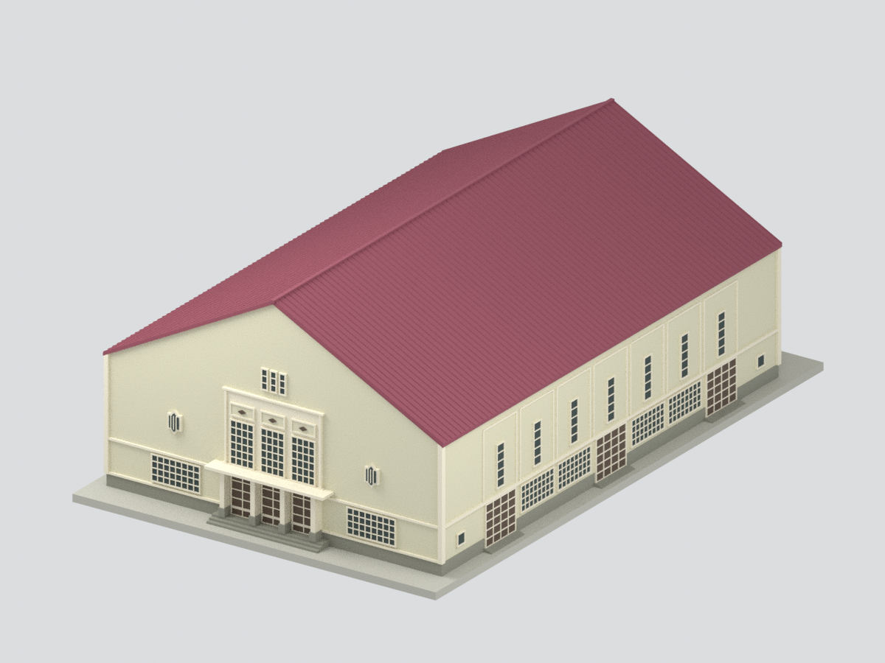
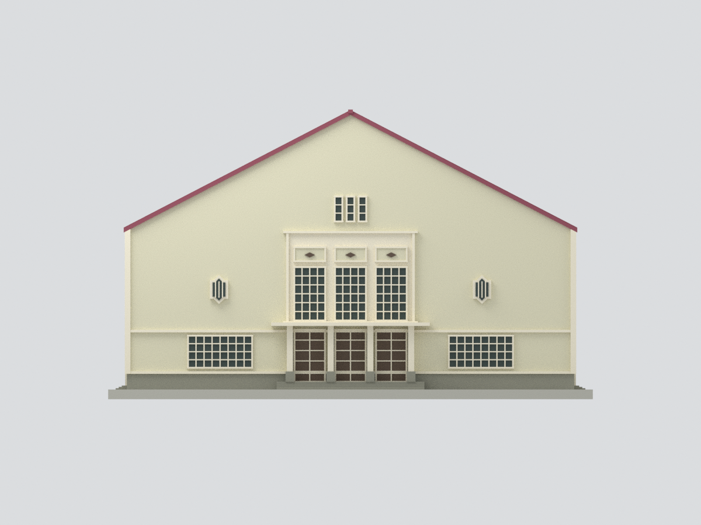
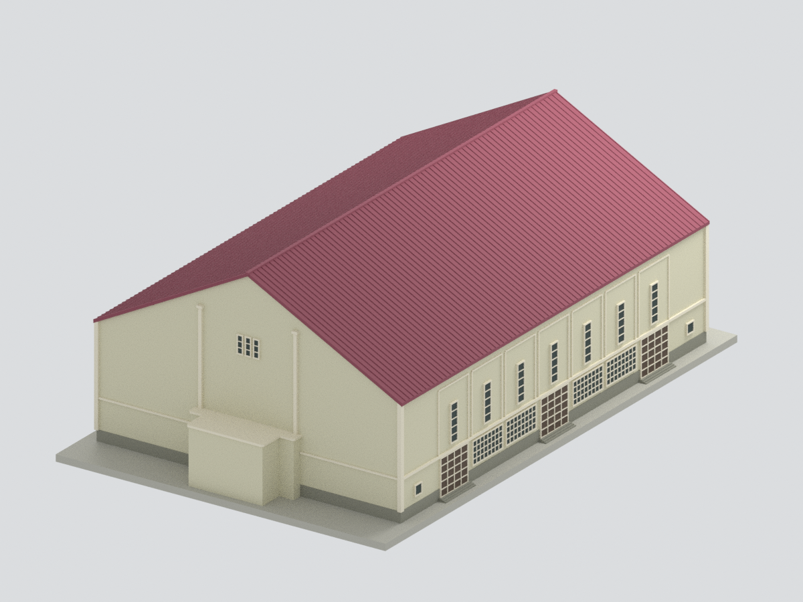
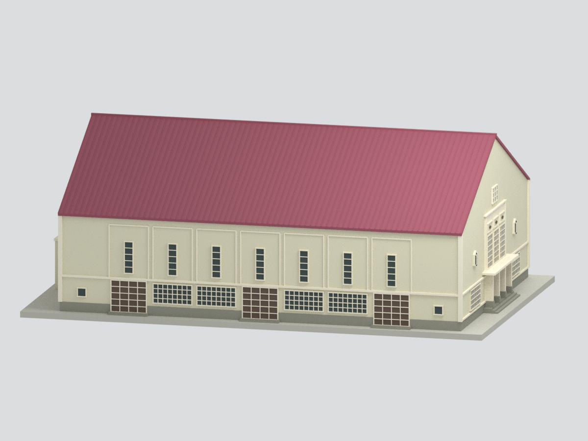
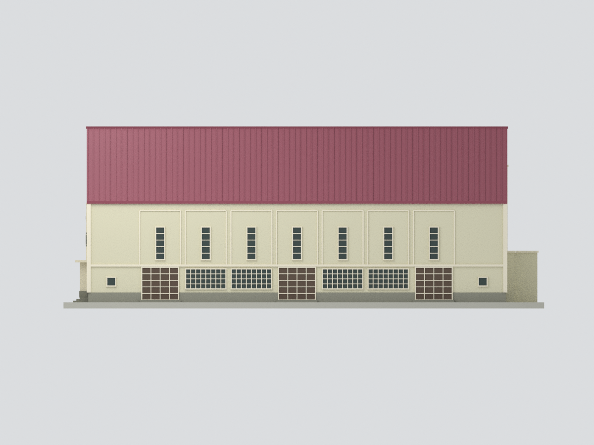
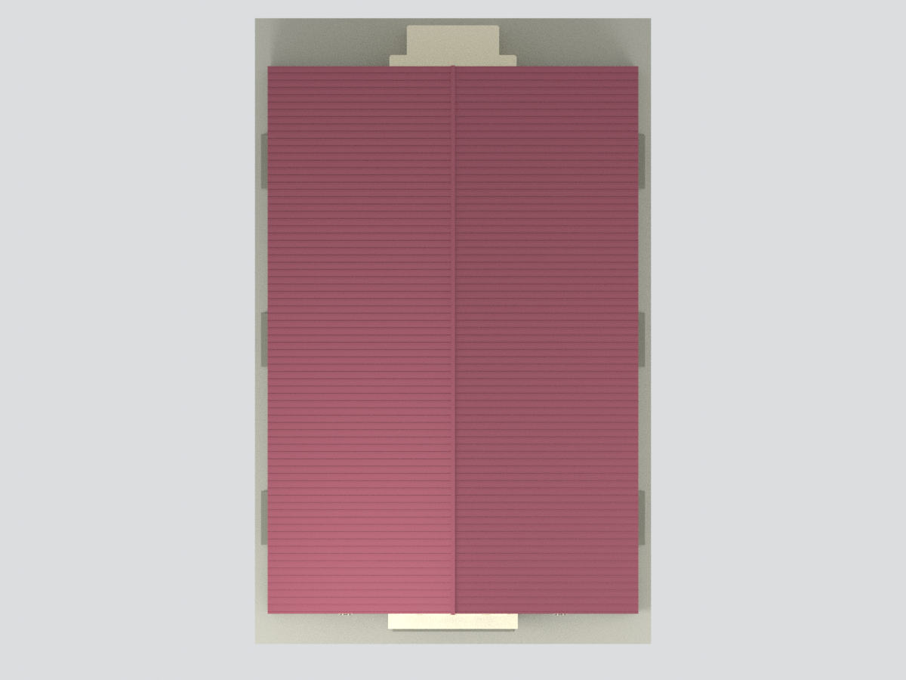
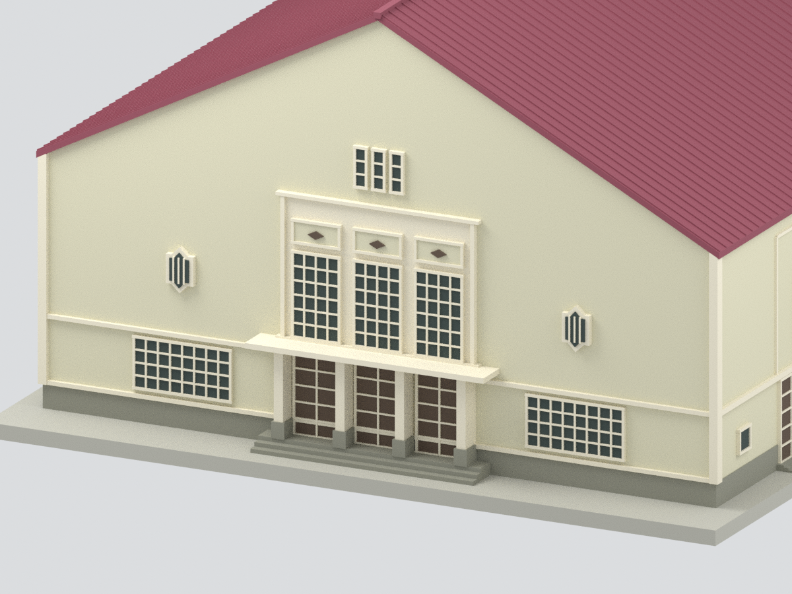

# 臺中一中校史館｜2012 調查外觀模型

**這是 2012 年調查報告 A 組「現況」的主要完整外殼，不是今日修復後的外觀，也不是原始竣工狀態。**

## 下載
- [STL 單色實體](model.stl)
- [3MF 分面色彩實體](model.3mf)
- [Blender 可編輯檔](scene.blend)（顯示合併成品，隱藏集合保留製作構件）
- [參數](parameters.json)、[重建腳本](build_model.py)、[來源紀錄](provenance.json)

## 建築與年代
現屬臺中市立臺中第一高級中等學校校本部；來源報告委託時校名為國立臺中第一高級中學。依 2012 年 3 月《歷史建築臺中一中校史館調查研究暨修復再利用計畫》既有平面、屋頂、四向立面、剖面與照片製作。只採 A 組測繪現況，不把 B 組修復建議或 2015 年完工材質混入。

## 保留內容
- 長方形主體、完整雙坡山牆、當年紅紫色金屬浪板屋頂。
- 東正面三組門、四柱淺門廊、中央三大窗、三狹窗與兩側角形裝飾窗。
- 南北長側各七扇高窗，下方三組門及四組橫窗。
- 西背面中央階狀低突出量體、兩高細柱及三狹窗，**沒有複製正面**。
- 腰線、窗格、基座與入口階梯為便於辨識和列印的簡化實體細節。

## 尺度與限制
- 名義比例 **1:150**。圖上主軸長 **30.10 m**、寬 **20.11 m**；這是軸線尺寸，不是含牆厚及突出物的最外廓。
- 東西立面總高標 12.7787 m，長側立面標 12.8617 m，地坪／圖面基準不同。模型採名義整合外殼與平坦展示底座，不是完整地形測繪。
- 未直接標註的突出深度、牆厚、窗位與飾框以圖面比例描摹；門窗採不透明、封閉的淺浮雕，非透明玻璃或可開啟門扇。
- 浪板細肋數量、細窗格、裝飾雕刻經簡化；色彩依當年照片取近似乾淨色，並非測色。
- 圖上粉刷剝落／滲水病害不是建物缺口；不刻意製成缺損。省略斑駁、文字、招牌、設備管線、臨時物、植栽與鄰棟。
- 不宣稱重建室內、屋架細節或現況翻修；沒有實體試印或材料耐久驗證。網格檢查不等於試印通過。

## 多視角
| 東正面 | 西後側 |
|---|---|
|  |  |

| 長側立體 | 長側立面 |
|---|---|
|  |  |

| 屋頂 | 入口細節（局部裁切） |
|---|---|
|  |  |

## 來源
- [學校官方公開電子書](https://ebook.tcfsh.tc.edu.tw/book/content.php?id=31)／[閱讀器](https://ebook.tcfsh.tc.edu.tw/reader/?bid=31)，2012 年 3 月，成大研究發展基金會、陳柏年等。電子書第 379、382、384–387 頁（A2-1、A2-4、A3-1～3、A4-1）及第 4–9 頁照片。
- [臺中市文化資產處建築紀錄](https://www.tchac.taichung.gov.tw/historybuilding?pid=42&uid=34)：僅交叉核對建築身分、屋頂形式與概略尺度，不取代歷史測繪。

公開套件不附原始照片或掃描圖；預覽全部為本模型的實際 Blender 渲染。來源公開可讀不等於原圖可任意再散布。

## 檢查與重建
`build_model.py` 使用 Python、numpy、trimesh、manifold3d 建立同一表面網格供 STL／3MF／Blender 使用；`render_model.py` 產生真實預覽。`QA.json`、`BLEND-QA.json`、`RENDER-BINDING-QA.json`、`SOURCE-VISUAL-QA.json` 分開記錄格式、渲染綁定與外觀審核，`SHA256SUMS` 提供檔案雜湊。
