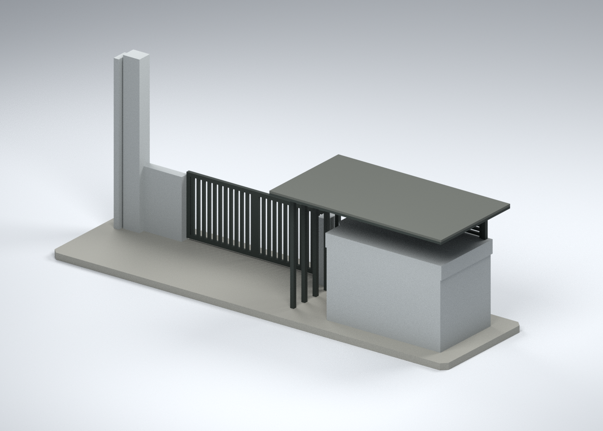
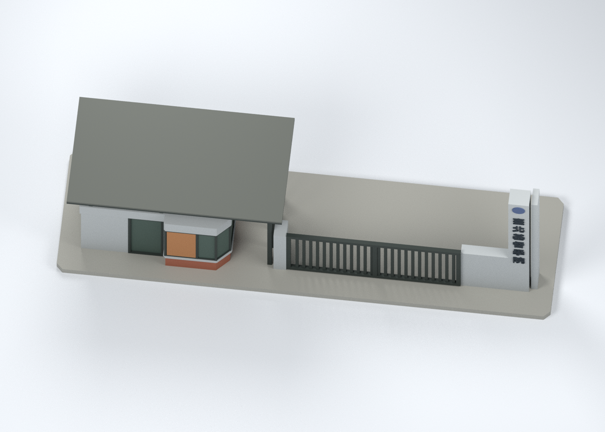
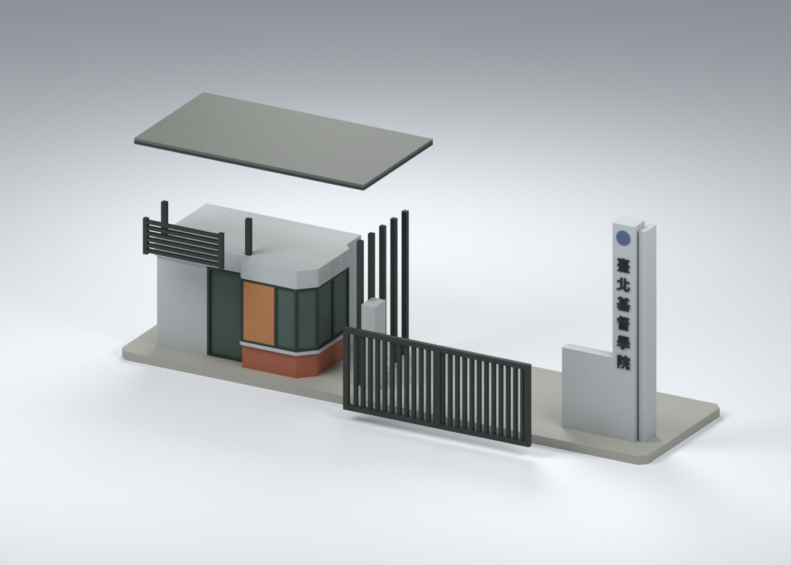

# 臺北基督學院淡水校區｜街側校門房與字塔

## 模型預覽

| 模型預覽 | 模型預覽 | 模型預覽 |
| :---: | :---: | :---: |
| 街側彩色外觀  | 背面估計封閉面  | 頂蓋上表面估計  |
| 四分件示意  |  |  |

> **外觀、幾何與配色交付完成；FFF 實際切片尚未驗證。** 這是有界小結構的外觀與分件候選，不是全校模型、實測復原或 2026 現況保證。

## 模型與下載

組裝外框約 **156 × 42 × 62.4 mm**，尺寸與相對距離均為照片比例估計，沒有宣稱實際比例尺。

- [通用 9 材質彩色 3MF 組裝外觀母版](appearance/cct-gate-ASSEMBLED.3mf)：4 個可獨立選取的網格部件；不是列印擺盤。
- [Blender 可編輯場景](scene.blend)、[完整幾何／材質／組裝矩陣](geometry.json)。場景中的 StudioGround_RENDER_ONLY 僅為打光地面，不在 STL 或 3MF 內。

| 部件 | STL（無色） | 原生平放／直立方向的表面彩色 3MF | 外框約 mm |
|---|---|---|---|
| 底板、門房與字塔 | [01](parts/01-base-gatehouse-pylon.stl) | [01](appearance/parts/01-base-gatehouse-pylon.3mf) | 156 × 42 × 62.4 |
| 薄頂蓋 | [02](parts/02-thin-canopy.stl) | [02](appearance/parts/02-thin-canopy.3mf) | 68 × 37 × 1.6 |
| 固定關閉位置門片 | [03](parts/03-fixed-gate-panel.stl) | [03](appearance/parts/03-fixed-gate-panel.3mf) | 55.1 × 22.8 × 1.3 |
| 上部水平格柵 | [04](parts/04-upper-louver-panel.stl) | [04](appearance/parts/04-upper-louver-panel.3mf) | 23.5 × 10 × 1.2 |

四片原生最低座標均為 Z=0。門片和格柵檔案平放；組裝矩陣將它們轉為直立。主件直立，屋頂薄片平放。接合是名義接觸／膠合候選，沒有卡榫、公差校準或膠合強度驗證。

## 來源能支持什麼

本次完整實看學校官方 [DSC_0619](https://www.cct.edu.tw/n_index/img/campusphoto/DSC_0619.jpg) 與 [DSC_0623](https://www.cct.edu.tw/n_index/img/campusphoto/DSC_0623.jpg) 兩個街側角度。第三個既有網址 DSC_0622 下載截斷／503，本次維持局部 HOLD，沒有假稱實看。

[官方校園剪影頁](https://www.cct.edu.tw/n_index/campusview.html) 把這組圖列在「2016 校園校門口建置」。這是建置年度線索；照片 EXIF 日期未另核實。原下載 SHA、舊研究圖與本次原圖的差異、逐圖依據見 [sources.json](sources.json)。不內含照片或裁切像素。

可辨識部分：灰色門房、左門及突出轉角窗、暖棕窗簾、磚紅窗下台座、薄平頂蓋和開放上部、水平格柵與右側細柱、灰色高字塔與側向窄片、深色直排校名。

明確簡化／未知：

- 背面用簡單封閉估計面；屋頂上表面只用平面，不假造設備或未知門窗。
- 柱數、格柵間距、玻璃分格採代表性節奏，非逐根測繪。磚材只保留整體色，沒有逐磚刻紋。
- 校名使用 Noto Sans CJK TC Bold 近似字形及間距，不是原招牌字型。圓徽只保留圓形位置和近似色，沒有編造徽章內文；低牆細小英文未建模。
- 固定門片不具開關機構。展示底板、加粗細柱及部件厚度是製造適配，非實際構造尺寸。
- 未納入遠處校舍、長圍牆、植栽、道路標線及門禁／監視設備。

完整界線見 [CONSTRAINTS.json](CONSTRAINTS.json)。

## 九種外觀材質，不限制四色

灰色面材、深色金屬、灰色頂蓋、灰綠玻璃、暖棕窗簾、磚紅窗下部、深色校名、灰藍圓徽、展示底板，共 9 個有名稱的 sRGB 表面材質。它們依照片人工近似；光照、反射和陰影並非油漆規格，玻璃以不透明色表示。

3MF 是通用 core basematerials 表面顏色，不是 9 個閉合色體、9 噴頭設定或已驗證的彩色切片專案。可在支援的工具中編輯材質；沒有強行合併成四色。需要四工具映射時應另外另存，不能覆蓋外觀母版。

## 製造狀態

**FFF 實際切片待驗，依目前工作順序延後。** 已完成網格、組裝接觸、解析截面與 3MF 格式檢查；這些不等同實際刀路。沒有無支撐可印、支撐可清、真機校準、試印或實際裝配成功的宣稱。

主件的凸出窗台、字體／圓徽、門窗框與細柱需要特別檢查。門片與水平格柵為細薄部件；拆件、搬運和膠合可能折損。不要將組裝外觀母版直接當作整件無支撐列印檔。

詳見 [製造說明](MANUFACTURING.md) 與 [檢查入口](qa/README.md)。不附可直接送印的 G-code。

## 重建與改色

- [build_model.py](source/build_model.py)：以 numpy、trimesh、manifold3d 和 OpenSCAD 建立原創幾何；需要已安裝 Noto Sans CJK TC Bold。[lettering.scad](source/lettering.scad) 產生六字字形，沒有附字型檔。
- [build_exchange.py](source/build_exchange.py)：Python 標準函式庫輸出 5 個 3MF，保留 STL 的 float32 頂點及三角形順序。
- [render_preview.py](source/render_preview.py)：Blender 4.3.2 場景與四視角預覽。
- [verify_geometry.py](source/verify_geometry.py)、[verify_exchange.py](source/verify_exchange.py)：重入幾何／組裝和 XML、lib3mf 嚴格檢查。
- [verify_rebuild.py](source/verify_rebuild.py)、[verify_scene.py](source/verify_scene.py)：乾淨目錄的幾何／3MF 重建比對，以及場景唯讀重開核驗。
- [第三方來源與字形說明](THIRD-PARTY-NOTICES.md)。

全套重建時在 build_model.py 的 PALETTE 改色；只重建 3MF 時可修改 geometry.json 的 materials 色碼再執行 build_exchange.py，並同步重建場景預覽。不同工具版本／字型版本不能假設位元組相同。lib3mf 的預設 6 位小數另存可能有最高約 0.0000153 mm 座標量化；發行交換檔由保值輸出器製作，並非該改色測試回存檔。
