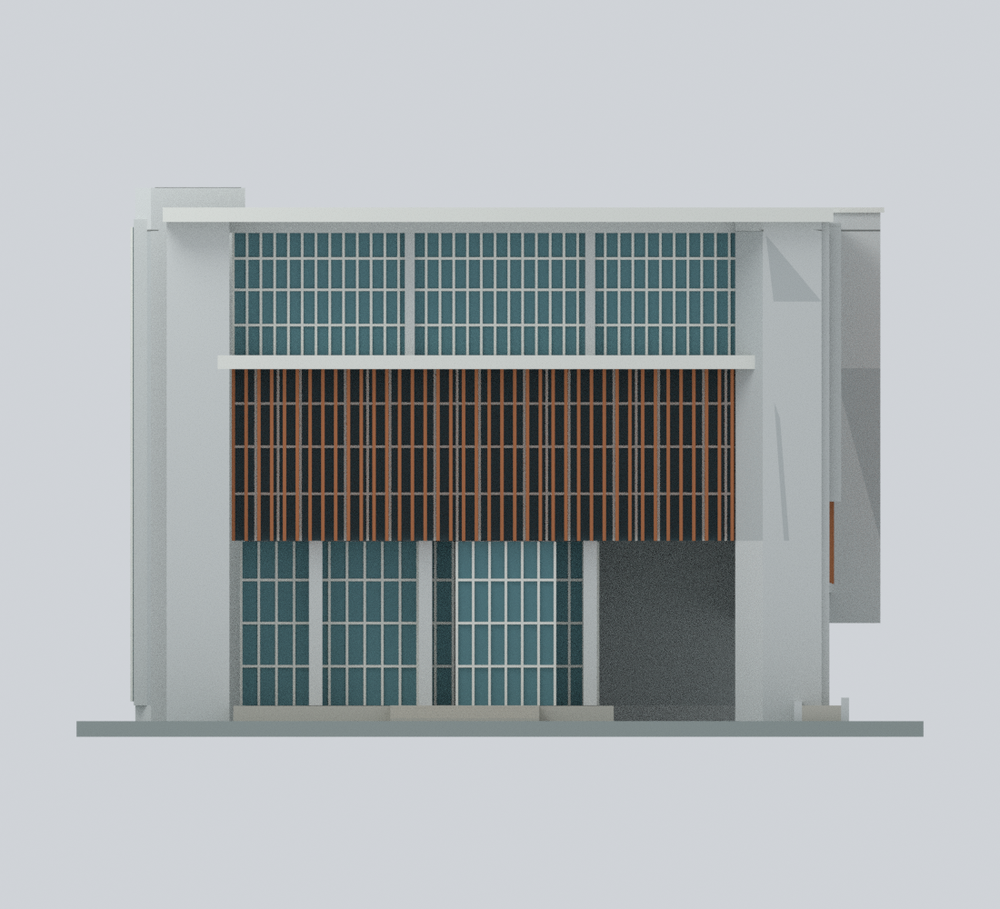

# 臺北市立大學建築模型圖鑑

目前收錄2套：天母體育館A棟（2012），以及博愛校區新圖書館（2020竣工／2021啟用）的有限細節外觀近似。本校為教育部115學年度正式大學，代碼3002；前身臺北體育學院不另計學校。天母只收錄A棟，不含B／C館；博愛只收錄新圖書館，其他建物及全校逐棟清單仍未完成。

## 建築圖鑑

| 建築模型 | 建築模型 | 建築模型 |
| :---: | :---: | :---: |
|  **[天母體育館A棟｜2012](天母校區/buildings/utaipei-tianmu-gymnasium-a-2012/README.md)** 銀色雙向曲面屋頂、採光帽與雙外梯 210 × 152 × 63.8 mm |  **[博愛校區新圖書館｜整棟地上外觀有限細節近似](博愛校區/buildings/utaipei-boai-library-2021/README.md)** 2020竣工／2021啟用；混合來源，非精確定年復原 |  |

[完整模型、正反並排預覽與下載](天母校區/buildings/utaipei-tianmu-gymnasium-a-2012/README.md) · [來源摘要](inventory/sources/utaipei-tianmu-gymnasium-a-2012-source-summary.md) · [QA摘要](inventory/qa/utaipei-tianmu-gymnasium-a-2012-review.md)

**天母體育館A棟既有模型：** 依校方平面、剖面與完工外觀照片重建銀色雙向主曲面、抬高採光帽、米黃牆體、粉色波形飾板與西側雙外梯。名目約1:500，尺度及方位仍是比例推估；北面僅近B梯局部有直接照片，遠段窗列及整體波形保守推定，沒有以南面鏡像代替來源證據。兩官方文字的啟用月份不同，本件只採2012年。

窗框約1.04 mm、梯欄改成約1.2 mm實心側板，採光帽角部及粉檐有已揭露的製造修形。完整有限數位檢查、獨立源碼／場景及九圖重播有公開證據；這不保證全方向最小厚度、免支撐或實際列印成功。尚未實體試印，帽緣、主屋檐與雨遮請另作切片與支撐檢查。

公開內容只含自行建立的幾何、程序材質、渲染、來源連結與檢查證據；不含校方PPT、第三方原照片、地圖或原圖說，不宣稱原作者授權或認可。

[博愛校區新圖書館｜整棟地上外觀有限細節近似](博愛校區/buildings/utaipei-boai-library-2021/README.md)：博愛校區新圖書館：2020竣工／2021啟用的整棟地上外觀有限細節近似，混合官方樓層導覽、實景與屋頂正射；來源拍攝日期未定，不是精確2021復原、已核實2026現況或測繪縮尺。六個地上高度區段並非六條等高窗帶；保留不對稱外緣、東北低層退縮、西南上層退縮、東大簷、北凹棕柵/玻璃塊、南開放格柵與東南核心。未知西立面細節中性化，中央暗頂不判定天井覆蓋/深度，155.81m²屋突為樓地板面積非投影/高度，不加完整屋頂樓層。212×216×140.15mm為含展示底板正規化尺寸；10材質3MF、STL、原生Blend和470隱藏建構元件、公開Python及9張實際圖。隱藏重疊元件不可直接與成品同印；無地下三層、室內、1972舊館或2008未建競圖。0.85mm棕柵、1.2mm格柵梁與0.65mm附著窗框浮雕，以及大簷/懸挑需支撐和近220mm列印床邊距評估，尚未試印；不作工程/避難/無障礙動線依據。

校區圖鑑：[天母校區](天母校區/README.md) · [博愛校區](博愛校區/README.md)
